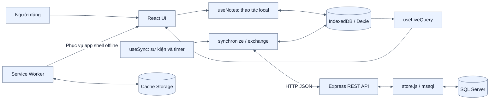
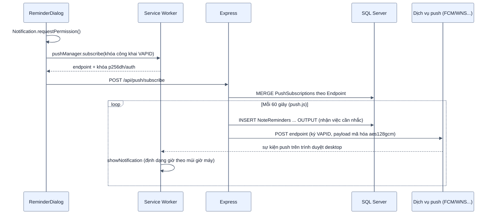

# Giải thích toàn bộ project PWA Notes

**Đề tài:** Xây dựng ứng dụng web offline-first cho ghi chú và công việc trên nền tảng Progressive Web App (PWA), sử dụng trên trình duyệt desktop.

**Thời gian thực hiện:** 13 tuần, từ ngày **30/09/2026** đến ngày **21/12/2026**.

| Vai trò | Họ và tên | Mã số |
|---|---|---|
| Thành viên | ĐẶNG TẤN ĐẠT | MSSV: 24TX610008 |
| Thành viên | NGUYỄN QUỐC BẢO | MSSV: 24TX810057 |
| Thành viên | PHẠM DUY PHƯỚC | MSSV: 24TX610011 |
| Giảng viên hướng dẫn | TRẦN QUANG KHẢI | MGV: 6452 |

> **Phạm vi đã chốt:** hệ thống chỉ được bàn giao để sử dụng bằng Chrome/Edge trên desktop hoặc laptop, qua một URL chính thức do server cung cấp. Không triển khai và không tuyên bố hỗ trợ cài đặt ứng dụng trên điện thoại/mobile. “PWA” trong tài liệu là kiến trúc kỹ thuật dùng Service Worker, cache và IndexedDB cho khả năng offline của web desktop, không phải phạm vi phát hành mobile app.

Trong các phần mô tả đồng bộ, “thiết bị” hoặc “client” có nghĩa là máy desktop/laptop hay profile trình duyệt độc lập; không có nghĩa là ứng dụng điện thoại.

**Các nội dung chính:** đăng nhập/đăng ký theo tài khoản (JWT + bcrypt), **dữ liệu ghi chú cô lập theo từng tài khoản** bằng `Notes.UserId`, ba chức năng AI local gồm tạo bản nháp, hỏi kho tri thức có dẫn nguồn và lập kế hoạch/mô phỏng tiến độ, trang Thống kê, Markdown-lite, **394 test tự động** (225 backend + 169 frontend), xử lý xung đột theo phiên bản, đồng bộ delta và nhắc việc bằng Web Push. Bộ sơ đồ kiến trúc nằm tại [`docs/architecture/00-MUC-LUC.md`](docs/architecture/00-MUC-LUC.md). Phạm vi triển khai là demo/bảo vệ nội bộ nhiều tài khoản, **chưa phải** hệ thống công khai trên Internet hay multi-tenant nhiều tổ chức.

## Mục lục

1. [Hiểu ứng dụng trong 2 phút](#1-hiểu-ứng-dụng-trong-2-phút)
2. [Đối chiếu mục tiêu và hiện trạng](#2-đối-chiếu-mục-tiêu-và-hiện-trạng)
3. [Kiến trúc và vai trò từng công nghệ](#3-kiến-trúc-và-vai-trò-từng-công-nghệ)
4. [Cấu trúc thư mục và cách đọc code](#4-cấu-trúc-thư-mục-và-cách-đọc-code)
5. [Mô hình dữ liệu](#5-mô-hình-dữ-liệu)
6. [Các thành phần giao diện](#6-các-thành-phần-giao-diện)
7. [Luồng khởi động ứng dụng](#7-luồng-khởi-động-ứng-dụng)
8. [Luồng từng chức năng](#8-luồng-từng-chức-năng)
9. [Cơ chế tự đồng bộ](#9-cơ-chế-tự-đồng-bộ)
10. [Thuật toán đồng bộ hai chiều](#10-thuật-toán-đồng-bộ-hai-chiều)
11. [Xung đột và các tình huống mất mạng](#11-xung-đột-và-các-tình-huống-mất-mạng)
12. [REST API và kiểm tra dữ liệu](#12-rest-api-và-kiểm-tra-dữ-liệu)
13. [SQL Server và ý nghĩa câu lệnh](#13-sql-server-và-ý-nghĩa-câu-lệnh)
14. [PWA, Service Worker và cache](#14-pwa-service-worker-và-cache)
15. [Cài đặt, cấu hình và câu lệnh vận hành](#15-cài-đặt-cấu-hình-và-câu-lệnh-vận-hành)
16. [Các cú pháp quan trọng trong mã nguồn](#16-các-cú-pháp-quan-trọng-trong-mã-nguồn)
17. [Kịch bản demo trước giảng viên](#17-kịch-bản-demo-trước-giảng-viên)
18. [Đánh giá hiệu năng và so sánh](#18-đánh-giá-hiệu-năng-và-so-sánh)
19. [Giới hạn và hướng hoàn thiện](#19-giới-hạn-và-hướng-hoàn-thiện)
20. [Câu hỏi phản biện và gợi ý trả lời](#20-câu-hỏi-phản-biện-và-gợi-ý-trả-lời)
21. [Bài trình bày ngắn và bảng ghi nhớ](#21-bài-trình-bày-ngắn-và-bảng-ghi-nhớ)
22. [Các nội dung đã bổ sung](#22-các-nội-dung-đã-bổ-sung)
23. [Chi tiết các tính năng chính](#23-chi-tiết-các-tính-năng-chính)

## 1. Hiểu ứng dụng trong 2 phút

Ứng dụng giúp người dùng thêm, sửa, xóa mềm, khôi phục, đánh dấu hoàn thành và tìm kiếm ghi chú/công việc. Người dùng có thể tiếp tục các thao tác này khi mất mạng, sau khi ứng dụng đã được tải và cache thành công trước đó.

Điểm cốt lõi là **mọi thao tác lưu đi vào IndexedDB trên trình duyệt trước**, kể cả khi đang online. Giao diện đọc lại IndexedDB để hiển thị. Một luồng riêng gửi những bản ghi thay đổi lên backend và lấy dữ liệu trên server về.

```text
Người dùng thao tác
        ↓
Ghi vào IndexedDB trên máy người dùng
        ↓
Giao diện cập nhật từ IndexedDB
        ↓
Khi kết nối cho phép: đồng bộ với Express → SQL Server
```

Ứng dụng có hai loại lưu trữ trên trình duyệt, không được nhầm lẫn:

| Kho lưu trữ | Lưu gì? | Tác dụng |
|---|---|---|
| Cache Storage do Service Worker quản lý | HTML, JavaScript, CSS, icon thuộc app shell | Mở lại giao diện khi offline |
| IndexedDB qua Dexie | Các bản ghi ghi chú/công việc | Đọc, thêm, sửa, xóa mềm dữ liệu khi offline |

**Nếu chỉ cache giao diện mà không có IndexedDB**, trang có thể mở được nhưng chức năng quản lý dữ liệu vẫn có thể phụ thuộc mạng. **Nếu chỉ có IndexedDB mà chưa cache giao diện**, dữ liệu có thể còn nhưng lần tải trang offline có thể không mở được ứng dụng.

Ghi chú và công việc dùng chung mô hình `Note`, phân biệt bằng `kind: note | task`. Chỉ công việc có checkbox hoàn thành và tham gia ba bộ lọc tiến độ loại trừ nhau: Đang thực hiện/Đang quá hạn/Đã hoàn thành. Ghi chú có thể để trống lịch; lịch công việc cũng không bắt buộc.

## 2. Đối chiếu mục tiêu và hiện trạng

| Yêu cầu | Code hiện tại | Cách trình bày chính xác |
|---|---|---|
| CRUD ghi chú/công việc | Có | Xóa là xóa mềm, chưa có xóa vĩnh viễn trên giao diện |
| Đánh dấu hoàn thành | Có | Checkbox thay đổi `done` |
| Phân loại tag | Có | Mỗi ghi chú có **một chuỗi tag**, chưa hỗ trợ nhiều tag có cấu trúc |
| Tìm kiếm | Có | Tìm trong tiêu đề, nội dung, tag trên dữ liệu local đang được lọc |
| Offline-first | Có | Ghi IndexedDB trước, đồng bộ sau |
| Đồng bộ hai chiều | Có | Push bản thay đổi, sau đó pull **delta**, chỉ lấy phần thay đổi sau con trỏ |
| Tự động và thủ công | Có | Các sự kiện/timer và nút thủ công cùng gọi cơ chế đồng bộ |
| Trạng thái offline/đồng bộ | Có | Phân biệt trạng thái công việc và trạng thái mạng/đồng bộ |
| Xử lý xung đột | **Có** | Khóa lạc quan theo `Version` trên server, không phụ thuộc đồng hồ client; xung đột không ghi đè mà hiện cho người dùng chọn giữ bản nào - xem §11, mục 23.9 |
| Web desktop qua URL server | Có | Chrome/Edge desktop, frontend/API cùng origin; không cài PWA/mobile |
| Tải lần đầu dưới 3 giây | Chưa có số liệu đo trong repo | Đây là mục tiêu cần đo, không suy ra chỉ từ build thành công |
| Chrome/Edge ổn định | Đã kiểm tra Edge và Chrome với SQL Server thật | Không khẳng định mọi phiên bản, mọi máy; giới hạn bằng chứng xem README §7 |
| Xác thực trước khi đồng bộ | **Có** | JWT + bcrypt; toàn bộ `/api/notes*` và `/api/ai*` yêu cầu `Authorization: Bearer`, xem mục 23.1 |
| Dữ liệu tách theo người dùng | **Có** | Cột `Notes.UserId` (FK → `Users.Id`), mọi truy vấn lọc theo token; xem mục 23.1 |
| Thời gian công việc | Có | startAt/dueAt tùy chọn; createdAt/completedAt/deletedAt riêng, không dùng updatedAt thay thế |
| Trợ lý AI tạo ghi chú | **Có** | Model chạy local qua Ollama, chỉ tạo bản nháp - không tự lưu; xem mục 23.2 |
| Trợ lý tri thức có dẫn nguồn | **Có** | Semantic search trên note đã đồng bộ, cache embedding trong SQL và trả nguồn kiểm chứng |
| AI lập kế hoạch và mô phỏng | **Có** | Ước lượng khối lượng, xếp lịch theo năng lực và so sánh ba kịch bản; không sửa dữ liệu gốc |
| Nhắc việc sắp đến hạn | **Có** | Web Push (VAPID) trên Chrome/Edge desktop; tab đóng chỉ nhận khi browser/hệ điều hành cho phép chạy nền; cần Internet + URL HTTPS; xem mục 23.10 |
| Thống kê trực quan | **Có** | Biểu đồ Recharts, tải riêng khi mở để không phình bundle chính; xem mục 23.3 |
| Bộ test tự động | **Có** | 394 test (225 backend + 169 frontend) giữ lại lâu dài trong source; xem mục 22 và 23.12 |
| Tự khôi phục mật khẩu (không cần admin can thiệp) | **Có** | Qua email (SMTP thật, tùy chọn) hoặc CLI `reset-password` dự phòng; xem mục 23.5 |
| Quản trị tài khoản tập trung | **Có** | 1 admin gốc, xem tiến độ/ghi chú mọi user (chỉ đọc), thêm/sửa/khóa tài khoản; xem mục 23.6 |

Tài liệu này là giải thích mã nguồn, không phải chứng nhận rằng mọi yêu cầu đã hoàn thành hoặc bản hiện tại hoàn toàn không có lỗi.

## 3. Kiến trúc và vai trò từng công nghệ



Nếu trình xem Markdown không hỗ trợ Mermaid, đọc sơ đồ như sau: giao diện trao đổi dữ liệu với IndexedDB; bộ đồng bộ nối IndexedDB với Express; Express dùng driver `mssql` để đọc/ghi SQL Server. Service Worker phục vụ các file giao diện từ cache, không trực tiếp chạy thuật toán đồng bộ ghi chú.

| Công nghệ | Vai trò trong project | Vì sao chọn |
|---|---|---|
| React 18 | Render UI từ state và dữ liệu local | Chia giao diện thành component, tái sử dụng form |
| TypeScript | Kiểm tra kiểu frontend khi phát triển/build | Làm rõ cấu trúc `Note`, props và trạng thái |
| Vite | Dev server và đóng gói frontend | Có quy trình dev/build/preview rõ ràng |
| Dexie | Lớp API thuận tiện trên IndexedDB | Truy vấn, transaction, nâng version schema |
| dexie-react-hooks | `useLiveQuery` | Phản ánh thay đổi IndexedDB lên UI |
| vite-plugin-pwa / Workbox | Sinh manifest, đăng ký và tạo Service Worker | Precache tài nguyên build, giảm code SW thủ công |
| Express 4 | Định tuyến API, parse JSON, middleware lỗi | Backend gọn, phù hợp REST |
| mssql | Kết nối SQL Server, bind tham số | Không ghép trực tiếp dữ liệu người dùng vào SQL |
| dotenv | Đọc biến môi trường backend (nạp một lần ở `src/env.js`, trước mọi module) | Tách cấu hình kết nối khỏi source |
| SQL Server | Lưu dữ liệu server, quyết định ghi/xung đột theo `Version`, cấp `rowversion` làm con trỏ delta | PK, kiểu dữ liệu, giao dịch có khóa dòng |
| bcryptjs | Băm/so khớp mật khẩu | Không lưu mật khẩu dạng rõ trong SQL |
| jsonwebtoken | Ký/xác minh JWT đăng nhập | Xác thực stateless, không cần bảng session |
| Ollama (ngoài Node, chạy local) | Model AI tạo bản nháp ghi chú từ ngôn ngữ tự nhiên | Chạy hoàn toàn trên máy, backend gọi qua HTTP nội bộ `127.0.0.1:11434`, không phải thư viện npm |
| Recharts | Vẽ biểu đồ ở trang Thống kê | Tách chunk riêng (`React.lazy`), chỉ tải khi mở trang này |
| Node test runner (`node --test`) | Test tự động backend | Không cần SQL thật; `store`/`ai` được truyền giả lập vào `createApp` |
| Vitest + Testing Library + fake-indexeddb | Test tự động frontend | Không cần trình duyệt thật; mô phỏng IndexedDB trong Node |

Không có Redux, ORM hoặc hàng đợi message broker. **Web Push** dùng thư viện `web-push` và dịch vụ push chuẩn của trình duyệt để nhắc việc; nó không phải WebSocket và không tham gia đồng bộ dữ liệu. Hệ thống không dùng WebSocket cho đồng bộ ghi chú mà vẫn dùng polling. Backend gọi Ollama qua HTTP nội bộ cho tính năng AI; luồng này độc lập với cơ chế đồng bộ ở mục 9-11.

## 4. Cấu trúc thư mục và cách đọc code

```text
pwa-notes/
├── README.md                         Hướng dẫn vận hành ngắn
├── GIAI_THICH_PROJECT.md               Tài liệu này
├── .gitignore                        Bỏ qua dependency/build/cache/.env
├── backend/
│   ├── .env                          Cấu hình thật, không đưa lên Git
│   ├── package.json                  Dependency và script backend (test, dev, start, migrate, reset-password, make-admin)
│   ├── package-lock.json             Khóa cây dependency
│   ├── schema.sql                    Tạo database, Users (Email/Role/ManagedByAdminId/Disabled...), Notes (có UserId) và index
│   ├── migrations/
│   │   ├── 002_note_schedule.sql     Thêm cột thời gian công việc
│   │   ├── 003_users.sql             Thêm bảng Users
│   │   ├── 004_notes_owner.sql       Thêm Notes.UserId + FK + index
│   │   ├── 005_users_reset_email.sql Thêm Email/ResetTokenHash/ResetTokenExpiresAt
│   │   ├── 006_users_admin.sql       Thêm IsAdmin/Disabled (IsAdmin sau bị thay bằng Role ở migration 007)
│   │   ├── 007_users_role_assignment.sql Đổi IsAdmin BIT → Role ('user'|'admin'|'root'), thêm ManagedByAdminId
│   │   ├── 008_admin_audit_log.sql   Thêm bảng AdminAuditLog
│   │   ├── 009_notes_version_rowver.sql Thêm Version/RowVer cho đồng bộ delta và phát hiện xung đột
│   │   ├── 010_push_reminders.sql    Thêm đăng ký Web Push và dấu vết nhắc việc
│   │   ├── 011_users_login_lock.sql  Thêm bộ đếm và thời hạn tạm chặn đăng nhập
│   │   ├── 012_users_managed_role.sql Dọn và ràng buộc liên kết quản lý theo role
│   │   └── 013_note_embeddings.sql    Cache vector cho Trợ lý tri thức
│   └── src/
│       ├── server.js                 Khởi chạy HTTP server
│       ├── app.js                    Routes (auth/notes/ai/knowledge/admin), validation, xử lý lỗi
│       ├── auth.js                   Hash mật khẩu, JWT, requireAuth, createRequireAdmin, requireRoot, token đặt lại mật khẩu
│       ├── ai.js                     Gọi Ollama local, dựng bản nháp ghi chú
│       ├── knowledge.js              Embedding, semantic search và câu trả lời có nguồn
│       ├── planner.js                Ước lượng, xếp lịch và mô phỏng tiến độ
│       ├── mailer.js                 Gửi email "quên mật khẩu" qua SMTP thật (nodemailer)
│       ├── rateLimit.js              Chính sách chặn đăng nhập sai (LOGIN_POLICY), bộ đếm tên không tồn tại, giới hạn theo IP cho đăng ký/quên mật khẩu
│       ├── validation.js             Validation nội dung và thời gian
│       ├── migrate.js                Chạy toàn bộ migration SQL theo thứ tự khi nâng cấp
│       ├── reset-password.js         CLI đặt lại mật khẩu (npm run reset-password)
│       ├── make-admin.js             CLI tạo/thăng cấp tài khoản admin gốc (npm run make-admin)
│       ├── store.js                  Connection pool, đọc delta/ghi theo Version lọc theo UserId, hàm dành cho admin
│       └── *.test.js                 Test tự động (validation/auth/ai/knowledge/push/app) - node --test
└── frontend/
    ├── package.json                  Dependency và script frontend (test, dev, build, preview)
    ├── package-lock.json             Khóa cây dependency
    ├── index.html                    HTML gốc, phần tử #root
    ├── vite.config.ts                React plugin, cấu hình PWA và Vitest
    ├── tsconfig.json                 Cấu hình kiểm tra TypeScript
    ├── public/icons/                 Icon 192px và 512px
    ├── src/
    │   ├── main.tsx                  Gắn React vào #root
    │   ├── App.tsx                   Ghép giao diện, cổng đăng nhập, lọc/tìm kiếm, lazy-load AdminPanel
    │   ├── styles.css                Bố cục, màu, chữ và thích ứng các cỡ màn hình desktop
    │   ├── vite-env.d.ts             Kiểu cho môi trường Vite
    │   ├── test/setup.ts             Nạp fake-indexeddb cho môi trường test
    │   ├── lib/
    │   │   └── markdownLite.ts       Parser markdown tối giản (không dùng dangerouslySetInnerHTML)
    │   ├── db/
    │   │   ├── database.ts           Interface Note, schema Dexie
    │   │   ├── noteFields.ts         Kiểu input, validation/định dạng thời gian
    │   │   ├── api.ts                Chọn URL, request, timeout, phân loại lỗi, lưu token
    │   │   ├── auth.ts               Gọi API đăng nhập/đăng ký/đổi-quên mật khẩu/email, quản lý phiên local
    │   │   ├── admin.ts              Gọi API /admin/* (danh sách user, xem ghi chú, thêm/sửa/khóa/reset mật khẩu)
    │   │   ├── ai.ts                 Gọi API Trợ lý AI, chuẩn hóa bản nháp
    │   │   ├── knowledge.ts          Gọi API hỏi kho tri thức
    │   │   ├── planner.ts            Gọi API mô phỏng tiến độ
    │   │   └── sync.ts               Protocol, push/pull, ACK, chống chồng lặp
    │   ├── hooks/
    │   │   ├── useNotes.ts           CRUD local và các bộ lọc
    │   │   ├── useSync.ts            Kích hoạt đồng bộ, trạng thái UI
    │   │   └── useAuth.ts            Trạng thái đăng nhập, đăng xuất có xác nhận
    │   ├── components/KnowledgeAssistant.tsx Hỏi đáp và hiển thị nguồn tri thức
    │   ├── components/PlanningAssistant.tsx Lập kế hoạch và so sánh kịch bản
    │   └── components/
    │       ├── NoteForm.tsx          Form thêm/sửa
    │       ├── AppErrorBoundary.tsx  Hiển thị lỗi render/storage
    │       ├── NoteList.tsx          Danh sách hoặc trạng thái rỗng
    │       ├── NoteItem.tsx          Một ghi chú, nút thao tác, render markdown-lite
    │       ├── MarkdownLite.tsx      Dựng React node từ parser markdown-lite
    │       ├── SyncBar.tsx           Thanh đồng bộ
    │       ├── LoginForm.tsx         Màn hình đăng nhập/đăng ký (kèm email bắt buộc)/quên mật khẩu
    │       ├── ResetPasswordForm.tsx Màn hình đặt mật khẩu mới từ link trong email (đọc ?resetToken=)
    │       ├── ChangePasswordDialog.tsx Đổi mật khẩu khi đã đăng nhập
    │       ├── EmailDialog.tsx       Gắn/đổi email khôi phục của tài khoản đang đăng nhập
    │       ├── AdminPanel.tsx        Trang quản trị (chunk tách riêng, chỉ admin dùng)
    │       ├── AIAssistant.tsx       Panel nhập yêu cầu AI, xem/áp dụng bản nháp
    │       ├── StatsView.tsx         Hộp thoại thống kê, tải StatsCharts theo yêu cầu
    │       ├── StatsCharts.tsx       Biểu đồ Recharts (chunk tách riêng)
    │       └── ProjectInfo.tsx       Thông tin đề tài, nhóm, GVHD
    └── dist/                        Sinh ra sau build, không sửa trực tiếp
```

`node_modules/` chứa thư viện cài bằng npm, không phải code nghiệp vụ của nhóm. `tsconfig.tsbuildinfo` là thông tin build tăng dần của TypeScript, có thể được sinh lại. `dist/` là sản phẩm build cần để chạy preview, không phải file kiểm thử cần xóa sau mỗi lần chạy.

Các file `.env.example` chỉ là mẫu. Backend đọc **backend/.env theo vị trí module**, không phụ thuộc thư mục gọi lệnh. Không dùng `.env` ở thư mục gốc để thay thế cấu hình này.

**Thứ tự đọc source nên dùng:**

1. `database.ts`: hiểu một bản ghi có gì.
2. `useNotes.ts`: hiểu thao tác người dùng làm thay đổi dữ liệu ra sao.
3. `App.tsx` và các component: biết người dùng kích hoạt thao tác ở đâu.
4. `useSync.ts`: biết khi nào cần đồng bộ.
5. `sync.ts` và `api.ts`: biết dữ liệu được gửi/nhận, chọn URL và phân loại lỗi như thế nào.
6. `app.js`: biết API kiểm tra và xử lý yêu cầu ra sao.
7. `store.js` và `schema.sql`: hiểu dữ liệu được lưu và xử lý xung đột ở SQL.
8. `vite.config.ts`: hiểu vì sao ứng dụng có thể tải lại offline.
9. `auth.js` và `db/auth.ts` + `hooks/useAuth.ts`: hiểu đăng nhập/đăng ký, cấp/kiểm tra JWT, và vì sao thiết bị dùng chung tự dọn cache khi đổi tài khoản (mục 23.1).
10. `ai.js`, `knowledge.js`, `planner.js` cùng các client/component tương ứng: hiểu ba luồng AI và ranh giới giữa ước lượng với thuật toán xác định (mục 23.2).
11. `store.js` (hàm `getAllUsersWithStats`/`setUserDisabled`/`updateUserByAdmin`) + `db/admin.ts` + `components/AdminPanel.tsx`: hiểu trang quản trị - admin chỉ xem (không sửa/xóa) ghi chú người khác, "xóa" user thực chất là khóa đăng nhập (mục 23.6).
12. Các file `*.test.js`/`*.test.ts`: xem cách từng phần được kiểm chứng độc lập, không cần chạy cả hệ thống.

## 5. Mô hình dữ liệu

### 5.1. Một `Note` gồm những gì?

| Trường frontend | Kiểu | Trường SQL | Ý nghĩa |
|---|---|---|---|
| `id` | `number`, có thể chưa có trước khi thêm | Không lưu | Khóa tự tăng riêng trong IndexedDB |
| `serverId` | `string`, optional cho dữ liệu cũ | `ServerId NVARCHAR(100)` PK | Định danh chung giữa client và server |
| *(không có ở client)* | — | `UserId INT NOT NULL` FK → `Users.Id` | Chủ sở hữu ghi chú, backend tự gán từ token khi đồng bộ - client không tự gửi và không cần biết trường này |
| `kind` | `note` hoặc `task` | `Kind NVARCHAR(10)` | Loại ghi chú/công việc |
| `createdAt` | `number` hoặc `null` | `CreatedAt BIGINT NULL` | Ngày tạo, dữ liệu cũ để null |
| `startAt` | `number` hoặc `null` | `StartAt BIGINT NULL` | Bắt đầu tùy chọn |
| `dueAt` | `number` hoặc `null` | `DueAt BIGINT NULL` | Hạn hoàn thành tùy chọn |
| `completedAt` | `number` hoặc `null` | `CompletedAt BIGINT NULL` | Thời điểm hoàn thành hiện tại |
| `deletedAt` | `number` hoặc `null` | `DeletedAt BIGINT NULL` | Thời điểm xóa hiện tại |
| `title` | `string` | `Title NVARCHAR(255)` | Tiêu đề, bắt buộc |
| `content` | `string` | `Content NVARCHAR(MAX)` | Nội dung |
| `tag` | `string` | `Tag NVARCHAR(100)` | Một nhãn phân loại |
| `done` | `boolean` | `Done BIT` | Công việc hoàn thành hay chưa |
| `updatedAt` | `number` | `UpdatedAt BIGINT` | Mốc thay đổi, milliseconds từ Unix epoch |
| `synced` | `0` hoặc `1` | Không lưu | Trạng thái đồng bộ riêng tại thiết bị |
| `deleted` | `0` hoặc `1` | `Deleted BIT` | Cờ xóa mềm |

Ví dụ minh họa, không phải dữ liệu thật:

```json
{
  "id": 1,
  "serverId": "be5c7f74-eab8-4b9a-83f4-918bbf0fe7b8",
  "title": "Viết chương 1",
  "content": "Trình bày mục tiêu và phạm vi đề tài",
  "tag": "tieu-luan",
  "done": false,
  "kind": "task",
  "createdAt": 1800000000000,
  "startAt": null,
  "dueAt": null,
  "completedAt": null,
  "deletedAt": null,
  "updatedAt": 1800000000000,
  "synced": 0,
  "deleted": 0
}
```

Mốc thời gian trong ví dụ chỉ dùng để minh họa định dạng; khi chạy thật code dùng `Date.now()`.

### 5.2. Vì sao có hai ID?

Máy A và máy B đều có thể tự sinh `id = 1`. Vì vậy không dùng `id` local làm khóa chung trên server.

`serverId` được tạo bằng `crypto.randomUUID()` **ngay ở client trước lần gửi đầu**, dù tên trường có chữ “server”. Nó đi theo bản ghi trong mọi lần retry. `exchange()` cấp bổ sung UUID thiếu cho dữ liệu cũ trước khi gửi.

### 5.2a. Bảng `Users` và chủ sở hữu ghi chú

```sql
Users (
  Id                  INT IDENTITY(1,1) PRIMARY KEY,
  Username            NVARCHAR(100) NOT NULL UNIQUE,
  PasswordHash        NVARCHAR(255) NOT NULL,
  DisplayName         NVARCHAR(100) NOT NULL,
  Email               NVARCHAR(255) NULL,     -- unique lọc NULL (migration 005), dùng gửi mail "quên mật khẩu"
  ResetTokenHash       NVARCHAR(64) NULL,       -- SHA-256 của token đặt lại mật khẩu đang chờ dùng, KHÔNG lưu token gốc
  ResetTokenExpiresAt  BIGINT NULL,              -- hạn dùng token (epoch ms)
  Role                NVARCHAR(20) NOT NULL DEFAULT N'user',  -- migration 007 - 'user' | 'admin' | 'root' (thay IsAdmin BIT cũ)
  ManagedByAdminId    INT NULL,                 -- migration 007 - chỉ có ý nghĩa khi Role='user', root gán user này cho admin nào quản lý
  Disabled            BIT NOT NULL DEFAULT 0,  -- migration 006 - admin "xóa" user = khóa đăng nhập, không xóa dữ liệu
  CreatedAt           BIGINT NOT NULL
)
```

`Notes.UserId` tham chiếu tới `Users.Id`. Client không bao giờ tự gửi `UserId` - `req.user.sub` (giải mã từ JWT ở middleware `requireAuth`) là nguồn duy nhất được backend tin, gán cho mọi lượt `getAllNotes`/`upsertNote`. Vì vậy không có trường "UserId" nào trong body request mà client kiểm soát được. Chi tiết cơ chế xác thực và cô lập dữ liệu xem mục 23.1; luồng "quên mật khẩu qua email" dùng `Email`/`ResetTokenHash`/`ResetTokenExpiresAt` xem mục 23.5; luồng phân quyền admin + gán quản lý dùng `Role`/`ManagedByAdminId` xem mục 23.7.

`Email` dùng `UNIQUE INDEX ... WHERE Email IS NOT NULL` thay vì ràng buộc `UNIQUE` thường - SQL Server chỉ cho phép **một** dòng NULL trong `UNIQUE` constraint/index thường, mà phần lớn tài khoản (nhất là tài khoản tạo trước migration 005) sẽ không có email, nên phải lọc bỏ NULL khi kiểm tra trùng.

**Bảng `AdminAuditLog`** (migration 008, mục 23.8) lưu nhật ký hành động quản trị: `ActorUserId`/`ActorUsername`, `TargetUserId`/`TargetUsername` (nullable), `Action`, `Details`, `CreatedAt` - tách bảng riêng thay vì thêm cột vào `Notes`/`Users` vì đây là dữ liệu "sự kiện đã xảy ra" (append-only, không update/xóa), khác bản chất với dữ liệu "trạng thái hiện tại" của 2 bảng kia.

### 5.3. Ba trạng thái độc lập

| `done` | `synced` | `deleted` | Diễn giải |
|---|---|---|---|
| false | 0 | 0 | Chưa hoàn thành, đang chờ gửi |
| true | 0 | 0 | Đã hoàn thành trên thiết bị, chưa đồng bộ thay đổi |
| true | 1 | 0 | Đã hoàn thành và đã trao đổi với server |
| false | 0 | 1 | Đã xóa local, cần gửi thao tác xóa |
| false | 1 | 1 | Bản ghi xóa mềm đã đồng bộ |

Không được trả lời “pending nghĩa là công việc chưa hoàn thành”. Trong project, **pending nghĩa là chờ đồng bộ**.

### 5.4. Schema IndexedDB

```ts
this.version(1).stores({
  notes: '++id, title, tag, updatedAt, synced, deleted'
})
this.version(2).stores({
  notes: '++id, title, tag, updatedAt, synced, deleted, serverId'
})
this.version(3).stores({
  notes: '++id, tag, updatedAt, synced, deleted, serverId, kind, dueAt'
}) // Source có upgrade callback: bản cũ giữ kind=task, các mốc lịch sử để null.
```

- `NotesDB`: tên database local; `notes`: object store, tương tự bảng ở góc nhìn ứng dụng.
- `++id`: khóa tự tăng.
- Những tên còn lại là index, không phải danh sách duy nhất những thuộc tính được lưu. `content` và `done` vẫn được lưu dù không xuất hiện trong chuỗi schema.
- Bản nâng cấp đầu thêm index `serverId`. Bản nâng cấp lịch bỏ index `title` không dùng, thêm `kind`/`dueAt` và nâng cấp dữ liệu cũ mà không xóa dữ liệu; không tự đoán thời gian lịch sử.
- `synced` và `deleted` dùng số 0/1 để truy vấn index; boolean không phải kiểu khóa index hợp lệ của IndexedDB.
- Index `serverId` hiện không có tiền tố `&`, tức chưa có ràng buộc unique trong IndexedDB. Khóa chính SQL mới là ràng buộc unique phía server.

## 6. Các thành phần giao diện

| Thành phần | Trách nhiệm | Không đảm nhiệm |
|---|---|---|
| `App.tsx` | Quản lý màn hình chọn, tag, từ tìm kiếm; nối callback với hook | Không viết truy vấn SQL |
| `NoteForm` | Nhập, kiểm tra tiêu đề, chờ lưu xong, giữ nội dung khi lỗi | Không gọi API trực tiếp |
| `NoteList` | Render các bản ghi, thông báo danh sách rỗng | Không tự đồng bộ |
| `NoteItem` | Checkbox hoàn thành, sửa, xóa, khôi phục; hiển thị nhãn | Không quyết định xung đột server |
| `SyncBar` | Hiển thị trạng thái và nút đồng bộ | Không tự lưu ghi chú |
| `ProjectInfo` | Hộp thoại đề tài, thành viên, GVHD | Không ghi thông tin nhóm vào database |
| `styles.css` | Sidebar, thẻ, typography, media queries | Không thay đổi logic dữ liệu |

`NoteForm` dùng lại cho cả thêm và sửa: khi có `initial` thì nạp nội dung cũ và hiển thị “Lưu thay đổi”. Trong `NoteItem`, callback có tên `onAdd` của form được nối tới `onEdit`; tên prop không có nghĩa là sửa sẽ tạo bản ghi mới.

Khi đang lưu, form khóa input và nút để hạn chế gửi lặp. Chỉ xóa nội dung input sau khi Promise lưu local thành công. Tuy nhiên **nội dung đang gõ chưa bấm lưu chỉ nằm trong React state**, chưa có autosave bản nháp khi reload/đóng tab.

Nút “Ghi chú mới” cuộn tới form và focus tiêu đề. Tính năng tìm kiếm dùng `toLocaleLowerCase('vi')` và `includes()`: không phân biệt hoa/thường, nhưng **không tự bỏ dấu tiếng Việt**.

Hộp thoại thông tin dùng `<dialog>` và `showModal()`, đóng bằng nút hoặc Escape. Việc mở hộp thoại không unmount form nên bản nháp vẫn còn trong lần mở đó.

## 7. Luồng khởi động ứng dụng

1. Người dùng mở URL chính thức của server bằng Chrome/Edge desktop. `localhost:4173` và `localhost:5173` chỉ xuất hiện trong môi trường phát triển/kiểm thử của nhóm.
2. `index.html` có `<div id="root">` và nạp `src/main.tsx` trong chế độ dev; build sẽ thay bằng bundle.
3. `main.tsx` gọi `createRoot(...).render(<StrictMode><App /></StrictMode>)`.
4. `App` gọi `useNotes()` và `useSync()`.
5. `useNotes()` đăng ký live query, mở IndexedDB và lấy bản ghi theo `updatedAt` giảm dần.
6. UI render dữ liệu local; không cần đợi SQL Server trả lời để đọc ghi chú đã có trên thiết bị.
7. `useSync()` lấy danh sách chờ đồng bộ. Khi truy vấn có kết quả, effect hẹn đồng bộ sau khoảng 400ms.
8. Nếu online, client push/pull. IndexedDB thay đổi khiến UI render lại.
9. Ở bản production, script do plugin sinh đăng ký Service Worker để cache tài nguyên ứng dụng.

`StrictMode` hỗ trợ phát hiện vấn đề khi phát triển, có thể khiến effect được setup/cleanup thêm một lần trong dev. Việc cleanup timer/listener trong hook là cần thiết; không kết luận rằng mỗi lần effect chạy thêm là thêm một bản ghi SQL.

## 8. Luồng từng chức năng

### 8.1. Thêm ghi chú

```text
NoteForm.handleSubmit
 → preventDefault, kiểm tra title.trim(), bật saving
 → App truyền addNote từ useNotes
 → db.notes.add({serverId: UUID, done:false, synced:0, deleted:0, ...})
 → IndexedDB commit
 → form được reset
 → useLiveQuery cập nhật danh sách
 → pendingKey thay đổi → hẹn đồng bộ
```

Tiêu đề, nội dung, tag được `trim()` ở form. Tag trống được chuyển thành `chung`. Việc thêm không `await fetch()` nên backend mất kết nối không chặn lưu local, miễn IndexedDB còn hoạt động.

### 8.2. Sửa nội dung

1. Bấm “Sửa” làm `NoteItem.editing = true`.
2. Form hiển thị giá trị hiện tại.
3. Khi lưu, gọi `updateNote(id, changes)`.
4. Trong transaction đọc bản mới nhất, cập nhật các trường thay đổi, đặt `synced = 0`.
5. Đặt mốc thay đổi mới:

```ts
updatedAt: Math.max(Date.now(), current.updatedAt + 1)
```

Công thức đảm bảo lần sửa sau của **cùng bản ghi local** có timestamp lớn hơn lần trước, kể cả hai thao tác trong cùng millisecond hoặc đồng hồ local bị lùi. Nó không đồng bộ đồng hồ giữa các máy.

### 8.3. Hoàn thành/bỏ hoàn thành

```text
Checkbox → toggleDone(note)
 → đọc current trong IndexedDB
 → updateNote(id, { done: !current.done })
 → updatedAt tăng, synced = 0
 → UI đổi nhãn, bộ đếm thay đổi
 → đồng bộ như các thao tác sửa khác
```

Đọc `current.done` tránh dùng giá trị cũ. Chỉ công việc chưa xóa được toggle. Hoàn thành lưu completedAt=Date.now(); bỏ hoàn thành đặt null. Chuyển công việc đã hoàn thành thành ghi chú sẽ bỏ done và completedAt.

### 8.4. Xóa và khôi phục

```text
Xóa:       updateNote(id, { deleted: 1 })
Khôi phục: updateNote(id, { deleted: 0 })
```

Cả hai thao tác đều cập nhật `updatedAt`, đặt `synced = 0` và đưa bản ghi vào luồng đồng bộ.

Xóa mềm cần thiết vì nếu xóa hẳn local ngay khi offline thì lần sau có mạng sẽ không còn bản ghi để báo server rằng dữ liệu cần xóa. Bản ghi xóa mềm còn được gọi là **tombstone**.

Mục Đã xóa đọc `deleted=1`. Xóa lưu `deletedAt` riêng; khôi phục đặt null. Ngày tạo không thay đổi khi sửa. Chưa có lịch sử mọi lần xóa/khôi phục; dữ liệu cũ thiếu mốc lịch sử hiển thị “Chưa có thông tin”.

### 8.5. Thời gian công việc

Form nhận `NoteInput` gồm title/content/tag/kind/startAt/dueAt. Hai thời gian đều tùy chọn, nhưng nếu cùng có thì hạn phải sau hoặc bằng bắt đầu. `datetime-local` nhận giờ thiết bị, chuyển sang epoch; SQL/IndexedDB lưu epoch, giao diện hiển thị theo múi giờ hiện tại. Mục Đang quá hạn cập nhật khoảng 30 giây và khi focus, không thay đổi updatedAt. Chưa có thông báo nhắc hạn chạy nền.

### 8.6. Lọc, tìm kiếm và số đếm

| Mục | Điều kiện |
|---|---|
| Tất cả ghi chú | `deleted === 0` |
| Đang thực hiện | Công việc, `deleted === 0 && !done && !isOverdue(...)` |
| Đã hoàn thành | Công việc, `deleted === 0 && done` |
| Đang quá hạn | Công việc chưa xóa/chưa hoàn thành, có dueAt nhỏ hơn thời gian hiện tại |
| Chờ đồng bộ | `synced === 0 && !conflict`, **bao gồm cả bản đã xóa đang chờ gửi**, nhưng không gộp bản xung đột vì bản đó cần người dùng xử lý trước |
| Đã xóa | `deleted === 1` |

Thứ tự xử lý: đọc tất cả local → chọn trạng thái → chọn tag → tìm kiếm trong `App`. Số đếm sidebar tính trên toàn bộ dữ liệu theo trạng thái, không giảm theo từ tìm kiếm/tag; số cạnh “Ghi chú của bạn” là số thực sự đang hiển thị.

Danh sách tag lấy từ nhóm trạng thái đang chọn, không lấy từ kết quả tìm kiếm. Chuyển mục trạng thái sẽ reset tag và từ tìm kiếm. Các thao tác này đều hoạt động offline và không sinh request tìm kiếm lên server.

## 9. Cơ chế tự đồng bộ

File `useSync.ts` trả `{ isOnline, status, errorMessage, syncNow }`. `isOnline` lấy tín hiệu từ trình duyệt; `status` mô tả lần đồng bộ, không phải trạng thái hoàn thành công việc. `errorMessage` giải thích lỗi, được xóa khi đồng bộ thành công.

### 9.1. Khi nào chạy?

| Tác nhân | Hành vi hiện tại |
|---|---|
| Lần đầu truy vấn pending có kết quả | Hẹn `syncNow()` sau 400ms, kể cả chưa có note chờ |
| ID/timestamp của tập pending thay đổi | Hủy timeout cũ, hẹn lại sau 400ms |
| Sự kiện `online` | Đánh dấu online và gọi đồng bộ |
| Sự kiện `offline` | Đặt offline, không chủ động gửi mới |
| Trạng thái `error` hoặc `pending`, vẫn online và `retryable.current=true` | Timer thử lại khoảng 3 giây |
| Mỗi 30 giây khi trình duyệt online và `retryable.current=true` | Thực hiện push/pull để nhận thay đổi server |
| Cửa sổ được focus hoặc tab trở lại visible | Nếu online thì đồng bộ |
| Bấm “Đồng bộ ngay” | Gọi cùng hàm `syncNow()` |

`pendingKey` là chuỗi ghép `id:updatedAt` của các bản `synced=0`. Nó giúp phát hiện **sửa nội dung dù số lượng pending không đổi**. Nếu chỉ quan sát số lượng, một bản pending được sửa thêm có thể không kích hoạt effect mới.

400ms là cách gom các thay đổi gần nhau, không phải thời gian cam kết lưu lên SQL. 3 giây là khoảng thử lại khi phù hợp, không phải bảo đảm đã đồng bộ xong trong 3 giây; request có thể mất tới 15 giây, server có thể đang lỗi và trình duyệt có thể giảm tần suất timer ở tab nền.

### 9.2. Ý nghĩa trạng thái

| Giá trị | Hiển thị | Diễn giải |
|---|---|---|
| `offline` | Đang offline, dữ liệu lưu cục bộ | Trình duyệt báo không có mạng |
| `pending` | Có thay đổi chờ đồng bộ | Còn việc cần trao đổi; cũng là trạng thái khởi tạo online |
| `syncing` | Đang đồng bộ | Đang thực hiện push/pull |
| `synced` | Đã đồng bộ với server | Lượt trao đổi hoàn tất và không còn pending được đếm ở thời điểm đó |
| `error` | Chưa đồng bộ được với máy chủ | Request hoặc bước xử lý thất bại; kèm `errorMessage` |

`navigator.onLine = true` không chứng minh SQL/API đang truy cập được. Máy có Wi-Fi nhưng backend tắt vẫn có thể báo online và đồng bộ lỗi. Dấu chấm kết nối và dòng trạng thái có thể khác nhau mà không mâu thuẫn.

Nút thủ công bị disable khi offline hoặc đang syncing. Nó chỉ là phương án dự phòng, không có một thuật toán riêng.

### 9.3. Phân loại lỗi và điều kiện thử lại

`api.ts` định nghĩa `SyncFailure(message, retryable=true)`. `useSync.ts` lưu quyết định vào ref `retryable`; `sync.ts` cũng dùng lớp lỗi này khi protocol, ACK hoặc dữ liệu remote không hợp lệ.

| Nhóm lỗi trong code | `retryable` | Cách xử lý |
|---|---|---|
| Mất kết nối API, timeout 15 giây, HTTP 503 và các mã HTTP lỗi chưa được phân loại riêng | `true` | Cho phép timer thử lại; backend/SQL cần phục hồi |
| HTTP 400, 401, 403, 404, 409, 413 | `false` | Dừng timer thử lại; kiểm tra dữ liệu, quyền, URL, phiên bản hoặc kích thước yêu cầu |
| Content-Type không phải JSON, JSON không đọc được, protocol/ACK/remote sai | `false` | Dừng timer thử lại; kiểm tra API và dữ liệu |
| Lỗi khác không thuộc `SyncFailure`, ví dụ lỗi IndexedDB | `true` theo cách xử lý hiện tại | Hiển thị lỗi xử lý dữ liệu thiết bị và vẫn cho phép timer thử lại |

`false` không có nghĩa lỗi vĩnh viễn hay dữ liệu bị xóa. Nó chỉ ngăn hai timer 3 giây/30 giây lặp lại yêu cầu khi cần sửa nguyên nhân. Thay đổi `pendingKey`, sự kiện online, focus/visible và nút thủ công vẫn có thể gọi `syncNow()`. Thành công sẽ đặt lại `retryable.current=true`. Khi đang thử lại, thanh trạng thái có thể còn hiển thị chi tiết lỗi trước đó đến lúc thành công.

## 10. Thuật toán đồng bộ hai chiều

### 10.1. Trình tự toàn lượt

```mermaid
%%{init: {"theme":"base","themeVariables":{"darkMode":false,"background":"#ffffff","primaryColor":"#eaf2ff","primaryTextColor":"#172033","primaryBorderColor":"#5b6b88","secondaryColor":"#edf8f0","secondaryTextColor":"#172033","secondaryBorderColor":"#5b6b88","tertiaryColor":"#fff7e6","tertiaryTextColor":"#172033","tertiaryBorderColor":"#7c6a46","lineColor":"#475569","textColor":"#172033","mainBkg":"#eaf2ff","nodeBorder":"#5b6b88","clusterBkg":"#f8fafc","clusterBorder":"#94a3b8","edgeLabelBackground":"#ffffff","actorBkg":"#eaf2ff","actorBorder":"#5b6b88","actorTextColor":"#172033","signalColor":"#475569","signalTextColor":"#172033","labelBoxBkgColor":"#ffffff","labelTextColor":"#172033","fontFamily":"Arial, sans-serif"},"themeCSS":"svg { background-color: #ffffff !important; }"}}%%
sequenceDiagram
    participant UI as useSync
    participant SY as sync.ts
    participant DB as IndexedDB
    participant API as Express
    participant SQL as SQL Server
    UI->>SY: synchronize()
    SY->>API: GET /api/notes/protocol (phải = 3)
    SY->>DB: Bổ sung UUID thiếu cho bản synced=0
    opt Chưa có con trỏ (lần đầu / vừa nâng cấp)
        SY->>API: GET /api/notes?since=0 (tải trước để biết Version)
    end
    loop Mỗi lô tối đa 3 bản ghi chờ gửi, KHÔNG gồm bản đang xung đột
        SY->>API: POST /api/notes/sync (kèm baseVersion)
        API->>SQL: Giao dịch khóa dòng, so Version
        SQL-->>API: applied / conflict / rejected
        API-->>SY: results
        SY->>DB: applied: synced=1 + Version mới; conflict: lưu bản server
    end
    loop Tới khi hasMore=false
        SY->>API: GET /api/notes?since=<con trỏ>
        API->>SQL: RowVer > con trỏ AND < MIN_ACTIVE_ROWVERSION()
        API-->>SY: notes, cursor, hasMore, reset
        SY->>DB: Ghép theo serverId + lưu con trỏ trong 1 transaction
    end
    SY-->>UI: Hoàn tất hoặc ném lỗi
```

### 10.2. Bước A — hạn chế đồng bộ chồng nhau

`running` là biến Promise ở cấp module. Nếu một lượt đang chạy, những lời gọi khác trong cùng trang nhận lại Promise đó. Không tạo thêm một luồng mạng chỉ vì nhiều effect cùng kích hoạt.

Nếu có `navigator.locks`, code lấy khóa tên `pwa-notes-sync` để tuần tự hóa lượt đồng bộ giữa các tab cùng origin. Trình duyệt không hỗ trợ Web Locks sẽ dùng phương án chỉ có `running`; không được khẳng định fallback bảo vệ đầy đủ giữa nhiều tab.

Cuối lượt, `finally` đặt `running = undefined`, kể cả khi lỗi, để lần sau có thể thử lại.

### 10.3. Bước B — push các bản pending

Trước push, client kiểm tra `GET /api/notes/protocol` phải có version=3. POST kèm `X-Sync-Version: 3`; client cũ (v2, không gửi `baseVersion`) bị trả 409 để không ghi đè theo kiểu "timestamp mới nhất thắng" như trước.

1. Trong transaction, tìm `synced = 0` và cấp UUID cho bản chưa có `serverId`.
2. Đọc snapshot pending để gửi, **bỏ qua ghi chú đang có `conflict`** (chờ người dùng chọn, gửi lại cũng chỉ nhận xung đột lần nữa).
3. Chia thành lô tối đa **3 bản ghi** để cả nội dung nhiều ký tự JSON escape vẫn dưới giới hạn body 2 MB. API cho phép 100 bản/lần nhưng client gửi 3.
4. POST JSON lên `/api/notes/sync` - chỉ các trường server cần, kèm `baseVersion` (phiên bản server mà bản sửa dựa vào; `null` = ghi chú mới). Không gửi `conflict`/`synced`.
5. Kiểm tra số kết quả, mapping `localId/serverId` và dạng từng kết quả.
6. Trong transaction local, theo từng kết quả:
   - `applied` + `version`: nếu `current.updatedAt === sent.updatedAt` thì `synced = 1`, `baseVersion = version`; nếu người dùng đã sửa tiếp trong lúc chờ thì chỉ cập nhật `baseVersion` (vẫn chờ gửi, và lần gửi sau dựa trên đúng phiên bản vừa ghi - không tự xung đột với chính mình).
   - `conflict` + `server`: lưu bản server vào `conflict`, **không đổi nội dung local**. Ngoại lệ: ghi chú mới (`baseVersion=null`) mà server đang ở phiên bản 1 - nghĩa là lần gửi trước đã tới server nhưng mất phản hồi (ServerId do chính thiết bị sinh, thiết bị khác sửa sẽ thành phiên bản 2+) - thì nhận phiên bản 1 làm gốc và gửi lại ở lượt sau.
   - `rejected`: ServerId tình cờ trùng ghi chú của tài khoản khác → sinh UUID mới, gửi lại ở lượt sau.

Hàng đợi ở đây là **tập bản ghi có cờ dirty `synced=0`**, không phải bảng lưu từng thao tác. Một ghi chú sửa 5 lần offline thường chỉ gửi trạng thái cuối. Đây là đồng bộ trạng thái, không phải đồng bộ nhật ký thao tác.

### 10.4. Bước C — pull delta

GET chạy cả khi pending rỗng để nhận thay đổi từ thiết bị khác, nhưng chỉ hỏi **phần thay đổi sau con trỏ** đã lưu trong bảng `meta` của IndexedDB: `GET /api/notes?since=<con trỏ>`. Server trả tối đa 500 ghi chú/trang kèm `cursor` mới và `hasMore`; client lặp tới khi `hasMore=false`. Mỗi trang được áp dụng **cùng với việc lưu con trỏ trong một transaction IndexedDB** - đứt mạng giữa chừng thì lần sau tiếp tục đúng từ trang chưa áp dụng, không bỏ sót, không áp dụng hai lần.

| Tình huống local | Cách xử lý remote |
|---|---|
| Chưa có `serverId` tương ứng | Thêm local với `synced=1`, `baseVersion = version` |
| Local đã `synced=1` | Nhận bản server (nếu server có phiên bản **thấp hơn** bản local - chỉ xảy ra khi database bị khôi phục từ backup - thì đánh dấu chờ gửi lại bản local) |
| Local còn pending | **Không ghi đè**. Nếu đang xung đột và server đổi tiếp thì cập nhật bản so sánh cho mới nhất; còn lại lần push sau sẽ tự phát hiện xung đột |
| Local là dữ liệu cũ (`baseVersion` chưa có) còn pending | Nhận `Version` server làm gốc; nếu server có bản mới hơn với nội dung khác (trước đây sẽ bị ghi đè mất) thì đánh dấu xung đột |

Khác với bản LWW cũ, bước pull **không bao giờ ghi đè một thay đổi local chưa gửi**. Lần đầu trên thiết bị (chưa có con trỏ: mới đăng nhập, vừa đổi tài khoản, hoặc vừa nâng cấp từ v2) client pull **trước** push để biết phiên bản hiện tại trên server, rồi push, rồi pull lần nữa.

Con trỏ gắn với tài khoản: `clearLocalData()` xóa **cả ghi chú lẫn con trỏ** trong một transaction khi đăng xuất hoặc đăng nhập tài khoản khác. Nếu chỉ xóa ghi chú mà giữ con trỏ, tài khoản kế tiếp sẽ chỉ tải "thay đổi sau con trỏ cũ" và thiếu gần hết dữ liệu.

Nếu server báo `reset=true` (con trỏ lớn hơn giá trị rowversion lớn nhất database từng cấp - database đã bị khôi phục/tạo lại), client tải lại **toàn bộ** các trang vào bộ nhớ rồi áp dụng trong một transaction; ghi chú local từng lên server nhưng nay không còn được đánh dấu chờ gửi như ghi chú mới để không mất.

Remote được kiểm tra cả kiểu và giới hạn giống backend (UUID/tiêu đề/nội dung/tag/thời gian/`version`), con trỏ phải là chuỗi số và phải tiến lên khi `hasMore=true` trước khi ghi. Client chặn tối đa 1.000 trang trong một lượt để tránh vòng lặp vô hạn do server lỗi; riêng luồng reset chỉ đánh dấu orphan sau khi đã tải đủ toàn bộ trang. **Không có transaction chung xuyên suốt HTTP + SQL + IndexedDB**.

### 10.5. Timeout và cache của API

`request()` trong `frontend/src/db/api.ts` tạo `AbortController`, hẹn abort sau 15.000ms cho mỗi request, kiểm tra `response.ok` và Content-Type, đọc JSON rồi dọn timeout trong `finally`. Đây không phải giới hạn 15 giây cho toàn bộ lượt push/pull. Phân loại lỗi xem §9.3.

`cache: 'no-store'` yêu cầu fetch không dùng HTTP cache cho request này. API không được cấu hình runtime cache trong SW của project. Đây không phải cách xóa dữ liệu IndexedDB.

Abort phía client không chắc đã hủy thao tác SQL ở server; server có thể đã ghi thành công. UUID cố định giúp retry an toàn hơn khi không biết request trước đã hoàn tất đến đâu.

## 11. Xung đột và các tình huống mất mạng

### 11.1. Khóa lạc quan theo phiên bản

Mỗi dòng `Notes` có cột `Version` (bắt đầu 1, server tự tăng mỗi lần ghi). Client nhớ phiên bản server của từng ghi chú (`baseVersion`) và gửi kèm khi sửa. Server chỉ ghi khi `baseVersion` **bằng** `Version` hiện tại:

| Bước | Server `Version` | Việc xảy ra |
|---|---:|---|
| A và B cùng tải ghi chú | 1 | Cả hai có `baseVersion = 1` |
| A sửa, gửi `baseVersion=1` | 1 → 2 | Khớp → ghi, trả `applied, version 2` |
| B (offline từ trước) sửa, gửi `baseVersion=1` | 2 | Lệch → **không ghi**, trả `conflict` kèm bản của A |
| B chọn "Giữ bản của tôi" → gửi `baseVersion=2` | 2 → 3 | Khớp → ghi |

Quyết định dựa trên **phiên bản server**, không dựa vào `updatedAt` do client tự đặt - máy có đồng hồ chạy nhanh vài giờ vẫn nhận xung đột chứ không "thắng". Hai request đồng thời cùng `baseVersion` được tuần tự hóa bằng khóa dòng (`UPDLOCK, HOLDLOCK` trong giao dịch, xem §13.4): request thứ nhất ghi và tăng `Version`, request thứ hai thấy `Version` đã khác nên nhận `conflict`.

**Không coi là xung đột** khi nội dung gửi lên đã **y hệt** bản trên server (so tiêu đề/nội dung/tag/loại/hoàn thành/xóa/lịch, so dạng nhị phân nên phân biệt hoa/thường và khoảng trắng cuối): đó là request gửi lại sau khi mất phản hồi, hoặc hai thiết bị sửa giống nhau. Server trả `applied` với phiên bản hiện tại, không ghi thêm.

Khi có xung đột, ghi chú hiện nhãn "Xung đột", sidebar xuất hiện mục **Xung đột đồng bộ** (chỉ hiện khi có), thanh đồng bộ báo trạng thái riêng (không lặp gửi lại mỗi 3 giây). `ConflictPanel` liệt kê **chỉ các trường khác nhau** giữa hai bản và cho 3 lựa chọn:

| Lựa chọn | Kết quả |
|---|---|
| Giữ bản của tôi | `baseVersion` := phiên bản server vừa thấy, gửi lại → ghi đè đúng phiên bản đó. Nếu server lại đổi tiếp trong lúc này → báo xung đột lần nữa, vẫn không ghi đè mù |
| Dùng bản trên server | Nội dung local := bản server, `synced=1`, không gửi gì lên |
| Giữ cả hai | Ghi chú gốc nhận bản server; nội dung trên thiết bị được tách thành **ghi chú mới** (ServerId mới, tiêu đề thêm "(bản sao xung đột)", cắt để không vượt 255 ký tự) - không mất bên nào |

Chưa có hợp nhất tự động từng trường (A đổi tiêu đề, B tích hoàn thành cùng lúc vẫn là một xung đột người dùng phải chọn): muốn merge 3 chiều cần lưu thêm bản gốc chung của hai phía. Đây là hướng mở rộng, xem §19.2.

### 11.2. Sửa trong lúc đang gửi

```text
Local: title=A, updatedAt=100, baseVersion=1 → được lấy làm snapshot gửi
Trong lúc chờ: người dùng sửa thành B, updatedAt=101, synced=0
Response: applied, version=2
So sánh: current.updatedAt=101 khác sent.updatedAt=100
→ Không đánh dấu B là synced=1, nhưng đặt baseVersion=2
→ Lượt sau gửi B với baseVersion=2 → khớp → ghi, version=3
```

Nếu không cập nhật `baseVersion` ở bước này, lượt sau B sẽ gửi `baseVersion=1` và tự xung đột với chính bản A vừa ghi.

### 11.3. Server đã lưu nhưng response bị mất

Client chưa biết thành công nên vẫn giữ pending. Lượt sau gửi lại cùng UUID:

- Nội dung chưa đổi → server thấy y hệt bản đang có → `applied` (idempotent), không tạo bản trùng, không tăng `Version`.
- Ghi chú đã có trên server và người dùng sửa tiếp → `baseVersion` đã cũ → xung đột (với chính thay đổi trước của mình). Ngoại lệ đã xử lý tự động: ghi chú **mới** (`baseVersion=null`) mà server còn ở phiên bản 1 - chắc chắn là bản do chính thiết bị này gửi và chưa ai sửa - client nhận phiên bản 1 làm gốc và gửi lại, không hiện xung đột.

Đây là retry an toàn về trạng thái bản ghi, **không phải đảm bảo request chỉ được thực thi đúng một lần**.

### 11.4. Batch lỗi giữa chừng

Backend `await upsertNote()` tuần tự, mỗi ghi chú là một giao dịch SQL riêng. Nếu bản thứ 3 lỗi thì bản 1–2 có thể đã lưu; API trả lỗi chung. Lượt retry gửi lại các bản chưa được xác nhận; nhờ so khớp nội dung (§11.1) các bản đã lưu nhận `applied` thay vì xung đột.

### 11.5. Xóa trên một máy, sửa trên máy khác

Xóa là xóa mềm, cũng là một lần ghi làm tăng `Version`. Máy A xóa (v2) trong khi máy B sửa từ v1 → B nhận xung đột, bảng so sánh hiện "Trạng thái: Đang dùng / Đã xóa"; người dùng tự quyết định giữ bản sửa (ghi chú xuất hiện lại) hay chấp nhận xóa. Không còn trường hợp một bản sửa có timestamp lớn hơn âm thầm làm ghi chú đã xóa sống lại.

### 11.6. Đóng tab, xóa dữ liệu trình duyệt

- Bản đã commit vào IndexedDB thường còn sau reload/đóng rồi mở lại cùng origin và profile.
- Bản nháp chưa bấm lưu không được bảo đảm giữ lại.
- Đóng toàn bộ ứng dụng: hook và timer không còn chạy; chưa có Background Sync thật để bảo đảm gửi khi đã đóng.
- Xóa site data, dùng profile khác, chế độ riêng tư, đầy quota hoặc storage bị trình duyệt thu hồi có thể làm dữ liệu local không còn/không ghi được.
- Vì vậy nên nói “giảm nguy cơ mất thay đổi đã lưu khi mất mạng”, không nói “không thể mất dữ liệu trong mọi tình huống”.

## 12. REST API và kiểm tra dữ liệu

### 12.1. Các endpoint thực sự có

| Method và đường dẫn | Vai trò | Cần đăng nhập? | HTTP thành công |
|---|---|---|---|
| `POST /api/auth/register` | Tạo tài khoản mới, trả JWT | Không | 201 |
| `POST /api/auth/login` | Xác thực mật khẩu, trả JWT | Không | 200 |
| `GET /api/auth/me` | Trả profile mới nhất (id/username/displayName/email/role) từ dòng user `requireAuth` vừa đọc trong DB | Có | 200 |
| `POST /api/auth/change-password` | Đổi mật khẩu, yêu cầu đúng mật khẩu hiện tại | Có | 200 |
| `POST /api/auth/email` | Gắn/đổi email khôi phục cho tài khoản đang đăng nhập | Có | 200 |
| `POST /api/auth/forgot-password` | Gửi email chứa link đặt lại mật khẩu nếu email khớp tài khoản (mục 23.5) - luôn trả cùng thông báo dù có khớp hay không | Không | 200 |
| `POST /api/auth/reset-password` | Đặt mật khẩu mới bằng token nhận qua email | Không | 200 |
| `GET /api/notes?since=<con trỏ>` | Trả các bản ghi **của tài khoản đang đăng nhập** đã thay đổi sau con trỏ (kể cả đã xóa mềm), tối đa 500/trang, kèm `cursor`, `hasMore`, `reset`. Thiếu `since` = từ đầu | Có | 200 |
| `GET /api/notes/protocol` | Trả version=3 để kiểm tra tương thích | Có | 200 |
| `POST /api/notes/sync` | Nhận danh sách trạng thái note kèm `baseVersion`; từng note trả `applied`/`conflict`/`rejected` | Có | 200 |
| `POST /api/ai/draft` | Gửi văn bản tự nhiên, backend gọi Ollama, trả bản nháp ghi chú (AI lỗi/quá giờ thì trả bản nháp cơ bản + `warning`) | Có | 200 |
| `POST /api/ai/knowledge/query` | Hỏi kho ghi chú đã đồng bộ; trả câu trả lời và nguồn liên quan của đúng tài khoản | Có | 200/503 |
| `POST /api/ai/planner/simulate` | Ước lượng task mở và mô phỏng lịch theo năng lực/kỳ đã chọn | Có | 200 |
| `POST /api/ai/warmup` | Nạp sẵn model vào RAM, trả ngay không chờ | Có | 202 |
| `GET /api/push/config?endpoint=` | Nhắc việc đã bật trên server chưa, khóa công khai VAPID, số phút nhắc trước, thiết bị này đã đăng ký chưa | Có | 200 |
| `POST /api/push/subscribe` | Lưu đăng ký push của thiết bị (chỉ nhận endpoint của dịch vụ push chính thức) | Có | 200 |
| `POST /api/push/unsubscribe` | Gỡ đăng ký của chính người gọi | Có | 200 |
| `PUT /api/push/settings` | Đổi số phút nhắc trước (0/5/10/15/30/60/120/1440) | Có | 200 |
| `POST /api/push/test` | Gửi thông báo thử tới mọi thiết bị của người gọi | Có | 200 |
| `GET /api/admin/users` | Danh sách mọi tài khoản kèm số liệu ghi chú (mục 23.6) | Có + admin | 200 |
| `GET /api/admin/users/:id/notes` | Ghi chú/công việc **đầy đủ** của 1 tài khoản bất kỳ, chỉ đọc | Có + admin | 200 |
| `POST /api/admin/users` | Admin tạo tài khoản mới thay người dùng | Có + admin | 201 |
| `PUT /api/admin/users/:id` | Admin sửa displayName/email của 1 tài khoản | Có + admin | 200 |
| `POST /api/admin/users/:id/disable` | Khóa đăng nhập 1 tài khoản (không xóa dữ liệu) | Có + admin | 200 |
| `POST /api/admin/users/:id/enable` | Mở khóa lại | Có + admin | 200 |
| `POST /api/admin/users/:id/reset-password` | Admin đặt mật khẩu mới cho 1 tài khoản, không cần biết mật khẩu cũ | Có + admin | 200 |
| `POST /api/admin/users/:id/promote` | Root phân quyền admin cho 1 user thường | Có + **root** | 200 |
| `POST /api/admin/users/:id/demote` | Root hạ quyền 1 admin về user thường (bỏ gán mọi thành viên họ đang quản lý) | Có + **root** | 200 |
| `POST /api/admin/users/:id/assign` | Root gán 1 user thường cho 1 admin quản lý | Có + **root** | 200 |
| `POST /api/admin/users/:id/unassign` | Root bỏ gán 1 user khỏi admin đang quản lý | Có + **root** | 200 |
| `GET /api/admin/audit-log` | 200 dòng nhật ký hành động quản trị gần nhất | Có + **root** | 200 |

Không có `PUT /notes/:id`, `DELETE /notes/:id` trong code hiện tại. CRUD local được biểu diễn dưới dạng trạng thái bản ghi rồi gom vào endpoint sync. API trao đổi JSON, theo phong cách REST; chưa tách tài nguyên CRUD thành đầy đủ các method riêng. **Mọi route `/api/notes*` và `/api/ai*` đều đi qua middleware `requireAuth`** (`backend/src/auth.js`) - thiếu hoặc sai `Authorization: Bearer <token>` sẽ nhận 401 trước khi route handler chạy.

Request POST mẫu, kèm header `X-Sync-Version: 3`:

```json
{
  "notes": [{
    "id": 1,
    "serverId": "be5c7f74-eab8-4b9a-83f4-918bbf0fe7b8",
    "title": "Viết chương 1",
    "content": "Mục tiêu và phạm vi",
    "tag": "tieu-luan",
    "done": false,
    "kind": "task",
    "createdAt": 1800000000000,
    "startAt": null,
    "dueAt": null,
    "completedAt": null,
    "deletedAt": null,
    "updatedAt": 1800000000000,
    "deleted": 0,
    "baseVersion": 4
  }]
}
```

Response POST:

```json
{
  "version": 3,
  "results": [{
    "localId": 1,
    "serverId": "be5c7f74-eab8-4b9a-83f4-918bbf0fe7b8",
    "status": "applied",
    "version": 5
  }]
}
```

Khi thiết bị khác đã sửa trước, kết quả có dạng `{ "localId": 1, "serverId": "...", "status": "conflict", "server": { ...bản đang có trên server, kèm "version": 5 } }`; ServerId thuộc tài khoản khác thì `{ ..., "status": "rejected" }` (không kèm dữ liệu gì của tài khoản kia).

Response GET mẫu:

```json
{ "notes": [ { "serverId": "...", "title": "...", "version": 5, "...": "..." } ],
  "cursor": "184467", "hasMore": false, "reset": false }
```

`localId` chỉ để client tìm đúng bản local trong response, không trở thành cột SQL. Client chỉ gửi các trường server cần (không gửi `synced`, `conflict`).

Mỗi note trong response GET có kind, createdAt/startAt/dueAt/completedAt/deletedAt, `version` bên cạnh các trường nội dung/trạng thái; không có id và synced local. `cursor` là chuỗi số (giá trị `rowversion` dạng BIGINT) để không mất chính xác khi qua JSON.

### 12.2. Validation backend

- `notes` phải là mảng, tối đa 100 phần tử; mảng rỗng hiện được chấp nhận.
- `id`: số nguyên an toàn, lớn hơn 0.
- `serverId`: chuỗi không rỗng, dài tối đa 100; chưa bắt buộc đúng định dạng UUID.
- `title`: chuỗi có nội dung sau trim, tối đa 255.
- `content`: chuỗi, tối đa 100.000 đơn vị độ dài chuỗi JavaScript.
- `tag`: chuỗi, tối đa 100.
- `done`: boolean; `deleted`: đúng số 0 hoặc 1.
- updatedAt: số nguyên từ 0 đến 8640000000000000; chỉ dùng để hiển thị/sắp xếp, **không còn dùng để quyết định ghi đè**.
- `baseVersion`: bắt buộc có mặt, là `null` hoặc số nguyên 1..2147483647 (client v2 không gửi trường này → 400).
- `since` (GET): chuỗi 1-19 chữ số, không vượt BIGINT; sai định dạng → 400.
- kind phải là note hoặc task. Các mốc thời gian phải là null hoặc epoch hợp lệ; dueAt không được trước startAt khi cả hai tồn tại.
- completedAt chỉ được có khi done=true; deletedAt chỉ được có khi deleted=1; ghi chú không được done=true. SQL cũng có CHECK constraint tương ứng.
- Trong cùng request không được lặp `id` hoặc `serverId`.
- JSON body giới hạn `2mb` ở middleware Express; giới hạn byte này độc lập với giới hạn ký tự từng trường.

TypeScript không thay thế validation: dữ liệu HTTP có thể đến từ client khác hoặc người gọi API trực tiếp.

### 12.3. Xử lý lỗi

| Trường hợp | HTTP |
|---|---:|
| Sai cấu trúc/giá trị note | 400 |
| Client thiếu/sai X-Sync-Version (khác 3) | 409 |
| Con trỏ `since` sai định dạng | 400 |
| API không tồn tại | 404 |
| JSON không hợp lệ | 400 |
| Body vượt giới hạn | 413 |
| Lỗi truy cập DB hoặc lỗi khác đi qua middleware cuối | 503 |

`try/catch` trong route chuyển lỗi tới `next(error)`. Middleware cuối có bốn tham số `(error, req, res, next)`, là dạng middleware lỗi của Express. Backend chờ SQL hoàn tất bằng `await` rồi mới trả response.

`cors()` cho phép origin trong ALLOWED_ORIGINS truy cập API qua trình duyệt. **CORS không phải xác thực, không bảo vệ API khỏi công cụ gọi trực tiếp**.

## 13. SQL Server và ý nghĩa câu lệnh

### 13.1. Schema

`CREATE DATABASE PwaNotesDB` tạo database. `USE PwaNotesDB` chọn database. `CREATE TABLE Users` rồi `CREATE TABLE Notes` tạo hai bảng - **Users phải tạo trước Notes** vì `Notes.UserId` tham chiếu `Users.Id` bằng FK; đổi thứ tự sẽ báo lỗi "invalid object name Users". `GO` là dấu phân tách batch được công cụ như SSMS/sqlcmd hiểu, không phải một lệnh T-SQL để truyền nguyên vào mọi driver.

- `PRIMARY KEY` trên `ServerId` đảm bảo duy nhất và không null.
- `Notes.UserId INT NOT NULL CONSTRAINT FK_Notes_UserId REFERENCES Users(Id)`: mỗi note bắt buộc có chủ sở hữu hợp lệ, không cho phép note "mồ côi". Index `IX_Notes_UserId` hỗ trợ lọc theo tài khoản trong `getAllNotes`.
- `NVARCHAR` hỗ trợ Unicode, phù hợp nội dung tiếng Việt.
- `NVARCHAR(MAX)` cho nội dung dài, nhưng API vẫn giới hạn 100.000 ký tự theo cách đếm của JS.
- `BIT` lưu 0/1, driver chuyển đổi với boolean.
- `BIGINT` chứa timestamp millisecond vì `INT` không đủ cho epoch hiện tại.
- `DEFAULT 0` cho Done/Deleted áp dụng khi lệnh insert không cung cấp giá trị.
- Index Tag có thể hỗ trợ truy vấn tag phía SQL trong tương lai; API hiện chưa lọc theo tag.
- Index UpdatedAt có thể hỗ trợ sắp xếp; hiệu quả thực tế cần xem execution plan và quy mô dữ liệu.

`schema.sql` hiện là script khởi tạo, **không idempotent**: chạy lại các lệnh CREATE khi đối tượng đã có có thể báo lỗi. Không xóa database để “chạy lại cho sạch” khi đã có dữ liệu cần giữ. Việc thêm `UserId` cho database **đã có dữ liệu cũ** được thực hiện qua `migrations/004_notes_owner.sql`, và migration này **cố tình không tự xóa/gán dữ liệu cũ** - nếu bảng `Notes` còn bản ghi chưa có chủ, lệnh `ALTER TABLE ... ADD UserId INT NOT NULL` (không có DEFAULT) sẽ báo lỗi thay vì âm thầm xóa hay gán bừa; người vận hành phải tự quyết định xử lý dữ liệu cũ trước khi chạy lại.

### 13.2. Pool kết nối

`getPool()` lưu Promise từ `sql.connect(config)` trong `poolPromise`. Các request dùng lại pool. Nếu lần kết nối thất bại, `.catch()` đặt biến về null để lần tiếp theo thử lại.

Pool là nhóm kết nối được tái sử dụng. `server.js` hiện chờ `checkDatabase()` kiểm tra SQL và các cột thời gian trước khi listen; sai cấu hình hoặc thiếu migration sẽ không mở HTTP. SIGINT/SIGTERM đóng HTTP và pool. Production còn kiểm tra bản build frontend đã có.

### 13.3. Đọc delta và chuyển kiểu

```sql
DECLARE @From BIGINT = CONVERT(BIGINT, @Since);
DECLARE @Reset BIT = CASE WHEN @From > CONVERT(BIGINT, @@DBTS) THEN 1 ELSE 0 END;
IF @Reset = 1 SET @From = 0;
SELECT TOP (@Take) <các cột>, CONVERT(BIGINT, RowVer) AS Seq
FROM Notes
WHERE UserId = @UserId AND RowVer > CONVERT(BINARY(8), @From) AND RowVer < MIN_ACTIVE_ROWVERSION()
ORDER BY RowVer;
```

| Thành phần | Giải thích |
|---|---|
| `RowVer ROWVERSION` | SQL Server tự gán một số tăng dần **trên toàn database** mỗi lần INSERT/UPDATE dòng đó - không cần code ứng dụng tự tăng, không phụ thuộc đồng hồ |
| `RowVer > @From` | Chỉ lấy dòng thay đổi sau con trỏ client gửi lên; index `IX_Notes_UserId_RowVer (UserId, RowVer)` phục vụ đúng điều kiện này |
| `RowVer < MIN_ACTIVE_ROWVERSION()` | Một giao dịch đang chạy dở có thể đã nhận RowVer **nhỏ hơn** một dòng khác vừa commit. Nếu trả dòng lớn hơn trước, con trỏ nhảy qua và dòng kia bị bỏ sót vĩnh viễn. Hàm này trả RowVer nhỏ nhất còn thuộc giao dịch chưa xong, nên chỉ trả những gì chắc chắn đã "ổn định". Đã kiểm chứng trên SQL thật: mở một giao dịch UPDATE chưa commit, commit một ghi chú khác sau đó - GET không trả ghi chú sau, commit giao dịch đầu thì GET trả cả hai đúng thứ tự |
| `@@DBTS` | RowVer lớn nhất database từng cấp. Con trỏ lớn hơn giá trị này = database đã bị khôi phục/tạo lại → `reset=1`, trả lại từ đầu |
| `TOP (@Take)` với `@Take = limit + 1` | Lấy dư 1 dòng để biết còn trang sau (`hasMore`) mà không cần `COUNT` |

Không có `WHERE Deleted=0`, vì thiết bị khác cần nhận thao tác xóa (xóa mềm cũng làm RowVer đổi). `mapNote()` đổi tên PascalCase của SQL sang camelCase frontend, chuẩn hóa content/tag, đổi `Done` sang boolean, `Deleted` sang 0/1, `UpdatedAt` sang number, kèm `version`. `@UserId` lấy từ `req.user.sub` (JWT đã xác thực ở middleware) - client không có cách nào truyền `UserId` của người khác vào câu SELECT này. Trang quản trị dùng `getAllNotes(userId)` (lấy toàn bộ một lần, chỉ đọc).

### 13.4. Ghi theo phiên bản và bind tham số

```sql
SET XACT_ABORT ON;
BEGIN TRANSACTION;
SELECT @CurUser = UserId, @CurVersion = Version
FROM Notes WITH (UPDLOCK, HOLDLOCK) WHERE ServerId = @ServerId;
IF @CurUser IS NULL            -> INSERT ..., Version = 1                 ('applied', 1)
ELSE IF @CurUser <> @UserId    -> không đụng tới                          ('rejected')
ELSE IF @BaseVersion = @CurVersion -> UPDATE ..., Version = Version + 1  ('applied', +1)
ELSE IF <nội dung y hệt, so VARBINARY> -> không ghi                      ('applied', hiện tại)
ELSE                           -> không ghi                              ('conflict')
COMMIT TRANSACTION;
```

| Thành phần | Giải thích |
|---|---|
| `UPDLOCK` | Khóa cập nhật trên dòng đọc được: request thứ hai cùng ServerId phải chờ request đầu commit rồi mới đọc `Version` - tránh cả hai cùng đọc v1 rồi cùng ghi |
| `HOLDLOCK` | Ngữ nghĩa serializable: khi dòng **chưa tồn tại**, khóa cả khoảng khóa để hai request cùng chèn một ServerId không chen nhau |
| `SET XACT_ABORT ON` | Lỗi giữa chừng (vd vi phạm CHECK) tự rollback cả giao dịch, không để khóa treo |
| `@CurUser <> @UserId` | Chống chiếm đoạt ghi chú: tài khoản B gửi ServerId thuộc A → không cập nhật, không tạo trùng, không trả dữ liệu của A; chỉ báo `rejected` để client B tự đổi UUID |
| `CONVERT(VARBINARY(MAX), Title) = CONVERT(VARBINARY(MAX), @Title)` | Với collation mặc định, phép `=` của SQL Server **bỏ qua hoa/thường và khoảng trắng cuối** ('abc' = 'ABC ' là đúng). So nhị phân để "sửa chữ hoa" không bị coi nhầm là nội dung trùng rồi mất |

Khóa không có nghĩa hệ thống không bao giờ deadlock hoặc không cần xử lý lỗi/retry. Lỗi SQL đi qua middleware lỗi (503) và client tự thử lại.

`.input('Title', sql.NVarChar(255), incoming.title)` truyền giá trị như tham số, không nối title vào chuỗi SQL. Cách này giảm nguy cơ SQL injection từ nội dung note. Nó không thay thế phân quyền, xác thực hay kiểm tra mọi vấn đề bảo mật khác.

## 14. Nền tảng PWA trên trình duyệt desktop, Service Worker và cache

### 14.1. Manifest

Trong `vite.config.ts`, manifest chứa tên app, tên ngắn, ngôn ngữ, mô tả, URL khởi chạy, trường `display`, màu nền/chủ đề và icon 192/512. Đây là metadata do plugin PWA sinh ra cùng Service Worker.

`display: 'standalone'` là metadata kỹ thuật còn có trong manifest, nhưng luồng sử dụng chính thức **không yêu cầu và không kiểm thử cài ứng dụng**. Người dùng mở URL server trong tab Chrome/Edge desktop. Manifest không chứa dữ liệu note và không phải file cấu hình SQL.

Màu manifest/meta đã đồng nhất với giao diện: nền #f5f7fa, chủ đề #246e62. SW không fallback /api/ sang HTML.

### 14.2. Service Worker được tạo ở đâu?

Project không có file SW nghiệp vụ tự viết trong `src`. Plugin sinh `dist/sw.js`, file Workbox liên quan, `manifest.webmanifest` và script đăng ký khi build.

`globPatterns: ['**/*.{js,css,html,ico,png,svg}']` chọn tài nguyên app shell để precache. Workbox dùng thông tin revision của tài nguyên để quản lý các bản cache. Không nên sửa `dist/sw.js` trực tiếp vì lần build sau sẽ ghi lại.

Tài nguyên đã precache có thể được phục vụ từ cache khi request phù hợp. Điều này không có nghĩa tất cả URL Internet hoặc API đều được cache.

### 14.3. Vòng đời và cập nhật

Luồng khái quát: đăng ký → tải SW → install/precache → activate → xử lý request theo cấu hình. `registerType: 'autoUpdate'` chọn hành vi cập nhật SW tự động của plugin, **khác với tự đồng bộ dữ liệu ghi chú** trong `useSync`.

Trang đang mở vẫn có thể chạy JavaScript đã tải trước đó; build xong không bảo đảm mọi tab lập tức đổi giao diện. Khi kiểm tra bản mới, tải lại lúc online hoặc đóng/mở lại ứng dụng. Không xóa site data tùy tiện vì có thể mất note chưa đồng bộ.

### 14.4. Điều kiện dùng offline

- Cần ít nhất một lần mở URL server khi online để tải giao diện và tạo cache.
- Nên chạy bản build/preview và kiểm tra Service Worker đã active/điều khiển trang.
- Môi trường triển khai cần secure context: localhost phục vụ phát triển; triển khai thực tế dùng HTTPS.
- Trình duyệt lần đầu chưa từng tải app không thể tự mở app offline từ không có gì.
- Không cài PWA/mobile trong phạm vi bàn giao; offline được kiểm tra ngay trong tab desktop đã được Service Worker kiểm soát.
- Service Worker không biến JavaScript thành dịch vụ đồng bộ nền liên tục; khi tab đóng, dữ liệu pending chỉ tiếp tục đồng bộ ở lần mở URL sau.

## 15. Cài đặt, cấu hình và câu lệnh vận hành

### 15.1. Chuẩn bị

Cần Node/npm tương thích dependency đã khóa, Chrome/Edge desktop, SQL Server và công cụ quản trị như SSMS. README nêu Node 20+; môi trường kiểm tra trước đã dùng Node 24. Nên chọn bản Node LTS phù hợp và dùng cùng lockfile khi tái lập.

```powershell
node --version
npm --version
```

Hai lệnh chỉ kiểm tra phiên bản. Nếu PowerShell không nhận `npm`, kiểm tra Node/npm và PATH hoặc mở terminal mới sau khi cài; đây không mặc định là lỗi code ứng dụng.

### 15.2. SQL và `.env`

Chạy script `backend/schema.sql` trong SSMS **khi khởi tạo lần đầu**. Nếu database/bảng đã có, chỉ chạy truy vấn kiểm tra, không chạy lại toàn bộ script CREATE.

Ví dụ cấu hình mẫu để tự điền vào `backend/.env`, không phải mật khẩu thật:

```dotenv
DB_SERVER=localhost
DB_NAME=PwaNotesDB
DB_USER=ten_tai_khoan_sql
DB_PASSWORD="MAT_KHAU_CUA_BAN"
DB_PORT=1433
DB_INSTANCE=SQLEXPRESS
PORT=4000
```

| Biến | Ý nghĩa |
|---|---|
| `DB_SERVER` | Máy chạy SQL Server |
| `DB_NAME` | Database; mặc định PwaNotesDB |
| `DB_USER`, `DB_PASSWORD` | Tài khoản SQL Authentication |
| `DB_PORT` | Khi có, dùng TCP trực tiếp, phải là số nguyên 1–65535 |
| `DB_INSTANCE` | Chỉ dùng để dò instance khi không có DB_PORT; mặc định SQLEXPRESS |
| `PORT` | Cổng HTTP backend; mặc định 4000 |

DB_PORT có ưu tiên hơn DB_INSTANCE trong code. Cổng SQL thật phải trùng với cấu hình TCP/IP đang lắng nghe; không phải mọi SQL Express đều dùng 1433. Dò tên instance thường phụ thuộc SQL Server Browser.

Mật khẩu chứa `#` cần được bao bằng dấu nháy phù hợp để dotenv không hiểu phần sau là chú thích. Không đưa mật khẩu vào frontend, tài liệu nộp hoặc Git. Tài khoản `sa` từng dùng để thử kết nối không phải lựa chọn phân quyền tối thiểu cho triển khai thật.

### 15.3. Chạy backend — terminal 1

Khi nâng cấp database đã có, chạy `npm run migrate` trong backend trước khi khởi động. Không chạy lại schema.sql trên dữ liệu hiện có. Migration thêm cột/CHECK constraint trong transaction, có thể chạy lại.

```powershell
cd "D:\DTTX - DH Su Pham Ky Thuat TP.HCM\TLCN\pwa-notes\backend"
npm ci
npm run dev
```

- `npm ci`: cài theo package-lock, thay thế node_modules hiện có nếu cần, phù hợp tái lập.
- `npm install`: cũng có thể dùng khi thiết lập/thay đổi dependency, nhưng có thể cập nhật lockfile.
- `npm run dev` ở backend thực tế là `node src/server.js`, **không có nodemon/auto-restart**. Sửa code hoặc `.env` thì dừng bằng Ctrl+C rồi chạy lại.

Kiểm tra đọc API bằng trình duyệt ở `http://localhost:4000/api/notes` hoặc:

```powershell
Invoke-RestMethod -Uri 'http://localhost:4000/api/notes' -Method Get
```

Chế độ dev ở cổng 4000 phục vụ API. Khi NODE_ENV=production, Express phục vụ cả frontend/dist, nên localhost:4000 trở thành URL ứng dụng đầy đủ.

### 15.4. Chạy frontend development — terminal 2

```powershell
cd "D:\DTTX - DH Su Pham Ky Thuat TP.HCM\TLCN\pwa-notes\frontend"
npm ci
npm run dev
```

Mặc định mở `http://localhost:5173`. Đây là chế độ phát triển, thuận tiện khi sửa React/CSS. Cấu hình hiện không bật PWA devOptions, nên không dùng dev làm bằng chứng đầy đủ về offline app shell.

### 15.5. Kiểm tra bản build tại máy phát triển

```powershell
cd "D:\DTTX - DH Su Pham Ky Thuat TP.HCM\TLCN\pwa-notes\frontend"
npm run build
npm run preview -- --port 4173 --strictPort
```

- `npm run build` = `tsc -b && vite build`.
- `tsc -b`: kiểm tra TypeScript theo cấu hình project; có thể sinh `.tsbuildinfo`.
- `&&`: chỉ chạy Vite nếu bước TypeScript thành công.
- `vite build`: bundle/minify tài nguyên và sinh sản phẩm PWA vào `dist`.
- `preview`: phục vụ `dist` đã build, không tự build lại source.
- `--` sau npm chuyển các tham số phía sau cho lệnh Vite.
- `--strictPort`: nếu cổng đã bị dùng thì báo lỗi thay vì đổi sang cổng khác gây nhầm.

Mở `http://localhost:4173` ngay trên server. `vite.config.ts` đặt `host: '0.0.0.0'` cho dev/preview để lắng nghe mọi card mạng; client cùng LAN phải mở IP hoặc hostname thật, ví dụ `http://192.168.1.20:4173`, tuyệt đối không dùng `0.0.0.0` làm địa chỉ đích. Backend vẫn chạy ở terminal 1; request `/api` được Vite proxy nội bộ tới `127.0.0.1:4000`. Preview chỉ dùng kiểm thử LAN; HTTP qua IP không đủ secure context cho toàn bộ PWA/Web Push và không phải URL bàn giao chính thức.

### 15.6. Frontend API URL và origin

**Chế độ production nội bộ:** build frontend, đặt NODE_ENV=production rồi chạy `npm start` trong backend. Express phục vụ UI/API cùng origin ở cổng PORT, mặc định bind 127.0.0.1. Reverse proxy cung cấp một URL HTTPS duy nhất cho toàn bộ người dùng desktop và chuyển tiếp cả `/` lẫn `/api`; người dùng không truy cập cổng Vite hoặc URL HTTP IP-LAN. SQL production mặc định cần mã hóa/chứng chỉ; README mô tả ngoại lệ cho SQL local tin cậy.

`db/api.ts` chọn địa chỉ API: ưu tiên `VITE_API_URL`; nếu không đặt và ứng dụng chạy trên HTTP localhost/loopback cổng 4173 hoặc 5173 thì gọi trực tiếp backend cổng 4000. Nhờ vậy, PWA đã cache vẫn đồng bộ khi Vite dừng nhưng backend còn hoạt động. Các môi trường khác dùng `/api/notes` cùng origin; production Express phục vụ cả frontend và API. Nếu muốn backend khác origin hoặc cổng khác, cấu hình ALLOWED_ORIGINS và đặt frontend/.env rồi build lại:

```dotenv
VITE_API_URL=https://ten-mien-backend.example/api/notes
```

Đây là địa chỉ ví dụ, phải thay bằng endpoint thật. Biến `VITE_*` được đưa vào bundle cho trình duyệt đọc, **không phải nơi lưu bí mật**.

IndexedDB, SW và cache gắn với origin, gồm protocol + host + port. `localhost:5173`, `localhost:4173` và `127.0.0.1:4173` không phải cùng origin. Chuyển URL có thể thấy local trống; chưa chắc dữ liệu đã bị xóa. Nếu dữ liệu đã lên SQL, origin mới có thể tải về khi đồng bộ.

### 15.7. Lệnh kiểm tra code và dependency

Dự án có **bộ test tự động giữ lại lâu dài trong source**, chạy được bằng:

```powershell
# Tại backend - Node test runner có sẵn trong Node, không cần SQL thật
cd backend
npm test

# Tại frontend - Vitest + Testing Library + fake-indexeddb, không cần trình duyệt thật
cd frontend
npm test
```

Kết quả hiện tại: **225 test backend + 169 test frontend = 394 test, đều pass**. Phạm vi gồm validation, auth, API, AI tạo bản nháp, AI tri thức, AI lập kế hoạch/mô phỏng, thống kê và bộ lọc trạng thái công việc không chồng lặp, lọc tag theo loại nội dung, đồng bộ, IndexedDB, component React, Markdown-lite và Web Push giả lập. `npm test` in ra số liệu thật; cần chạy lại trước khi trình bày.

Ngoài test tự động, vẫn có thể chạy các lệnh kiểm tra nhanh khác:

```powershell
# Tại frontend
npm run build

# Tại backend
node --check src/server.js
node --check src/app.js
node --check src/store.js

# Chạy trong từng thư mục package nếu muốn kiểm tra advisory dependency
npm audit
```

`node --check` chỉ kiểm tra cú pháp, không chạy CRUD/SQL - không thay thế được `npm test`. `npm audit` kiểm tra advisory dependency tại thời điểm gọi, không chứng minh ứng dụng đã có auth hoặc không có lỗi nghiệp vụ.

## 16. Các cú pháp quan trọng trong mã nguồn

| Cú pháp/API | Giải thích bằng ngôn ngữ đơn giản | Ví dụ trong project |
|---|---|---|
| `async / await` | Chờ công việc bất đồng bộ hoàn tất, không block toàn bộ event loop | Chờ IndexedDB, fetch, SQL |
| `Promise` | Đại diện kết quả sẽ có hoặc lỗi của thao tác bất đồng bộ | `running`, `onAdd` |
| `try/catch/finally` | Xử lý thành công/lỗi và luôn dọn tài nguyên | Hủy timeout, reset saving |
| `useState` | Giữ state giao diện giữa các lần render | title, editing, view, status |
| `useEffect` | Đăng ký tác vụ phụ và trả cleanup | online/offline listener, timer |
| `useCallback(..., [])` | Giữ tham chiếu hàm ổn định giữa các render | syncNow |
| `useRef` | Giữ tham chiếu DOM không cần render lại | focus input, mở dialog |
| `useLiveQuery` | Theo dõi truy vấn Dexie và cập nhật khi dữ liệu liên quan đổi | Danh sách và pendingKey |
| `db.transaction('rw', ...)` | Nhóm đọc/ghi local trong một transaction | Sửa/merge dữ liệu |
| `Partial<NoteInput & Pick<Note, 'done' \| 'deleted'>>` | Kết hợp trường nhập liệu với done/deleted, rồi cho phép truyền một phần các trường | Kiểu của changes trong updateNote |
| `Omit<Note, 'id' \| 'synced'>` | Kiểu Note nhưng loại hai trường local | RemoteNote |
| `?.` | Chỉ truy cập/gọi nếu bên trái không null/undefined | dialog.current?.showModal() |
| `??` | Dùng giá trị dự phòng khi null/undefined | initial?.title ?? '' |
| `...changes` | Sao chép các thuộc tính vào đối tượng mới | Dữ liệu update |
| `note.id!` | Khẳng định với TypeScript rằng id đã tồn tại | Không phải kiểm tra runtime |
| `void syncNow()` | Chủ ý không chờ Promise tại callback | Bản thân syncNow có catch |
| `new Set(...)` | Tập hợp giá trị duy nhất | Tag và kiểm tra ID trùng |
| `map / filter / includes` | Biến đổi, lọc và tìm chuỗi | Hiển thị danh sách/tìm kiếm |
| `res.json()` | Trả JSON HTTP | API Express |
| `next(error)` | Chuyển lỗi tới middleware lỗi | Route Express |

`noEmit: true` trong tsconfig khiến TypeScript không tự xuất JS của source ở bước kiểm tra; Vite thực hiện bước tạo bundle. `strict: true` tăng kiểm tra kiểu. TypeScript bị loại bỏ khi build, trình duyệt cuối cùng chạy JavaScript.

## 17. Kịch bản demo trước giảng viên

### 17.1. Chuẩn bị trước buổi báo cáo

1. Mở SQL Server, kiểm tra database/bảng; giữ backend chạy.
2. Build và preview, dùng duy nhất một origin nhất quán.
3. Mở online, kiểm tra DevTools → Application → Service Workers và IndexedDB.
4. Đợi đồng bộ xong; lưu nội dung đang nhập trước khi reload.
5. Chuẩn bị SSMS với truy vấn dưới đây; không hiển thị file `.env` chứa mật khẩu khi chia sẻ màn hình.

```sql
USE PwaNotesDB;
SELECT ServerId, Title, Content, Tag, Done, Deleted, UpdatedAt
FROM dbo.Notes
ORDER BY UpdatedAt DESC;
```

### 17.2. Demo online → offline → online trong 5–7 phút

| Bước | Thao tác | Quan sát và điều cần giải thích |
|---|---|---|
| 1 | Thêm “DEMO — Viết chương 1”, tag `demo-bao-ve` | Hiện local trước, sau đó nhãn đã đồng bộ |
| 2 | Kiểm tra SQL | Chứng minh bản ghi thực sự nằm ở server |
| 3 | F12 → Network → Offline | Trạng thái đổi offline; không tắt backend |
| 4 | Thêm “DEMO — Chuẩn bị slide”, sửa nội dung, tích hoàn thành | UI vẫn hoạt động, pending khác với done |
| 5 | Xóa một ghi chú, vào Đã xóa, khôi phục | Tombstone giữ dữ liệu và có thể phục hồi local |
| 6 | Lưu xong rồi Ctrl+R khi vẫn offline | Giao diện lấy từ SW, dữ liệu lấy từ IndexedDB |
| 7 | Chuyển No throttling, không bấm nút sync | Quan sát tự đồng bộ, SQL đổi theo |
| 8 | Bấm sync thủ công thêm một lần | Số bản ghi cùng ServerId không tăng |

Thêm bài kiểm tra backend mất kết nối: giữ trình duyệt online, dừng backend, thêm một note. Note vẫn lưu local nhưng sync lỗi. Khởi động lại backend và quan sát retry. Tình huống này khác với offline toàn trình duyệt.

### 17.3. Demo nhiều client

Dùng hai profile trình duyệt hoặc Chrome và Edge để có IndexedDB độc lập. Cùng trỏ về một backend. Đợi cả hai đã nhận cùng note trước khi sửa, vì xung đột cần **cùng ServerId**, không phải hai note trùng tiêu đề.

Để demo xung đột: cho A offline rồi sửa, cho B sửa cùng note và đồng bộ xong, nối lại A. A phải hiện nhãn "Xung đột" và mục "Xung đột đồng bộ"; truy vấn SQL cho thấy nội dung của B vẫn còn (không bị ghi đè) và cột `Version` đã tăng. Thử cả ba lựa chọn (README §8 kịch bản 21). Có thể chỉnh đồng hồ máy A nhanh hơn để chứng minh kết quả không phụ thuộc đồng hồ.

### 17.4. Kiểm tra bản web desktop qua URL server

Mở URL production của server trên Chrome/Edge desktop, kiểm tra frontend và API cùng origin, Service Worker đã điều khiển trang và thao tác offline/reconnect hoạt động. Ghi nhận phiên bản browser, URL server và trạng thái Service Worker. Không dùng menu cài ứng dụng và không lấy khả năng cài trên mobile làm tiêu chí của đề tài.

### 17.5. Dọn dữ liệu demo

Xóa trên giao diện chỉ chuyển sang thùng rác. Không chạy `DELETE FROM Notes` toàn bảng để dọn demo. Nếu cần xóa vĩnh viễn bản thử, phải xác định chính xác ID do bài thử tạo, bảo đảm không có client offline giữ bản pending có thể gửi lại, và xử lý local tương ứng. Không xóa dữ liệu người dùng chỉ vì có tiêu đề giống ví dụ.

Tài liệu này không tạo bất kỳ bản ghi demo, script test hay dữ liệu giả nào trong ứng dụng.

## 18. Đánh giá hiệu năng và so sánh

### 18.1. Định nghĩa rõ “tải dưới 3 giây”

Cần xác định chỉ số: ví dụ LCP cho phần nội dung chính, hoặc thời điểm ghi chú local đã render và có thể thao tác. `load` của trang và thời điểm SQL đồng bộ xong là các mốc khác nhau. Không dùng chúng thay thế nhau mà không giải thích.

Đề xuất quy trình đo:

1. Chốt cấu hình máy, phiên bản browser, URL, số note, mạng và CPU throttling.
2. Đo cold load trên profile thử riêng, chưa có SW/cache, để không phải xóa dữ liệu người dùng.
3. Đo warm load sau khi SW đã active và cache đã sẵn sàng.
4. Đo offline reload của cùng bản build.
5. Lặp lại tối thiểu 5 lần mỗi tình huống, báo trung vị và khoảng dao động.
6. Đo riêng thời gian bấm lưu → thấy bản ghi local và thời gian online trở lại → SQL có dữ liệu.

| Kịch bản | LCP hoặc chỉ số đã chọn | Thời gian thấy dữ liệu local | Thời gian đồng bộ SQL | Ghi chú môi trường |
|---|---|---|---|---|
| Lần đầu online | Chưa đo | Chưa đo | Chưa đo | Điền sau thí nghiệm |
| Lần sau có cache | Chưa đo | Chưa đo | Chưa đo | Điền sau thí nghiệm |
| Reload offline | Chưa đo | Chưa đo | Không áp dụng lúc mất mạng | Điền sau thí nghiệm |
| Online trở lại | Không nhất thiết tải lại trang | Dữ liệu đã ở local | Chưa đo | Điền sau thí nghiệm |

Build thành công, số KB bundle và kết quả npm audit không chứng minh mục tiêu tải trang dưới 3 giây.

### 18.2. So với web app truyền thống phụ thuộc server

| Tiêu chí | Web app luôn gọi server cho thao tác chính | Project offline-first này |
|---|---|---|
| Khi mất mạng | Thường không hoàn tất thao tác nếu không có lớp offline | Lưu local và tiếp tục sử dụng dữ liệu đã có |
| Phản hồi khi lưu | Phụ thuộc độ trễ mạng và API | Chủ yếu phụ thuộc ghi local |
| Dữ liệu giữa thiết bị | Dựa vào trạng thái server | Có thời gian các bản local khác nhau |
| Xử lý lỗi mạng | Có thể báo thất bại ngay | Giữ pending và retry |
| Phức tạp triển khai | Ít vấn đề đồng bộ local hơn | Phải xử lý ID, xung đột, cache, migration, retry |
| Rủi ro | Mất khả năng thao tác khi server/network lỗi | Storage local bị xóa, xung đột cần người dùng xử lý |

Đây là so sánh với mô hình truyền thống đã định nghĩa trong cột, không phải khẳng định mọi web app không phải PWA đều không thể cache hoặc offline.

## 19. Giới hạn và hướng hoàn thiện

### 19.1. Xác thực và cô lập dữ liệu

Bản hiện tại có bảng `Users`, JWT, `bcryptjs` để băm mật khẩu, cột `Notes.UserId`, middleware `requireAuth` bảo vệ mọi route `/api/notes*` và `/api/ai*`, cùng các truy vấn SQL lọc theo danh tính do server giải mã từ token. Server không tin trường nhận dạng tài khoản do client tự gửi. Cache local được dọn hoặc tách theo tài khoản trên thiết bị dùng chung. Chi tiết đầy đủ ở mục 23.1; danh sách các khuyết điểm đã xử lý nằm ở mục 22.

Hệ thống hiện có ba cấp `user`–`admin`–`root`, giới hạn đăng ký/quên mật khẩu theo IP, đếm số lần đăng nhập sai theo tài khoản và tự khóa tạm thời. Admin hoặc root có thể mở khóa đúng phạm vi quản lý. Tuy nhiên, đăng ký tài khoản mới vẫn mở cho người truy cập được backend; hệ thống chưa có quản lý phiên theo từng thiết bị, thu hồi riêng từng token, giới hạn tổng lượt thử đăng nhập theo IP trên nhiều tên tài khoản hoặc kiểm thử bảo mật độc lập. Vì vậy phạm vi phù hợp là demo/bảo vệ nội bộ, chưa phải dịch vụ production công khai trên Internet.

### 19.2. Giới hạn thuật toán và lưu trữ

| Giới hạn | Hậu quả | Hướng cải tiến |
|---|---|---|
| Xung đột theo toàn bản ghi | Sửa độc lập ở 2 trường khác nhau vẫn là một xung đột người dùng phải chọn | Lưu bản gốc chung để merge 3 chiều theo từng trường, hoặc CRDT nếu cần |
| Local đọc toàn bộ để lọc/đếm | Tăng bộ nhớ và thời gian render | Truy vấn index, phân trang, virtual list |
| Retry cố định khoảng 3 giây | Nhiều client có thể tạo nhiều request khi backend lỗi lâu | Exponential backoff và jitter |
| Không có transaction toàn batch SQL | Có thể lưu thành công một phần | Transaction khi nghiệp vụ cần tất cả hoặc không gì |
| Index local serverId chưa unique | Cần thận trọng ở môi trường không có khóa đa tab | Migration unique với xử lý dữ liệu trùng |
| Chưa có lịch sử phiên bản | Không xem được mọi lần chỉnh sửa | Bảng lịch sử/audit riêng |
| Chỉ lưu mốc hiện tại | Không lưu mọi lần xóa/hoàn thành | Bảng lịch sử riêng nếu cần audit |
| Chưa autosave nháp | Reload mất nội dung chưa bấm lưu | Lưu nháp cục bộ riêng |
| Chưa xin persistent storage/backup | Có rủi ro khi storage bị thu hồi/xóa | Export/backup, cân nhắc Storage API |

UI có thể hiện rỗng trong lúc live query đang tải (`all ?? []`). Lỗi render/đọc storage có AppErrorBoundary hướng dẫn kiểm tra quyền/dung lượng và tải lại; không tự xóa dữ liệu.

### 19.3. Giới hạn bảo mật và triển khai

Backend đọc `DB_ENCRYPT`/`DB_TRUST_CERTIFICATE`; mặc định production là `encrypt=true` và `trust=false`. Ngoại lệ SQL local trên máy demo tin cậy phải khai báo rõ. Phạm vi hiện thống nhất dùng nội bộ; hệ thống đã giới hạn một số route theo IP, đếm đăng nhập sai theo tài khoản và khóa tạm thời, nhưng trước khi công khai vẫn cần HTTPS thật, giới hạn tổng lượt thử đăng nhập theo IP trên nhiều tài khoản, thu hồi token theo từng phiên và quản lý bí mật chặt hơn. Client không được tự nhận danh tính bằng `UserId` trong body: `UserId` không xuất hiện trong request body mà được server suy ra từ JWT đã xác thực.

Timestamp do client gửi chưa kiểm tra lệch giờ tối đa; trong cơ chế đồng bộ hiện tại nó chỉ ảnh hưởng hiển thị/sắp xếp, không còn quyết định bản nào được ghi (quyết định bằng `Version` phía server).

### 19.4. Ưu tiên phát triển tiếp theo

1. Đo hiệu năng và lưu bằng chứng Chrome/Edge desktop trên URL server thực tế, xem mục 18.1.
2. Mở rộng lịch và nhắc việc với lịch lặp, hoãn nhắc hoặc nhiều mốc nhắc cho một công việc nếu phạm vi sau này yêu cầu.
3. Cải thiện xử lý xung đột theo từng trường và kiểm thử với tập dữ liệu lớn.
4. Tăng độ bền storage, bổ sung xuất dữ liệu và quy trình sao lưu/khôi phục.
5. Bổ sung tệp đính kèm và đồng bộ realtime qua WebSocket giữa nhiều thiết bị nếu mở rộng phạm vi sản phẩm.

Không đánh đồng việc dọn file kiểm thử tạm với việc chất lượng phần mềm tự được bảo đảm. Project có bộ test tự động giữ lại lâu dài trong source (xem mục 15.7, 22.2), nhưng có test không có nghĩa là hết lỗi: các hành vi chưa được bao phủ vẫn cần đọc code và kiểm tra thủ công.

## 20. Câu hỏi phản biện và gợi ý trả lời

### 1. Điểm khác biệt chính của đề tài là gì?

“Điểm chính là offline-first: thao tác ghi chú được lưu vào IndexedDB trước, không chờ mạng. Giao diện có thể tải lại từ Service Worker cache, và thay đổi được đồng bộ hai chiều khi kết nối cho phép.”

### 2. Vì sao cần cả Service Worker lẫn IndexedDB?

“Service Worker giữ các tài nguyên để mở giao diện offline; IndexedDB giữ dữ liệu nghiệp vụ. Hai thành phần giải quyết hai vấn đề khác nhau.” Chỉ vào `vite.config.ts` và `database.ts`.

### 3. Lần đầu chưa bao giờ mở app mà mất mạng có dùng được không?

“Không. Cần truy cập online để tải ứng dụng và tạo cache trước. Offline hoạt động trên tài nguyên/dữ liệu đã có trên thiết bị.”

### 4. Service Worker có trực tiếp đồng bộ note không?

“Bản hiện tại không. Service Worker do plugin sinh phục vụ cache; `useSync.ts` và `sync.ts` trong trang React đảm nhiệm đồng bộ.”

### 5. Đóng tab rồi có mạng lại thì tự gửi không?

“Chưa bảo đảm. Hiện chưa triển khai Background Sync; dữ liệu local được xử lý tiếp khi người dùng mở lại URL server trong trình duyệt desktop. Không mô tả timer trong React là Background Sync API.”

### 6. Vì sao dùng IndexedDB thay vì localStorage?

“IndexedDB phù hợp dữ liệu có cấu trúc, index và transaction, với API bất đồng bộ. Dexie giúp viết logic truy vấn/nâng version dễ quản lý hơn. localStorage chỉ là kho chuỗi đồng bộ đơn giản.”

### 7. Đang online sao không lưu SQL ngay?

“Mọi đường ghi đều đi qua local để hành vi nhất quán và không phụ thuộc độ trễ mạng. Sau khi local commit, cơ chế sync thực hiện ghi SQL. Nhờ đó mất mạng giữa chừng không làm mất khả năng thao tác local.”

### 8. Làm sao biết bản nào cần đồng bộ?

“Bản mới/sửa/xóa/khôi phục đều đặt `synced=0`. Đây là cờ dirty. `pendingKey` theo dõi ID và timestamp của tập dirty để kích hoạt gửi.”

### 9. Tại sao dữ liệu đã hoàn thành vẫn pending?

“`done` mô tả nghiệp vụ công việc, `synced` mô tả việc chuyển dữ liệu. Người dùng có thể hoàn thành công việc offline nên done=true nhưng synced=0.”

### 10. Mất response rồi gửi lại có trùng không?

“Client lưu UUID trước khi gửi. Retry dùng lại UUID; server khóa dòng theo khóa chính đó, thấy nội dung đã y hệt thì trả `applied` mà không ghi thêm, không tăng Version. Request có thể lặp nhưng không tạo thêm note và không gây xung đột giả chỉ vì retry.”

### 11. Người dùng sửa trong lúc request đang chạy thì sao?

“Response chỉ đánh dấu synced nếu timestamp hiện tại bằng timestamp snapshot đã gửi. Nếu khác, thay đổi mới vẫn pending và sẽ được gửi tiếp.”

### 12. Tại sao xóa mà SQL vẫn còn dòng?

“Đây là xóa mềm. Cờ Deleted giúp truyền thao tác xóa sang các client, đồng thời cho phép xem và khôi phục. Xóa hẳn ngay có thể làm mất dấu thao tác xóa khi offline.”

### 13. Mục Đã xóa có phải audit log không?

“Không. Nó là các bản ghi mới nhất đang có Deleted=1. Chưa lưu lịch sử mọi lần sửa/xóa hay người thực hiện.”

### 14. Xung đột được phát hiện ở đâu?

"Ở giao dịch SQL trong `upsertNote` (`store.js`): khóa dòng bằng `UPDLOCK, HOLDLOCK`, so `baseVersion` client gửi với `Version` hiện tại. Khớp thì ghi và tăng `Version`; lệch thì không ghi, trả `conflict` kèm bản trên server. Client lưu bản đó vào `conflict` và hiện cho người dùng chọn."

### 15. Đồng hồ hai máy lệch nhau thì sao?

"Không ảnh hưởng quyết định ghi. Hệ thống dùng `Version` do server tăng nên đồng hồ client chỉ ảnh hưởng hiển thị và sắp xếp. Test tự động và kịch bản tay cố ý dùng `updatedAt` rất lớn để chứng minh server vẫn phát hiện xung đột."

### 16. Cơ chế này có bảo đảm không mất nội dung không?

"Không có thay đổi nào bị ghi đè âm thầm: server không bao giờ ghi khi phiên bản lệch, client không bao giờ ghi đè bản local chưa gửi khi pull. Người dùng chọn giữ bản nào, hoặc giữ cả hai. Nhưng dữ liệu vẫn có thể mất vì lý do khác - xóa site data khi còn pending, người dùng chọn 'Dùng bản trên server' - và chưa có merge tự động từng trường."

### 17. Tại sao push xong còn phải GET?

“Push chỉ gửi thay đổi của thiết bị này; GET (delta) nhận thay đổi từ thiết bị khác. Lần đầu trên thiết bị còn GET **trước** push để biết phiên bản hiện tại trên server.”

### 18. App có realtime không?

“Không dùng WebSocket hoặc push realtime. Có sự kiện mạng/focus và polling 30 giây; client khác không chắc thấy thay đổi ngay tức thì.”

### 19. Cách bảo vệ khỏi SQL injection?

“Dữ liệu được bind bằng `.input()` của `mssql` vào các tham số có kiểu, không ghép trực tiếp vào câu query. Hệ thống có xác thực JWT, cô lập dữ liệu theo tài khoản, giới hạn một số route theo IP và khóa tạm thời sau nhiều lần đăng nhập sai. Tuy vậy, các biện pháp này không thay thế kiểm thử bảo mật độc lập và chưa đủ để kết luận hệ thống sẵn sàng công khai trên Internet.”

### 20. Yêu cầu xác thực đã đạt chưa?

“Đã đạt yêu cầu trong phạm vi đề tài: đăng ký/đăng nhập bằng JWT + bcrypt, middleware `requireAuth` chặn API note/AI khi chưa đăng nhập, dữ liệu ghi chú được cô lập theo `UserId`, có ba cấp `user`–`admin`–`root`, và tài khoản bị khóa tạm thời sau nhiều lần đăng nhập sai. Giới hạn còn lại là đăng ký vẫn mở cho người truy cập được backend, chưa quản lý phiên theo từng thiết bị, chưa thu hồi riêng từng token và chưa có giới hạn tổng lượt thử đăng nhập theo IP trên nhiều tên tài khoản.”

### 21. Chứng minh tải dưới 3 giây như thế nào?

“Cần đo chỉ số xác định trên môi trường cụ thể, tách cold/warm/offline load, lặp lại và báo kết quả. Em không dùng build thành công hoặc cảm giác nhanh làm bằng chứng định lượng.”

### 22. Cache mất thì dữ liệu note có mất không?

“Cache Storage và IndexedDB là hai kho khác nhau. Xóa riêng cache app shell không đồng nghĩa xóa note, nhưng có thể không mở trang offline được. Clear site data có thể xóa cả hai.”

### 23. Tại sao chuyển 5173 sang 4173 lại khác dữ liệu?

“Hai cổng tạo hai origin khác nhau, nên kho local khác nhau. Các note đã đồng bộ có thể được kéo từ cùng server về; note chỉ tồn tại offline ở origin cũ chưa tự chuyển sang origin mới.”

### 24. Có thể nhiều request đồng bộ cùng lúc không?

“Trong cùng trang, biến Promise running gộp các lời gọi. Khi Web Locks được hỗ trợ, khóa chung giúp tuần tự hóa giữa các tab cùng origin. Server còn dùng PK và HOLDLOCK cho upsert; không có nghĩa loại bỏ mọi lỗi đồng thời.”

### 25. Hạn chế khi có rất nhiều ghi chú?

“Phía server đã có delta sync theo `rowversion`, phân trang 500 bản ghi và index `(UserId, RowVer)` nên mỗi lượt chỉ truyền phần thay đổi. Phía client vẫn đọc toàn bộ IndexedDB để lọc/đếm - phù hợp quy mô nhỏ, cần truy vấn theo index/virtual list khi dữ liệu rất lớn; chưa có số đo tải.”

### 26. Thời gian bắt đầu, hạn và hoàn thành khác nhau thế nào?

“startAt/dueAt là kế hoạch tùy chọn; completedAt là lúc thực tế tích hoàn thành. createdAt là lúc tạo, deletedAt là lúc xóa hiện tại. updatedAt là lần sửa cuối (hiển thị/sắp xếp; không còn dùng để quyết định ghi đè trong cơ chế đồng bộ hiện tại). Dữ liệu cũ chưa có lịch sử để null; không suy đoán từ updatedAt.”

### 27. Nhóm có dùng công cụ hỗ trợ xây dựng không?

Trả lời trung thực theo quá trình thực hiện và quy định môn học. Có thể nói: “Nhóm có sử dụng công cụ hỗ trợ trong phát triển và kiểm tra. Nhóm chịu trách nhiệm hiểu kiến trúc, kiểm chứng hành vi và trình bày giới hạn của sản phẩm.” Không tự nhận mọi thuật toán/thư viện là do nhóm viết từ đầu.

### 28. Nếu được làm tiếp, ưu tiên gì?

“Xác thực và cô lập dữ liệu theo người dùng đã hoàn thành. Ưu tiên tiếp theo là đo hiệu năng thực tế trên Chrome/Edge desktop qua URL server, sau đó cân nhắc tệp đính kèm, đồng bộ realtime qua WebSocket và mở rộng Markdown-lite thành trình soạn thảo đầy đủ hơn nếu phạm vi đề tài cho phép. Cài đặt mobile không nằm trong lộ trình hiện tại.”

### 29. Trợ lý AI có gửi dữ liệu ghi chú lên cloud không?

“Không. Backend gọi HTTP nội bộ tới Ollama (`127.0.0.1:11434` mặc định), không có endpoint AI cloud. Luồng tạo bản nháp gửi câu người dùng nhập; luồng tri thức gửi câu hỏi và các nguồn liên quan; planner gửi tối đa 60 công việc đang mở của đúng tài khoản để ước lượng. Không luồng nào gửi toàn bộ database. Nếu đổi `OLLAMA_URL` sang máy khác thì biên riêng tư cũng thay đổi.”

### 30. AI có tự động lưu ghi chú không?

“Không. `/api/ai/draft` chỉ trả về một bản nháp (title/content/tag/kind/startAt/dueAt), không có thao tác ghi nào vào SQL hay IndexedDB. Người dùng phải xem bản nháp trên giao diện và bấm Áp dụng thì `addNote()` mới thực sự lưu - đúng luồng offline-first đã mô tả ở mục 8.1, không phải một đường ghi dữ liệu riêng bỏ qua kiểm tra.”

### 31. Vì sao chọn model chạy local (Ollama) thay vì gọi API AI thương mại?

“Để giữ đúng tinh thần offline-first và không phát sinh chi phí/API key phải quản lý bí mật; đổi lại, chất lượng suy luận ngôn ngữ tự nhiên (đặc biệt bóc tách ngày giờ tương đối) phụ thuộc vào model được chọn chạy trên máy, không mạnh bằng các model cloud lớn nhất. Đây là đánh đổi có chủ đích, không phải hạn chế ngoài ý muốn.”

### 32. Bộ test tự động test được gì và không test được gì?

“Test được: validation dữ liệu, hash/verify mật khẩu, ký/xác minh JWT, hành vi từng route API khi được gọi trực tiếp (dùng store và module AI giả lập để không cần SQL/Ollama thật), logic đồng bộ hai chiều ở phía client, và các thao tác CRUD của hook `useNotes` chạy trên IndexedDB giả lập. Không test được: hành vi Service Worker thật trong trình duyệt, hiệu năng/tải trang, và các tình huống chỉ xảy ra khi có SQL Server/Ollama thật đang chạy - những phần đó vẫn cần kiểm tra thủ công theo mục 8 của README.”

### 33. Vì sao dữ liệu note cũ (trước khi có UserId) không còn trong hệ thống?

“Nhóm chọn xóa sạch dữ liệu note demo cũ khi thêm cột `UserId` bắt buộc NOT NULL, thay vì tự đoán gán chúng cho một tài khoản hay để chúng tồn tại mà không ai thấy được. Đây là quyết định có cân nhắc, áp dụng cho dữ liệu thử nghiệm trong quá trình phát triển - không phải hành vi tự động của migration; `migrations/004_notes_owner.sql` mặc định sẽ báo lỗi (không tự xóa) nếu chạy trên một database đã có note thiếu chủ.”

## 21. Bài trình bày ngắn và bảng ghi nhớ

### 21.1. Bài giới thiệu khoảng 90 giây

> Đề tài của nhóm là xây dựng ứng dụng web offline-first cho ghi chú và công việc trên nền tảng PWA, sử dụng bằng Chrome/Edge desktop qua một URL do server cung cấp. Project không triển khai cài đặt trên điện thoại/mobile. Mỗi người dùng đăng nhập bằng tài khoản riêng và chỉ thấy dữ liệu của chính mình; trong không gian đó có thể thêm, sửa, đánh dấu hoàn thành, phân loại theo tag, xóa mềm và khôi phục ghi chú.
>
> Kiến trúc gồm React và TypeScript ở frontend, IndexedDB thông qua Dexie để lưu dữ liệu trên thiết bị, Express làm REST API và SQL Server lưu dữ liệu phía server. Mọi thao tác ghi được lưu vào IndexedDB trước, nên người dùng không cần chờ mạng để thao tác với dữ liệu local.
>
> Service Worker cache các tài nguyên giao diện để mở lại ứng dụng khi offline. Khi có kết nối, một luồng riêng gửi các note có cờ chưa đồng bộ lên API, sau đó lấy dữ liệu server về - chỉ dữ liệu của tài khoản đang đăng nhập, xác thực bằng JWT. Mỗi note có UUID ổn định để tránh tạo trùng khi retry. Xung đột được phát hiện theo số phiên bản do server quản lý: server không ghi đè khi thiết bị dựa trên phiên bản cũ, người dùng chọn giữ bản nào. Mỗi lượt chỉ tải phần thay đổi (delta).
>
> Hệ thống có ba luồng AI local qua Ollama: tạo bản nháp để xác nhận trước khi lưu, hỏi kho ghi chú có nguồn, và lập kế hoạch theo năng lực với ba kịch bản tiến độ. Phần lập kế hoạch tách AI ước lượng khỏi thuật toán xếp lịch để số liệu có thể kiểm chứng.
>
> Ngoài ra có luồng tự khôi phục mật khẩu qua email (token dùng 1 lần, tự hết hạn) song song với công cụ dòng lệnh dự phòng, và một tài khoản admin gốc duy nhất để xem tiến độ/ghi chú của mọi người dùng (chỉ đọc) cùng quản lý tài khoản (thêm, sửa, khóa/mở khóa đăng nhập) mà không phá vỡ ranh giới cô lập dữ liệu theo từng tài khoản.
>
> Các luồng nghiệp vụ, đồng bộ và xác thực được bảo vệ bằng 394 test tự động. Xung đột dựa trên `Version` server, không phụ thuộc đồng hồ client; `updatedAt` chỉ phục vụ hiển thị/thứ tự local. Giới hạn còn lại: chưa có Background Sync khi đóng app và chưa đo hiệu năng tải trang bằng số liệu trình duyệt thực tế.

### 21.2. Bảng tra file khi mở code trả lời

| Cần giải thích | Mở file |
|---|---|
| Model và local schema | `frontend/src/db/database.ts` |
| Thêm/sửa/xóa/khôi phục, timestamp tăng | `frontend/src/hooks/useNotes.ts` |
| Sự kiện online và retry 3s/poll 30s | `frontend/src/hooks/useSync.ts` |
| Chia lô 3, protocol v2, ACK, pull và khóa | `frontend/src/db/sync.ts` |
| Chọn URL API, timeout 15s/request, SyncFailure và retryable | `frontend/src/db/api.ts` |
| Form giữ nội dung khi lưu lỗi | `frontend/src/components/NoteForm.tsx` |
| Checkbox, xóa mềm, hiển thị thời điểm xóa | `frontend/src/components/NoteItem.tsx` |
| Bộ lọc/tìm kiếm và tổng quan | `frontend/src/App.tsx` |
| API/validation/mã lỗi | `backend/src/app.js` |
| Pool, tham số SQL, ghi theo Version (UPDLOCK/HOLDLOCK), delta theo RowVer, lọc theo UserId | `backend/src/store.js` |
| Manifest và cache offline | `frontend/vite.config.ts` |
| Hash mật khẩu, ký/xác minh JWT, middleware requireAuth | `backend/src/auth.js` |
| Đăng nhập/đăng ký, dọn cache khi đổi tài khoản | `frontend/src/db/auth.ts`, `hooks/useAuth.ts` |
| Quên mật khẩu qua email, token 1 lần, SMTP | `backend/src/mailer.js`, `auth.js` (`createResetToken`/`hashResetToken`), `app.js` (`/auth/forgot-password`, `/auth/reset-password`) |
| Quản trị: 1 admin gốc, chỉ xem ghi chú người khác, khóa/mở khóa | `backend/src/auth.js` (`createRequireAdmin`), `app.js` (`/api/admin/*`), `frontend/src/components/AdminPanel.tsx` |
| Gọi Ollama, dựng prompt, phân loại lỗi AI | `backend/src/ai.js` |
| Panel Trợ lý AI, luồng draft → Áp dụng | `frontend/src/components/AIAssistant.tsx` |
| Embedding, xếp hạng nguồn và RAG local | `backend/src/knowledge.js` |
| Giao diện hỏi đáp và thẻ nguồn | `frontend/src/components/KnowledgeAssistant.tsx` |
| Ước lượng và bộ mô phỏng tiến độ | `backend/src/planner.js` |
| Giao diện ba kịch bản/lịch theo ngày | `frontend/src/components/PlanningAssistant.tsx` |
| Biểu đồ thống kê, lazy-load Recharts | `frontend/src/components/StatsView.tsx`, `StatsCharts.tsx` |
| Parser markdown-lite và render an toàn XSS | `frontend/src/lib/markdownLite.ts`, `components/MarkdownLite.tsx` |
| Bộ test tự động (xem cách từng phần được kiểm chứng) | `backend/src/*.test.js`, `frontend/src/**/*.test.ts` |

### 21.3. Những cách nói cần tránh

| Không nên nói | Nên nói |
|---|---|
| “Ứng dụng không bao giờ mất dữ liệu” | “Thay đổi đã lưu local được giữ để retry; còn giới hạn storage và xung đột” |
| “SW đồng bộ khi tắt app” | “Hiện đồng bộ do React điều phối khi app đang hoạt động” |
| “Pending là chưa hoàn thành” | “Pending là chưa đồng bộ; done là hoàn thành” |
| “Xóa là mất hẳn khỏi database” | “Xóa mềm bằng Deleted=1” |
| “Đã có lịch sử đầy đủ” | “Có thùng rác; chưa có lịch sử mọi phiên bản” |
| “Đã bảo mật vì dùng CORS/TypeScript” | “CORS và TypeScript không thay thế auth/authorization” |
| “Đã dưới 3 giây vì build thành công” | “Cần số liệu đo trên môi trường xác định” |
| “ServerId chỉ xuất hiện sau lần gửi đầu” | “Client tạo UUID trước khi gửi để retry cùng ID” |
| “Không bao giờ có xung đột” | “Xung đột được phát hiện theo phiên bản và không ghi đè âm thầm; người dùng phải chọn, chưa merge tự động từng trường” |
| “Đã xác thực nên hệ thống đã an toàn” | “Có xác thực, cô lập dữ liệu theo tài khoản, chặn đăng nhập sai theo tài khoản (tự hết hạn); chưa có thu hồi token riêng lẻ, chưa có giới hạn tổng theo IP, chưa qua kiểm thử bảo mật độc lập” |
| “AI tự tạo và tự lưu ghi chú” | “AI chỉ tạo bản nháp; người dùng phải bấm Áp dụng thì mới thực sự lưu” |
| “AI chạy local nên tuyệt đối chính xác” | “Chạy local chỉ nghĩa là không gửi dữ liệu ra ngoài; độ chính xác vẫn phụ thuộc model, có thể sai” |
| “AI bảo đảm hoàn thành đúng hạn” | “AI ước lượng; thuật toán mô phỏng theo giả định phút/ngày, kết quả chỉ để tham khảo” |
| “Có test tự động nên hết lỗi” | “Test chỉ chứng minh các hành vi được viết test hoạt động đúng lặp lại được; phần chưa test vẫn cần kiểm tra thủ công” |

**Cách tự ôn:** thử giải thích từ một lần bấm “Thêm ghi chú” đến lúc xuất hiện trong SQL mà không nhìn tài liệu; sau đó giải thích lại cùng luồng khi offline, khi mất response và khi người dùng sửa trong lúc request đang chạy. Nếu nêu đúng vai trò của từng file và giới hạn của từng bước, bạn đã hiểu phần cốt lõi của project.

## 22. Các nội dung đã bổ sung

Mục này tóm tắt các nội dung đã bổ sung, file liên quan và giới hạn còn lại của từng hạng mục.

### 22.1. Bảng tổng hợp

| Nội dung bổ sung | Cách thực hiện | File chính | Giới hạn còn lại |
|---|---|---|---|
| Xác thực và phân quyền | JWT + bcrypt; middleware `requireAuth` chặn mọi route note/AI; phân quyền `user`–`admin`–`root`; khóa tạm thời khi đăng nhập sai nhiều lần | `backend/src/auth.js`, `backend/src/app.js`, `backend/src/rateLimit.js` | Đăng ký còn mở; chưa quản lý phiên và thu hồi riêng từng token; chưa giới hạn tổng lượt thử đăng nhập theo IP trên nhiều tài khoản |
| Cô lập dữ liệu theo tài khoản | Cột `Notes.UserId` (FK), mọi truy vấn đọc/ghi lọc và kiểm tra theo `UserId` lấy từ token | `backend/src/store.js`, `backend/schema.sql`, `migrations/004_notes_owner.sql` | Chưa có chia sẻ ghi chú có kiểm soát giữa các tài khoản nếu sau này cần |
| Kiểm thử tự động | 394 test giữ lại lâu dài trong source | `backend/src/*.test.js`, `frontend/src/**/*.test.ts` | Unit test mặc định không dùng trình duyệt, Ollama hoặc dịch vụ push thật |
| Ba chức năng AI | Tạo bản nháp, RAG có nguồn, lập kế hoạch/mô phỏng | `ai.js`, `knowledge.js`, `planner.js` và các component AI | Ước lượng/kết quả model phải được người dùng kiểm tra |
| Lọc danh sách và thống kê trực quan | Trang chính lọc Tất cả/Ghi chú/Công việc; thống kê hoạt động tạo mới, tag và bốn trạng thái công việc loại trừ nhau; chuyển 14 ngày/theo ngày hoặc 6 tháng/theo tháng | `frontend/src/App.tsx`, `components/StatsView.tsx`, `StatsCharts.tsx`, `lib/stats.ts` | Chỉ tính dữ liệu của tài khoản đang đăng nhập; hai khoảng thời gian cố định, chưa chọn ngày bắt đầu/kết thúc tùy ý |
| Markdown-lite | Đậm, nghiêng, code và danh sách được dựng trực tiếp thành React node | `frontend/src/lib/markdownLite.ts`, `components/MarkdownLite.tsx` | Không có heading, bảng, ảnh hoặc block lồng nhau như trình soạn thảo đầy đủ |

### 22.2. Một lỗi thật được chính bộ test tự động phát hiện

Đáng nói riêng vì đây là ví dụ cụ thể chứng minh giá trị của việc có test, không phải chỉ là con số cho có: khi thêm cột `Notes.UserId` và bắt đầu dùng `req.user.sub` (giá trị giải mã từ JWT) làm `UserId` cho các câu lệnh SQL, một test tích hợp gọi **API thật qua HTTP** (không tự tạo token thủ công trong test) phát hiện lỗi: hàm `signToken()` trong `backend/src/app.js` ở route đăng ký/đăng nhập được gọi với object sai định dạng - truyền thẳng kết quả trả về từ SQL (`{ Id, Username }`, viết hoa chữ cái đầu) trong khi `signToken()` cần `{ id, username }` (viết thường). Hậu quả: mọi token cấp ra từ khi có tính năng đăng nhập đều có `sub: undefined` - **lỗi này tồn tại âm thầm** vì trước đó chưa có chỗ nào thực sự đọc `sub`, chỉ tới khi dùng `sub` làm khóa ngoại `UserId` mới lộ ra dưới dạng lỗi ràng buộc NOT NULL của SQL.

Đã sửa bằng cách chuẩn hóa object truyền vào `signToken()` ở cả hai route, và giữ lại test hồi quy (`Token từ /api/auth/register giải mã ra đúng sub khớp id user thật` trong `backend/src/app.test.js`) giải mã token **thật** trả về từ API thay vì test bằng token tự tạo, để nếu lỗi tương tự tái diễn sẽ bị bắt lại ngay ở `npm test` thay vì chỉ lộ ra khi chạy thật với SQL Server. Đây là lý do tài liệu này nhấn mạnh test tích hợp gọi qua HTTP thật quan trọng hơn test đơn vị gọi hàm trực tiếp trong trường hợp này - test đơn vị `signToken`/`verifyToken` (đã có từ trước) vẫn pass bình thường suốt thời gian lỗi tồn tại, vì bản thân hai hàm đó không sai, chỉ có nơi gọi chúng sai.

### 22.3. Cách trình bày trước giảng viên

Khi trình bày, nên nói: “Project có xác thực, phân tách dữ liệu, đồng bộ offline, 394 test tự động và ba luồng AI local: tạo bản nháp, hỏi kho tri thức có nguồn, lập kế hoạch/mô phỏng tiến độ. AI chỉ ước lượng; lịch và rủi ro do thuật toán có test tính toán.”

## 23. Chi tiết các tính năng chính

### 23.1. Đăng nhập và cô lập dữ liệu theo tài khoản

**Luồng đăng ký/đăng nhập:**

```text
LoginForm (frontend)
 → POST /api/auth/register hoặc /api/auth/login
 → backend: hash/so khớp mật khẩu bằng bcryptjs
 → backend: signToken({ id, username }) → JWT ký bằng JWT_SECRET
 → frontend: setToken() lưu vào localStorage, phát AUTH_CHANGE_EVENT
 → useAuth() cập nhật isAuthenticated=true → App.tsx render giao diện chính
```

Từ đây, mọi request qua `request()` trong `frontend/src/db/api.ts` tự đính `Authorization: Bearer <token>`. Backend, ở `requireAuth` (`backend/src/auth.js`), giải mã token bằng `jwt.verify()`; sai/hết hạn trả 401 - **không có trạng thái session nào lưu ở server**, đúng nghĩa stateless JWT.

**Cô lập dữ liệu (khác về bản chất với chỉ ẩn ở giao diện):**

- `GET /api/notes` truyền `req.user.sub` vào `store.getNotesSince(userId, ...)`, câu SQL có `WHERE UserId = @UserId` - tài khoản khác không có cách nào lấy được dữ liệu này qua API, kể cả gọi trực tiếp bằng `curl`/Postman với token hợp lệ của **chính họ**.
- `POST /api/notes/sync` kiểm tra chủ sở hữu (`@CurUser <> @UserId`) ngay trong giao dịch SQL (xem mục 13.4) - không chỉ chặn ở tầng ứng dụng mà chặn ngay trong câu lệnh SQL thực thi.
- Đã kiểm chứng bằng kịch bản thật trên SQL Server: tài khoản B cố gửi `serverId` trùng với note của tài khoản A kèm `updatedAt` lớn hơn nhưng nội dung note của A không đổi. Server trả `status: "rejected"` cho riêng note đó, không kèm dữ liệu của A, để client B tự đổi sang UUID mới.

**Thiết bị dùng chung bởi nhiều tài khoản:** vì `IndexedDB` là một database chung cho cả trình duyệt/origin (không tách theo tài khoản), `frontend/src/db/auth.ts` lưu thêm một khóa `pwa-notes-last-user` trong `localStorage`; nếu tài khoản vừa đăng nhập khác tài khoản dùng lần trước trên thiết bị này, `db.notes.clear()` được gọi **trước khi** lưu phiên mới - tránh dữ liệu của tài khoản cũ hiển thị nhầm hoặc vô tình bị đẩy lên tài khoản mới khi đồng bộ. `frontend/src/hooks/useAuth.ts` cũng chặn đăng xuất bằng `window.confirm()` nếu còn ghi chú `synced=0` (chưa lên server), giải thích rõ đăng xuất sẽ xóa cache local. Đây là biện pháp giảm thiểu ở tầng ứng dụng, **không thay thế** cho khuyến nghị thực tế là mỗi người nên dùng thiết bị/trình duyệt riêng (đã nêu ở README mục 9).

### 23.2. Trợ lý AI (chạy local qua Ollama)

```text
AIAssistant.tsx: người dùng gõ yêu cầu tự nhiên, bấm "Tạo bằng AI"
 → POST /api/ai/draft { text } (kèm token)
 → backend/src/ai.js: dựng prompt kèm thời điểm hiện tại, gọi Ollama
   POST http://127.0.0.1:11434/api/generate { model, prompt, format: 'json' }
 → Ollama trả JSON dạng { title, content, tag, kind, startAt, dueAt }
 → backend chuẩn hóa: ép kiểu, hoán đổi nếu startAt > dueAt, bắt buộc title khác rỗng
 → frontend hiển thị bản nháp (chưa lưu) dưới dạng NoteForm SỬA ĐƯỢC, kèm nút Áp dụng / Hủy
 → chỉ khi bấm Áp dụng mới gọi addNote() với giá trị ĐÃ SỬA (nếu có) - đi đúng luồng thêm ghi chú ở mục 8.1
```

Model **không chạy trong trình duyệt** và **không phải thư viện npm** - nó là một tiến trình ngoài (Ollama) mà backend gọi qua HTTP nội bộ, tương tự cách gọi SQL Server nhưng khác giao thức. Vì vậy tính năng AI phụ thuộc vào việc máy chạy backend đã cài Ollama và tải model (`ollama pull`, xem README mục 2a). Nếu chưa, `ai.js` phân biệt các nhóm lỗi (`unreachable`, `timeout`, `model_error`, `bad_response`, `incomplete`) và route trả bản nháp cơ bản kèm cảnh báo phù hợp, không làm sập các tính năng ghi chú hoặc đồng bộ khác.

**Vì sao không tự động lưu:** đây là quyết định thiết kế có chủ đích, không phải hạn chế kỹ thuật - bản nháp AI có thể sai (bóc tách sai ngày giờ, hiểu sai ý người dùng), nên luôn cần một bước xác nhận của con người trước khi ghi vào IndexedDB, giữ đúng nguyên tắc "người dùng kiểm soát dữ liệu của mình" xuyên suốt toàn bộ ứng dụng.

**Bản nháp sửa được trước khi lưu:** kết quả AI được đưa vào một form đầy đủ gồm tiêu đề, nội dung, loại, tag, thời gian bắt đầu và hạn hoàn thành. Người dùng có thể sửa trực tiếp từng trường, bấm **Áp dụng bản nháp** để chuyển dữ liệu sang form chính hoặc **Hủy** mà không lưu.

Cách làm: `AIAssistant.tsx` **tái dùng thẳng** `NoteForm.tsx` (component sửa ghi chú đã có sẵn, dùng chung với `NoteItem.tsx` khi sửa ghi chú đã lưu) thay vì viết UI xem-trước riêng - truyền `initial={draft}` (kiểu `NoteInput` từ `draftFromText()` khớp thẳng với prop `initial` của `NoteForm`, không cần chuyển đổi). Thêm 2 prop tùy chọn cho `NoteForm` để tái dùng đúng ngữ cảnh: `heading` (đổi tiêu đề form từ "Chỉnh sửa ghi chú" thành "Bản nháp AI đề xuất") và `submitLabel` (đổi nút từ "Lưu thay đổi" thành "Áp dụng") - không đổi hành vi mặc định của `NoteForm` ở những nơi gọi khác (không truyền 2 prop này thì giữ nguyên như cũ).

Lỗi lưu thất bại (ví dụ IndexedDB đầy quota) được chính `NoteForm` tự bắt và hiển thị - giống hệt lúc sửa một ghi chú thường, không cần `AIAssistant.tsx` viết logic bắt lỗi trùng lặp. `AIAssistant.tsx` chỉ còn nhiệm vụ: gọi API tạo bản nháp, và dọn state (`draft`/`text`) khi `onApply()` thành công.

Kiểm thử: 3 test render component thật bằng `@testing-library/react` (`AIAssistant.test.tsx`) - đây là **bộ test render component đầu tiên** trong repo (các test trước đó chỉ kiểm tra tầng `db/`/`hooks/`/`lib/`, không dựng DOM). Test quan trọng nhất giả lập người dùng sửa tiêu đề bản nháp AI rồi bấm Áp dụng, xác nhận `onApply()` nhận đúng giá trị **đã sửa**, không phải giá trị AI đề xuất ban đầu - đây chính là hành vi hồi quy nếu sau này có ai vô tình đổi `NoteForm` lại thành hiển thị tĩnh.

**Tăng tốc và chính xác hơn trên máy chạy CPU:** với câu "Nhắc tôi nộp báo cáo vào 5h chiều thứ 6 ngày 25/09/2026", Ollama chạy `llama3.2` hoàn toàn bằng CPU (`size_vram: 0`) có thể mất 15-23 giây và hiểu sai "5h chiều" thành 05:00. Hệ thống xử lý theo ba lớp:

| Lớp | Thay đổi | Lý do |
|---|---|---|
| Đúng | `viDate.js` phân tích ngày giờ tiếng Việt bằng quy tắc; kết quả tìm được **luôn thắng** ngày giờ model đoán, và khi đã biết ngày giờ thì không hỏi model về ngày giờ nữa. Câu không có dấu hiệu thời gian nào ("mua sữa cho mẹ") cũng không hỏi (model nhỏ hay tự bịa hạn) | Việc xác định, kiểm thử được - không nên giao cho model 3B. Các từ trùng nhau khi bỏ dấu được đối chiếu lại chữ gốc có dấu: "mốt/một", "thứ tư/thứ tự", "tối/tới" ("thứ tư tuần **tới** 9h" từng bị hiểu thành 21h - lỗi thật do chính test phát hiện) |
| Nhanh | Prompt rút gọn, `format` là JSON schema (structured output), `temperature 0`, `num_predict 200`, `num_ctx 2048`, `keep_alive 30m`, nạp sẵn model khi backend khởi động và khi người dùng bấm vào ô nhập (`POST /api/ai/warmup`, tối đa 1 lần/5 phút) | 15-23 giây -> đo lại 3-10 giây trên cùng máy |
| Mượt | Timeout 60 giây (`OLLAMA_TIMEOUT_MS`); AI lỗi/quá giờ/Ollama tắt -> vẫn trả **bản nháp cơ bản** dựng bằng quy tắc (HTTP 200, `fallback: true`, `warning`); đếm giây + nút Hủy (đóng kết nối -> backend hủy luôn yêu cầu tới Ollama bằng `AbortSignal`) | Người dùng luôn có kết quả để sửa và lưu, không trắng tay |

Hậu kiểm thêm: content chỉ lặp lại cụm ngày giờ đã phân tích thì bỏ; không gợi ý tag mặc định "chung" cho model. `basicDraft` được route import trực tiếp (không qua đối tượng `ai` inject) - lúc đầu gọi qua `ai.basicDraft` thì một `ai` giả thiếu hàm này làm lỗi ngay trong khối `catch` và request **treo không trả lời**, bộ test phát hiện được.

Kiểm thử cho luồng bản nháp bao phủ parser ngày giờ, schema, timeout, hủy request, fallback, warm-up và thao tác sửa bản nháp trên component. Khi demo vẫn phải chạy lại với Ollama thật và model đang cấu hình.

**Bổ sung nội dung và tag dự phòng:** với câu "Nhắc tôi nộp báo cáo vào 5h chiều thứ 6 ngày 25/09/2026 với nội dung là ý tưởng của TLCN", hệ thống dùng `splitRequest` (`viDate.js`) để tách cụm nội dung người dùng nói rõ và ưu tiên nguyên văn; `suggestTag` gợi ý tag theo từ khóa nếu model để trống. Việc so khớp giữ dấu tiếng Việt để tránh nhầm các cặp như "họp/hộp", "thi/thì", "thầy/thấy", "môn/món" và "còn/con". Prompt yêu cầu tag và giữ nguyên chi tiết cụ thể; tiêu đề/nội dung chỉ loại cụm ngày giờ; chữ số đơn lẻ như "mua 2 hộp sữa" không bị hiểu nhầm thành hạn. Có 7 test bảo vệ các quy tắc này trong `viDate.test.js` và `ai.test.js`.

#### Trợ lý tri thức AI cục bộ có dẫn nguồn

```text
KnowledgeAssistant.tsx
 → POST /api/ai/knowledge/query { question, topK } + JWT
 → knowledge.js lấy tối đa 1.000 note đang hoạt động theo req.user.sub
 → tái sử dụng NoteEmbeddings; chỉ gọi /api/embed cho note mới hoặc đã đổi
 → embed câu hỏi, tính cosine similarity, chọn tối đa 8 nguồn
 → gọi /api/generate với câu hỏi và các nguồn top-K
 → trả answer + sources; giao diện hiển thị [1], [2] và thẻ nguồn có thể bấm
```

Cache vector nằm trong SQL Server, khóa theo `(UserId, ServerId)`. `NoteVersion`, hash SHA-256 nội dung và model embedding ngăn dùng nhầm vector cũ. Route không nhận `UserId` từ client nên không thể đổi tài khoản cần tra cứu bằng cách sửa request. Ghi chú chưa đồng bộ chưa nằm trên server nên chưa tham gia kho tri thức; điều này được nói rõ trên giao diện.

`knowledge.test.js`, route test, `db/knowledge.test.ts` và `KnowledgeAssistant.test.tsx` kiểm tra xếp hạng cosine, cache tăng dần, dẫn nguồn, cô lập tài khoản, validation, lỗi Ollama, timeout/hủy và hành vi component. Đây là RAG cục bộ: retrieval chọn nguồn trước, generation chỉ tổng hợp từ các nguồn đó.

#### AI lập kế hoạch và mô phỏng tiến độ

```text
PlanningAssistant.tsx: người dùng nhập phút/ngày, số ngày và mục tiêu
 → POST /api/ai/planner/simulate + JWT + múi giờ thiết bị
 → store.getPlanningTasks(): tối đa 60 task mở đã đồng bộ của đúng UserId
 → planner.js gọi llama3.2 để ước lượng phút, ưu tiên và lý do
 → validation giới hạn phút 15–480, ưu tiên 1–5; deadline đặt ưu tiên tối thiểu
 → thuật toán phân bổ theo ngày bắt đầu, deadline và năng lực
 → chạy ba lần với năng lực −25%, cơ sở, +25%
 → UI hiển thị tổng tải, rủi ro, lịch theo ngày và từng task
```

Tính năng này **không trùng** Trợ lý tri thức: RAG trả lời câu hỏi bằng nguồn văn bản, còn planner tạo lịch có cấu trúc từ tập task đang mở. Nó cũng không trùng AI tạo bản nháp vì không tạo hoặc lưu task mới. Phần dùng chung chỉ là `OLLAMA_MODEL`, xác thực JWT và dữ liệu `Notes`.

AI không trực tiếp quyết định lịch. Model chỉ làm phần khó biểu diễn bằng quy tắc là ước lượng khối lượng/ngữ cảnh; `simulate()` thực hiện phép phân bổ có thể test: không vượt năng lực ngày, không xếp trước `startAt`, deadline sớm đứng trước, phần không đủ chỗ được đánh dấu nguy cơ. Nếu Ollama lỗi, `fallbackEstimate()` vẫn tạo ước lượng dự phòng và UI ghi rõ cảnh báo. Kết quả không ghi database nên không thể âm thầm thay đổi deadline hay trạng thái công việc.

Kiểm thử gồm `planner.test.js` cho fallback, giới hạn năng lực, ngày bắt đầu, trễ hạn, ba kịch bản và tích hợp AI; route test xác minh validation/UserId từ JWT; `db/planner.test.ts` xác minh request/response/hủy; `PlanningAssistant.test.tsx` xác minh kết quả, fallback và chọn công việc. Structured output cũng được chạy thử trực tiếp với `llama3.2` thật.

### 23.3. Trang Thống kê

`StatsView.tsx` dùng `React.lazy()` để tải `StatsCharts.tsx` (chứa thư viện Recharts, khá nặng) **chỉ khi người dùng thực sự mở hộp thoại**, không đưa vào bundle JS chính - kiểm chứng được bằng `npm run build`: bundle chính giữ nguyên khoảng 280KB, `StatsCharts` tách thành chunk riêng khoảng 400KB chỉ tải khi cần. Đây là ví dụ cụ thể về code-splitting, liên quan tới mục 18.1 (mục tiêu tải trang nhanh) vì tránh việc một tính năng phụ làm chậm lần tải đầu của toàn app.

Dữ liệu biểu đồ tính hoàn toàn từ `db.notes` cục bộ qua `useLiveQuery` (giống cơ chế ở mục 5.4, 8.6), không gọi API riêng cho thống kê - nghĩa là số liệu phản ánh đúng những gì đang có trên IndexedDB của thiết bị đó tại thời điểm mở, có thể lệch với server một khoảnh khắc nếu đang có note pending chưa đồng bộ.

Toàn bộ giao diện dùng một bộ thuật ngữ chung do `TASK_STATUS_LABELS` trong `db/noteFields.ts` định nghĩa. Các bộ lọc tiến độ ở menu **Đang thực hiện / Đang quá hạn / Đã hoàn thành** không chồng lặp; riêng Thống kê tách nhóm đã hoàn thành thành **Đã hoàn thành (không trễ)** và **Đã hoàn thành trễ**. `buildTaskStatusReport()` phân mỗi công việc chưa xóa vào đúng một trong bốn trạng thái loại trừ nhau. `isCompletedLate()` xác định hoàn thành trễ khi `completedAt > dueAt`; đang quá hạn là công việc chưa hoàn thành và `dueAt < thời điểm xem`. Tổng bốn trạng thái luôn bằng tổng công việc. Tỷ lệ hoàn thành được tính bằng `(đã hoàn thành không trễ + đã hoàn thành trễ) / tổng công việc chưa xóa`, làm tròn đến phần trăm nguyên và thể hiện bằng biểu đồ donut với phần trăm cùng phân số ở tâm. Cửa sổ Thống kê ưu tiên biểu đồ và chú giải màu, chỉ giữ các nhãn số liệu ngắn thay cho đoạn giải thích dài. Trạng thái đồng bộ dùng nhãn **Nội dung chờ đồng bộ** vì có thể áp dụng cho cả ghi chú lẫn công việc.

Trang chính và cửa sổ Thống kê đều cho người dùng lọc theo **Tất cả / Ghi chú / Công việc**. Bộ lọc ở trang chính kết hợp với tìm kiếm và tag, đồng thời báo rõ số kết quả đang hiển thị. Khi chọn trạng thái trong sidebar, `selectView()` cập nhật bộ lọc rồi gọi `scrollIntoView()` để cuộn mượt tới danh sách; `scroll-margin-top` giữ tiêu đề danh sách không sát mép trên. Loại nội dung được áp dụng trước tag, vì vậy thanh tag chỉ liệt kê tag có ít nhất một bản ghi thuộc loại đang chọn; khi đổi loại, tag cũ được bỏ chọn để tránh điều kiện lọc không còn hợp lệ. Trong Thống kê, Tất cả hiển thị riêng tổng ghi chú và công việc, đồng thời biểu đồ tạo mới xếp chồng hai màu. Ghi chú hiển thị tổng số, số tạo trong khoảng, số tag, số chờ đồng bộ và chủ động ẩn toàn bộ biểu đồ hoàn thành/quá hạn không phù hợp. Công việc hiển thị bốn trạng thái loại trừ nhau, tỷ lệ hoàn thành và các biểu đồ tiến độ. Phân bố tag cũng lọc theo đúng loại đang chọn.

Người dùng chọn **14 ngày** thì biểu đồ tạo 14 cột ngày; chọn **6 tháng** thì tạo 6 cột tháng. Nội dung tạo mới được nhóm theo `createdAt`, công việc hoàn thành theo `completedAt`, trạng thái và xu hướng quá hạn theo `dueAt`. Bộ lọc áp dụng cả biểu đồ tròn nên số trong chú giải, lát cắt và biểu đồ cột thống nhất. Các thẻ tổng quan không ghi khoảng thời gian vẫn tính toàn bộ dữ liệu của phân loại đang chọn, nên số quá hạn trên thẻ có thể lớn hơn số trong biểu đồ nếu deadline nằm ngoài khoảng.

### 23.4. Markdown-lite

`frontend/src/lib/markdownLite.ts` là một parser tự viết, tách hai bước: `parseInline()` (nhận diện `**đậm**`, `*nghiêng*`, `` `code` `` bằng một regex quét tuần tự) và `parseBlocks()` (gộp dòng liên tiếp thành đoạn văn, nhận diện danh sách gạch đầu dòng và checkbox `- [ ]`/`- [x]`). `MarkdownLite.tsx` **dựng thẳng ra React element** từ cây dữ liệu đã parse (`<strong>`, `<em>`, `<code>`, `<ul>/<li>`), không đi qua bước "markdown → chuỗi HTML → `dangerouslySetInnerHTML`" như nhiều thư viện markdown phổ biến - vì vậy **an toàn trước XSS theo cách thiết kế** (by construction), không phải nhờ escape/sanitize thêm một bước riêng có thể bị quên.

Đây là lựa chọn có chủ đích đánh đổi tính năng lấy sự an toàn/đơn giản: đủ dùng cho ghi chú cá nhân, không hướng tới thay thế một trình soạn thảo block-based như Notion thật (đã nêu rõ trong README mục 9 và mục 20 câu hỏi liên quan).

### 23.5. Quên mật khẩu qua email

Chức năng quên mật khẩu hỗ trợ hai phương án: người dùng tự đặt lại qua email và quản trị viên dùng script CLI `npm run reset-password` trên máy chủ khi tài khoản chưa gắn email hoặc SMTP gặp lỗi.

**Cố ý là ngoại lệ duy nhất với nguyên tắc "chạy local":** toàn bộ phần còn lại của app (đặc biệt Trợ lý AI, mục 23.2) chủ động tránh gọi bất kỳ dịch vụ cloud nào. Gửi email thì khác - không có cách nào gửi email thật tới hộp thư người dùng mà không đi qua một máy chủ SMTP thật ở đâu đó (Gmail, Outlook...). Đây là lý do tính năng này **tùy chọn** (`SMTP_HOST`/`SMTP_USER`/`SMTP_PASS` để trống thì tự tắt, README mục 5) - khi trình bày/bảo vệ, nên nói rõ: "AI vẫn 100% local qua Ollama; gửi email là dịch vụ hạ tầng chuẩn, không phải AI cloud, và có thể tắt hoàn toàn mà không mất chức năng nào khác."

**Thiết kế bảo mật của token đặt lại mật khẩu** (`backend/src/auth.js` hàm `createResetToken`/`hashResetToken`, `backend/src/store.js` hàm `setResetToken`/`resetPasswordWithToken`):

- Token là 32 byte ngẫu nhiên (`crypto.randomBytes`), gửi qua email dưới dạng chuỗi hex trong link `<APP_BASE_URL>/?resetToken=...`. **Không lưu token gốc trong DB** - chỉ lưu bản băm SHA-256 (`ResetTokenHash`), tra cứu bằng `WHERE ResetTokenHash = @hash`. Khác mật khẩu (dùng bcrypt có salt, chậm cố ý để chống brute-force offline), token đã đủ entropy ngẫu nhiên nên băm nhanh SHA-256 là đủ và cần thiết để tra cứu trực tiếp bằng SQL.
- Hạn dùng (`ResetTokenExpiresAt`, mặc định 30 phút, đổi bằng `RESET_TOKEN_TTL_MIN`) và điều kiện khớp hash được kiểm tra **ngay trong một câu `UPDATE ... WHERE ResetTokenHash = @hash AND ResetTokenExpiresAt > @now`** duy nhất (không tách SELECT rồi UPDATE) - tránh race condition giữa lúc kiểm tra và lúc ghi, đồng thời tự động "dùng 1 lần": sau khi đổi mật khẩu thành công, `ResetTokenHash`/`ResetTokenExpiresAt` bị xóa về NULL trong cùng câu lệnh nên bấm lại link cũ lần 2 chắc chắn thất bại.
- Endpoint `POST /api/auth/forgot-password` **luôn trả cùng một thông báo** (`{ ok: true, message: 'Nếu email tồn tại...' }`) bất kể email có khớp tài khoản nào hay không, và việc gửi mail thật chạy `.catch()` không chặn response - tránh kiểu tấn công dò email hợp lệ qua sự khác biệt của response (timing hoặc nội dung). Lỗi gửi mail (SMTP sai cấu hình...) chỉ log ở console server, không lộ ra ngoài.
- Giới hạn 5 request/giờ theo IP (`createIpLimiter`, giống giới hạn đăng ký) để chống spam gửi mail hàng loạt.

Kiểm thử: `backend/src/app.test.js` có 12 test cho 4 route mới (`/auth/email`, `/auth/forgot-password`, `/auth/reset-password`) dùng store/mailer giả lập (không gọi SMTP thật), cùng test riêng cho `validEmail`/`createResetToken`/`hashResetToken` (`auth.test.js`) và test `MailerNotConfigured` khi thiếu biến môi trường SMTP (`mailer.test.js`). Đường dẫn SQL thật (`store.js` UPDATE/ALTER) đã được xác minh thủ công một lần bằng script tạm chạy trực tiếp trên SQL Server thật của máy phát triển rồi xóa - không phải phần bộ test giữ lại lâu dài, vì các test giữ lại dùng store giả lập để không phụ thuộc SQL Server khi chạy CI/máy khác (giống toàn bộ phần còn lại của `app.test.js`, xem mục 15.7).

Frontend: `LoginForm.tsx` thêm chế độ `forgot` (nhập email, gọi `forgotPassword()`) và trường "Email khôi phục" ngay trong form đăng ký (ban đầu là tùy chọn, sau đó đã đổi thành bắt buộc cho tài khoản mới như mô tả ngay dưới), `ResetPasswordForm.tsx` là màn hình mới đọc `?resetToken=` từ URL (`App.tsx` kiểm tra query param này **trước** cả khi kiểm tra đã đăng nhập hay chưa - để link trong email vẫn mở được đúng màn hình dù trình duyệt đang ở trạng thái nào), `EmailDialog.tsx` cho phép gắn/đổi email trong mục tài khoản ở sidebar; sidebar cũng hiển thị thẳng email hiện tại (hoặc "Chưa có email khôi phục") thay vì chỉ suy ra từ tên nút.

**Hai lỗi thật phát hiện khi rà lại toàn bộ luồng** (không phải chỉ phần vừa code): sau khi code xong route/API, người dùng yêu cầu kiểm tra lại **toàn bộ flow liên quan** thay vì chỉ phần vừa sửa - cách rà này lộ ra 2 lỗi thật:

1. **Mất email sau khi đăng nhập lại:** `store.updateEmail()` ghi đúng xuống DB, nhưng response của `/api/auth/login` và `/api/auth/register` chỉ có `id/username/displayName`, không có `email`. `saveSession()` ở frontend ghi đè toàn bộ cache user cục bộ bằng response đăng nhập mỗi lần - nên lần đăng nhập lại kế tiếp xóa mất trường `email` đã merge trước đó dù DB server vẫn còn đúng. Giao diện hiện sai trạng thái ("Thêm email khôi phục" dù tài khoản đã có email) dù dữ liệu server chưa bao giờ sai. Sửa: thêm `email: user.Email || null` vào cả hai response.
2. **Form đăng ký lờ luôn field email:** `store.createUser()` đã hỗ trợ tham số `email` từ trước (dùng cho `/api/auth/email`), nhưng route `POST /api/auth/register` chưa từng đọc `req.body.email` - form đăng ký gửi email lên vẫn bị bỏ qua hoàn toàn, tài khoản mới luôn tạo ra với `Email = NULL`. Đây là kiểu lỗi "code một nửa": thêm khả năng ở tầng dưới (store) mà quên nối tới tầng trên (route + UI) đang thật sự dùng nó. Sửa: route đọc + validate (`validEmail`) + truyền `email` cho `createUser`, đồng thời `store.createUser()` được bổ sung kiểm tra trùng email (mã lỗi `50003`, giống cách `50002` xử lý trùng username) để trả `409` rõ ràng thay vì để lỗi ràng buộc UNIQUE của SQL Server rơi xuống thành lỗi 503 chung chung.

Bài học trình bày khi bảo vệ: khi thêm một trường dữ liệu mới (ở đây là `email`), phải rà đủ **cả chuỗi**: cột DB → hàm store → route API (đọc vào lẫn trả ra) → hàm gọi API ở frontend → nơi hiển thị/cache ở UI. Sửa một khâu mà bỏ qua khâu khác tạo ra đúng loại lỗi "chạy được nhưng sai âm thầm" mà bộ test không tự bắt được nếu test cũng chỉ viết cho khâu vừa sửa - các test hồi quy mới (`POST /api/auth/register ... email`, `POST /api/auth/login trả kèm email`, `user.email cập nhật ngay sau updateEmail()`) được viết chính vì lý do này.

**Email trở thành bắt buộc lúc đăng ký (thay đổi tiếp theo, cùng ngày):** ban đầu email chỉ tùy chọn - đăng ký được cả khi bỏ trống, thêm sau qua `EmailDialog.tsx` cũng được. Sau khi trao đổi, quyết định đổi thành **bắt buộc ngay lúc đăng ký** để mọi tài khoản mới chắc chắn có đường tự khôi phục mật khẩu, không phụ thuộc người dùng nhớ vào mục tài khoản gắn email sau. Áp dụng ở cả 2 lớp - đúng nguyên tắc "không tin riêng validate phía client" đã dùng xuyên suốt dự án:

- Frontend (`LoginForm.tsx`): input email ở form đăng ký thêm `required`, trình duyệt chặn submit nếu để trống.
- Backend (`app.js` route `/api/auth/register`): đổi điều kiện từ `email !== undefined && email !== '' && !validEmail(email)` (chỉ kiểm tra **nếu có** điền) thành `!validEmail(email)` (luôn đòi hỏi phải có và hợp lệ) - vì input HTML `required` chỉ chặn được người dùng thao tác qua UI thật, ai gọi thẳng API (Postman, script) vẫn bỏ qua được nếu backend không tự kiểm tra lại.

**Không đổi ràng buộc DB** (`Users.Email` vẫn `NULL`-able): quyết định có chủ đích, không phải sót. Tài khoản tạo **trước** khi áp dụng quy tắc này (kể cả trong lúc phát triển) vẫn hợp lệ với `Email = NULL` - nếu đổi cột thành `NOT NULL` sẽ phá vỡ toàn bộ tài khoản cũ, migration sẽ cần giá trị mặc định giả không có ý nghĩa. Quy tắc "bắt buộc" ở đây là **quy tắc nghiệp vụ cho luồng đăng ký mới**, áp ở tầng API, không phải ràng buộc toàn vẹn dữ liệu ở tầng DB - đúng với triết lý "validate ở nơi có đủ ngữ cảnh nghiệp vụ" thay vì dồn hết xuống DB constraint.

### 23.6. Quản trị: 1 admin gốc, quản lý tài khoản, xem tiến độ mọi user

Yêu cầu ban đầu: "1 tài khoản gốc admin, quản lý toàn bộ user bao gồm ghi chú/công việc tương ứng, full quyền thêm/xóa/sửa user". Trước khi code, đã hỏi lại 4 quyết định thiết kế then chốt (đều ảnh hưởng tới nguyên tắc cô lập dữ liệu đã xây từ mục 23.1) và chốt theo lựa chọn của người yêu cầu:

| Quyết định | Lựa chọn đã chốt | Vì sao quan trọng |
| --- | --- | --- |
| Tạo admin đầu tiên | CLI `npm run make-admin -- <user> <mat-khau>` | Không có endpoint HTTP "tự phong admin" - giảm bề mặt tấn công |
| "Xóa" user | Vô hiệu hóa (khóa đăng nhập), không xóa dữ liệu | Không mất dữ liệu ngoài ý muốn, có thể mở khóa lại |
| Quyền trên ghi chú user khác | Chỉ xem (view-only) | Giữ đúng ranh giới cô lập dữ liệu theo tài khoản đã xây ở mục 23.1 - admin giám sát, không thao túng dữ liệu người khác |
| Số lượng admin | Chỉ 1 admin gốc, không phong thêm qua UI | Đơn giản, ít bề mặt tấn công hơn cho phạm vi demo - **sau đó được yêu cầu mở rộng thành 2 cấp (root + admin thường), xem cuối mục này** |

**Cơ chế kỹ thuật:**

- Migration 006 thêm `Users.IsAdmin`, `Users.Disabled` (mặc định 0 cho mọi tài khoản cũ - không đổi hành vi đăng nhập của ai). `IsAdmin` sau đó bị thay hoàn toàn bằng `Role` ở migration 007 (xem phần "2 cấp quản trị" cuối mục này) - phần mô tả `IsAdmin` bên dưới giữ nguyên làm ghi chép lịch sử quyết định thiết kế ban đầu.
- `backend/src/make-admin.js`: script CLI idempotent - username chưa có thì tạo mới; username đã có thì đặt lại mật khẩu **và** phong quyền admin gốc. Không có route API tương đương.
- `createRequireAdmin(store)` (`auth.js`): middleware chạy sau `requireAuth`, dùng dòng `req.authUser` mà `requireAuth` vừa đọc từ DB thay vì tin role đóng sẵn trong JWT hoặc query lại lần hai. Vì vậy thu hồi/hạ quyền admin có hiệu lực ngay mà mỗi request quản trị vẫn chỉ cần một lần đọc `Users` theo khóa chính.
- **Khóa có hiệu lực ngay cho mọi tài khoản:** `requireAuth` trong `auth.js` là factory `createRequireAuth(store)`. Sau khi `verifyToken()` xác minh chữ ký, middleware gọi `store.getUserById(payload.sub)` và trả 401 nếu tài khoản không còn tồn tại hoặc có `Disabled=1`, trước khi gắn `req.user` và gọi `next()`. Cơ chế này áp dụng cho toàn bộ route cần đăng nhập, không riêng `/api/admin/*`, nên token đã cấp không tiếp tục truy cập được sau khi tài khoản bị khóa.
- Đánh đổi: xác thực không còn hoàn toàn stateless - mỗi request có 1 truy vấn theo khóa chính `Users.Id` (đã có PRIMARY KEY, index sẵn, chi phí thấp). `requireAdmin` và `/api/auth/me` tái sử dụng kết quả này, không truy vấn trùng. Chấp nhận được ở quy mô demo; nêu rõ trong README mục 10 kèm hướng xử lý nếu sau này cần giảm tải (cache ngắn hạn, hoặc chỉ kiểm tra định kỳ).
- **Lỗi phát hiện khi rà lại chiều rộng (breadth check) sau khi sửa `requireAuth`:** `frontend/src/db/api.ts` có hàm `request()` riêng dùng cho `/api/notes*` (khác `apiFetch()` ở `db/auth.ts` dùng cho auth/admin) - hàm này **hardcode cứng** thông điệp "Phiên đăng nhập đã hết hạn..." cho MỌI lỗi 401, không đọc trường `error` thật từ response backend. Trước khi `requireAuth` biết phân biệt "hết hạn token" với "tài khoản bị khóa", cả hai case đều cùng một message nên không lộ ra vấn đề gì. Sau khi `requireAuth` trả message riêng cho từng trường hợp (mục trên), `request()` vẫn hiện cứng message cũ - người dùng bị khóa giữa chừng sẽ thấy `SyncBar` báo "phiên hết hạn" (sai ngữ cảnh) thay vì "tài khoản đã bị vô hiệu hóa" (đúng), dù backend đã trả đúng thông tin. Đây là ví dụ cụ thể cho việc sửa 1 tầng (backend) mà không rà tiếp các nơi TIÊU THỤ dữ liệu đó (ở đây là 1 trong 2 hàm gọi API phía frontend) - lỗi loại "im lặng", không crash, không lỗi console, chỉ sai nội dung hiển thị. Sửa: `request()` đọc `response.json()` lấy `error` khi có thể trước khi throw, giữ message cũ làm dự phòng nếu body không phải JSON hợp lệ. Test mới trong `api.test.ts` khẳng định đúng message được truyền tới tận `SyncBar` qua chuỗi `request() → sync.ts → useSync.ts (errorMessage) → SyncBar.tsx`.
- Chặn admin tự khóa chính mình (`userId === req.user.sub` ở route disable → 400) - tránh tự khóa mất quyền truy cập admin panel của chính mình (lockout).
- `getAllUsersWithStats()` (`store.js`): 1 câu `LEFT JOIN Notes` + `GROUP BY`, `ISNULL(SUM(...), 0)` để user chưa có ghi chú nào vẫn ra số 0 thay vì NULL (LEFT JOIN không khớp dòng nào thì `SUM` trên nhóm rỗng trả NULL theo chuẩn SQL).
- Admin xem ghi chú người khác qua `GET /api/admin/users/:id/notes` - **tái dùng thẳng** `store.getAllNotes(userId)` đã có sẵn cho chính chủ tài khoản, không viết hàm mới; chỉ khác ở chỗ `userId` trong route này đến từ `req.params.id` (do admin chỉ định) thay vì từ `req.user.sub` (chủ tài khoản tự gọi cho chính mình) - route KHÔNG có endpoint sửa/xóa note tương ứng, chỉ có GET.

Kiểm thử (giai đoạn 1 admin gốc): 3 test cho `createRequireAdmin` (`auth.test.js`, dùng store giả lập), 13 test cho toàn bộ route `/api/admin/*` + 2 test cho `Disabled`/role ở `/api/auth/login` (`app.test.js`). Đã verify tay 12 bước qua HTTP thật (đăng nhập admin, list, tạo user, xem ghi chú, khóa/mở khóa, đăng nhập tài khoản bị khóa bị từ chối, tự khóa chính mình bị chặn, đặt lại mật khẩu không cần mật khẩu cũ, user thường gọi API admin bị 403) trên SQL Server thật, dữ liệu test tạm đã dọn sau khi verify.

### 23.7. 2 cấp quản trị: root + admin thường được gán phạm vi quản lý

Yêu cầu tiếp theo: "tạo thêm phân quyền cho các user, chỉ user gốc admin được phép phân quyền (role) admin cho các user khác, các user có role là admin chỉ được phép xem/xóa/sửa các thành viên được tài khoản gốc admin thực hiện assign user để quản lý". Trước khi đổi schema, hỏi lại 3 quyết định (đều ảnh hưởng cấu trúc dữ liệu, khó đổi lại giữa chừng):

| Quyết định | Lựa chọn đã chốt |
| --- | --- |
| Admin thường có tự thêm user mới không | Không - chỉ quản lý user đã được root assign, tạo user mới vẫn chỉ root làm được |
| 1 user do 1 hay nhiều admin quản lý | Chỉ 1 admin phụ trách mỗi user (cột `ManagedByAdminId` trên `Users`, không cần bảng quan hệ nhiều-nhiều riêng) |
| Admin thường có xem được ghi chú user được giao không | Có - chỉ đọc, giống hệt quyền root đang có, chỉ giới hạn phạm vi user |

**Đổi mô hình dữ liệu (migration 007):** `Users.IsAdmin BIT` bị **xóa hẳn**, thay bằng `Users.Role NVARCHAR(20)` (`'user'` | `'admin'` | `'root'`, ràng buộc `CHECK`) và `Users.ManagedByAdminId INT NULL` (tự tham chiếu `Users.Id`, chỉ có ý nghĩa khi `Role='user'`). Migration backfill: tài khoản `IsAdmin=1` cũ (chính là admin gốc đã tạo qua CLI trước đó) tự động thành `Role='root'`, không mất quyền. Gặp đúng lỗi quen thuộc khi viết migration này lần đầu: `UPDATE Users SET Role = N'user' WHERE Role IS NULL` đặt **không bọc EXEC** ngay sau `ALTER TABLE ADD Role` trong cùng batch - dù nằm trong nhánh `ELSE` không chạy tới (vì cột `IsAdmin` cũ vẫn còn ở thời điểm migrate), SQL Server vẫn biên dịch toàn bộ batch trước khi chạy nên báo `Invalid column name 'Role'`. Sửa bằng cách bọc `EXEC(N'...')` cho câu lệnh đó, đúng kỹ thuật đã dùng ở migration 002/005/006 cho các trường hợp tương tự - nhắc lại đúng nguyên tắc: **mọi câu lệnh tham chiếu trực tiếp một cột vừa `ALTER TABLE ADD` phải bọc dynamic SQL nếu nằm cùng batch, kể cả trong nhánh không chạy tới**.

**Phân quyền (chỉ root):**

- `requireRoot` (`auth.js`): middleware chạy sau `requireAdmin`, đọc `req.actingAdmin.Role` (đã có sẵn từ `requireAdmin`, không tra DB thêm lần nữa) - 403 nếu không phải `'root'`. Áp cho 5 route: tạo user mới (`POST /admin/users`), phân quyền (`promote`), hạ quyền (`demote`), gán quản lý (`assign`), bỏ gán (`unassign`).
- `store.promoteToAdmin(userId)`: chỉ đổi được `Role='user'` → `'admin'` và đồng thời đặt `ManagedByAdminId=NULL`; admin mới không còn mang liên kết cũ như thể vẫn là thành viên do admin khác quản lý.
- `store.demoteToUser(userId)`: đổi `Role='admin'` → `'user'`, đồng thời **cascade bỏ gán** mọi user đang có `ManagedByAdminId` trỏ tới admin bị hạ quyền. Hai `UPDATE` nằm trong một transaction thật (`BEGIN TRANSACTION`/`COMMIT`, `XACT_ABORT ON`), nên lỗi giữa chừng không thể để trạng thái nửa hạ quyền, nửa còn gán.
- `store.assignUserToAdmin(userId, adminId)`: chỉ gán được khi target đang `Role='user'` VÀ adminId trỏ đúng một tài khoản `Role='admin'` (kiểm tra bằng `EXISTS` ngay trong `UPDATE`) - không gán được user cho chính root hay cho một user thường khác quản lý, tránh dữ liệu phân quyền vô nghĩa.
- `store.unassignUser(userId)` chỉ trả thành công khi target vẫn là user thường và thực sự đang được gán. Route trả 404 nếu ID không tồn tại, 400 nếu đối tượng không hợp lệ; không còn trả 200 giả cho thao tác không làm thay đổi dữ liệu.
- Route `disable`/`enable`/`PUT` (sửa)/`reset-password`/`GET .../notes` đều đi qua hàm dùng chung `loadManagedTarget()` trong `app.js`: tải target user, kiểm tra `canManage(actingAdmin, target)` (`root` luôn true; admin thường chỉ true khi `target.ManagedByAdminId === actingAdmin.Id`), tự trả 404 (không tồn tại) hoặc 403 (tồn tại nhưng ngoài phạm vi) và return sớm nếu không hợp lệ - viết một lần, dùng lại ở 4 route thay vì lặp logic kiểm tra phạm vi ở từng route.
- `GET /api/admin/users` gọi `getAllUsersWithStats(scopeAdminId)`: `scopeAdminId = null` (root) bỏ qua lọc; có giá trị (admin thường) thêm `WHERE u.ManagedByAdminId = @ScopeAdminId` ngay trong câu SQL - đảm bảo admin thường **không thể** thấy user ngoài phạm vi dù có sửa request thủ công, vì việc lọc nằm ở tầng truy vấn DB, không phải lọc ở tầng trình bày.

**Frontend (`AdminPanel.tsx`):** nhận prop `isRoot` từ `App.tsx` (suy ra từ `user.role === 'root'`). Root thấy thêm cột "Quản lý bởi" và các nút Phân quyền/Hạ quyền/Gán quản lý/Bỏ gán; admin thường chỉ thấy đúng danh sách đã lọc từ backend (không cần lọc lại ở frontend - tin dữ liệu server trả về, không tự suy luận phạm vi ở client). Màn "Gán quản lý" lấy danh sách admin từ chính danh sách user gốc đã tải (lọc `role==='admin'` ngay trên client), không gọi API riêng.

Kiểm thử (giai đoạn 2 cấp): 5 test cho `requireRoot`/`requireAdmin` cập nhật (`auth.test.js`), 21 test mới cho scoping + promote/demote/assign/unassign (`app.test.js`), 5 test cho các hàm gọi API tương ứng (`admin.test.ts`). Đã verify tay 13 bước qua HTTP thật trên SQL Server thật: đăng ký 2 tài khoản, root phân quyền admin cho 1 tài khoản, gán tài khoản còn lại cho admin đó quản lý, đăng nhập bằng admin thường xác nhận chỉ thấy đúng 1 thành viên được gán, xem ghi chú của thành viên đó (OK), thử xem 1 tài khoản khác không được gán (403), thử tạo user mới (403), thử phân quyền cho người khác (403), root hạ quyền admin đó về user, xác nhận thành viên tự động bị bỏ gán (`managedByAdminId` về `null`), xác nhận tài khoản vừa bị hạ quyền không còn gọi được `/api/admin/*` (403). Toàn bộ dữ liệu test tạm đã dọn sau khi verify.

### 23.8. Nhật ký hành động quản trị

Yêu cầu tiếp theo trong cùng phiên làm việc, sau khi hoàn thiện mô hình 2 cấp: thêm nhật ký ghi lại admin/root đã làm gì với tài khoản nào, lúc nào - đúng mục đã nêu trong README mục 10 là giới hạn còn thiếu ("không có nhiều log ghi lại admin đã làm gì lúc nào").

**Bảng mới `AdminAuditLog`** (migration 008): `ActorUserId`/`ActorUsername`, `TargetUserId`/`TargetUsername` (nullable - không phải hành động nào cũng có 1 target cụ thể), `Action` (chuỗi ngắn như `disable_user`, `promote`...), `Details` (text tự do, tùy hành động), `CreatedAt`. **Snapshot sẵn `Username`** (không chỉ lưu `Id` rồi JOIN) - lý do: log là bằng chứng lịch sử, phải đọc được rõ ràng ngay cả khi sau này tài khoản liên quan đổi tên hiển thị hoặc (nếu tương lai có tính năng đó) bị xóa hẳn; JOIN-only sẽ làm log "mất chữ" nếu dữ liệu gốc đổi.

**Ghi log không được làm hỏng hành động chính:** `logAction()` trong `app.js` gọi `store.logAdminAction(...)` theo kiểu **fire-and-forget có phòng thủ 2 lớp** - bọc cả lời gọi đồng bộ (`try/catch` phòng trường hợp hàm ném lỗi ngay khi gọi) lẫn promise trả về (`.catch()` phòng trường hợp lỗi bất đồng bộ từ DB) - và **không `await`** trong route handler. Nếu ghi log thất bại (ví dụ SQL tạm gián đoạn ngay lúc đó), hành động quản trị chính (đã `UPDATE`/`INSERT` thành công trước đó) vẫn trả về `200` bình thường cho người dùng, lỗi ghi log chỉ hiện ở console server - đúng nguyên tắc đã áp dụng cho việc gửi mail ở mục 23.5 (`mailer.sendResetPasswordEmail(...).catch(...)`), lặp lại đúng khuôn mẫu thay vì nghĩ cách mới. Có test riêng khẳng định hành vi này: `store.logAdminAction` cố tình ném lỗi, request vẫn trả `200`.

**Không log mật khẩu:** hành động `reset_password` chỉ ghi "admin X đã đặt lại mật khẩu cho user Y", không bao giờ ghi giá trị mật khẩu mới vào `Details` - có test khẳng định riêng (kiểm tra toàn bộ object log không chứa chuỗi mật khẩu đã gửi lên).

**Chỉ root xem được** (`GET /api/admin/audit-log`, qua `requireAdmin` + `requireRoot`) - kể cả admin thường cũng không xem được nhật ký của chính hành động họ làm, tránh phải thêm 1 lớp lọc phạm vi nữa cho một tính năng phụ; root vẫn thấy đầy đủ hành động của mọi admin (bao gồm cả root). Không phân trang (`TOP 200 ORDER BY CreatedAt DESC`) - nhất quán với quyết định "không làm phân trang ở giai đoạn này" đã chốt trước đó trong phiên làm việc.

**Không có cascade delete cho user có log:** `AdminAuditLog.TargetUserId`/`ActorUserId` là FK tới `Users.Id` không có `ON DELETE CASCADE` - hiện tại không sao vì app không có tính năng xóa cứng user (chỉ khóa/mở khóa), nhưng nếu sau này có ai thêm tính năng xóa cứng, phải tự dọn `AdminAuditLog` trước (đã tự gặp đúng việc này khi dọn dữ liệu test tạm lúc verify - xóa `AdminAuditLog` trước rồi mới xóa `Users` được, ngược lại sẽ vi phạm FK).

Kiểm thử: 6 test route (`app.test.js`) - ghi đúng actor/target/action, không log mật khẩu, ghi log lỗi không làm hỏng response chính, root xem được/admin thường bị chặn (403). 2 test cho `db/admin.ts` (`admin.test.ts`). Đã verify tay trên SQL Server thật: tạo user tạm, khóa, sửa thông tin, xem nhật ký - đúng thứ tự mới nhất trước, đúng actor/target/action/details cho từng dòng; dữ liệu test tạm (cả `Users` lẫn `AdminAuditLog` liên quan) đã dọn sau khi verify.

### 23.9. Xung đột đồng bộ theo phiên bản, đồng bộ delta và sửa lỗi nạp `.env`

**Lý do không dùng LWW theo thời gian client:** nếu server ghi khi `@UpdatedAt >= target.UpdatedAt`, máy có đồng hồ chạy nhanh có thể thắng sai; bản thua bị bỏ âm thầm và bước pull có thể ghi đè bản local đang chờ gửi. Cơ chế hiện tại dùng `Version` phía server để phát hiện xung đột và dùng delta để không tải lại toàn bộ ghi chú mỗi lượt.

**Thay đổi của cơ chế đồng bộ hiện tại:**

| Tầng | File | Nội dung |
|---|---|---|
| SQL | `migrations/009_notes_version_rowver.sql`, `schema.sql` | Cột `Version INT` (CHECK ≥ 1), `RowVer ROWVERSION`, index `(UserId, RowVer)`. Ghi chú cũ tự thành phiên bản 1 |
| Store | `store.js` | `upsertNote` viết lại thành giao dịch khóa dòng → `applied/conflict/rejected` (§13.4); `getNotesSince` đọc delta (§13.3); `mapNote`/`getNote` dùng chung |
| API | `app.js`, `validation.js` | `GET /api/notes?since=` phân trang; `POST /sync` trả trạng thái từng note; `baseVersion` bắt buộc; client v2 → 409 |
| IndexedDB | `database.ts` | Dexie v4: bảng `meta` giữ con trỏ; `Note.baseVersion`, `Note.conflict`; `clearLocalData()` xóa ghi chú + con trỏ cùng lúc (dùng ở đăng xuất và đổi tài khoản) |
| Đồng bộ | `sync.ts` | push theo trạng thái, pull delta nhiều trang, xử lý dữ liệu cũ chưa có `baseVersion`, reset con trỏ (§10.3-10.4) |
| Giao diện | `useNotes.ts`, `ConflictPanel.tsx`, `NoteItem`, `App`, `SyncBar`, `useSync` | Mục "Xung đột đồng bộ", bảng so sánh, 3 lựa chọn; trạng thái đồng bộ `conflict` tách khỏi `pending` để vòng thử lại 3 giây không gọi server vô ích |

**Những lỗi logic đã lường trước và có test riêng:** sửa trong lúc đang gửi (phải cập nhật `baseVersion` dù chưa đánh dấu synced); gửi lại sau mất phản hồi (so khớp nội dung → không xung đột giả); ghi chú mới mất phản hồi rồi sửa tiếp (nhận phiên bản 1 làm gốc); phân biệt hoa/thường/khoảng trắng khi so khớp; con trỏ phải xóa khi đổi tài khoản; giao dịch SQL đang mở không làm con trỏ nhảy qua (`MIN_ACTIVE_ROWVERSION`); dữ liệu offline tạo trước khi nâng cấp không bị mất; database khôi phục từ backup; tiêu đề bản sao xung đột không vượt 255 ký tự.

**Sửa lỗi có sẵn phát hiện khi chạy thử production:** `.env` trước đây chỉ được nạp trong `store.js`. Với ES module, `server.js → app.js → auth.js` được thực thi **trước** `store.js`, nên `JWT_SECRET` (và `JWT_EXPIRES_IN`, `OLLAMA_URL`, `OLLAMA_MODEL`, `RESET_TOKEN_TTL_MIN`) trong `.env` bị bỏ qua: chạy dev thì **âm thầm ký token bằng secret mặc định** `dev-only-insecure-secret-change-me` (ai biết chuỗi này đều tự ký được token giả), chạy production (`NODE_ENV=production`, README Cách A) thì crash "JWT_SECRET bắt buộc" dù `.env` đã điền. Sửa bằng `src/env.js` nạp `.env` và được `import` **đầu tiên** trong mọi module đọc `process.env` ở cấp module (`server.js`, `app.js`, `auth.js`, `ai.js`, `store.js`). Đã kiểm tra: production khởi động được chỉ với `.env`, và token mới không còn xác minh được bằng secret mặc định.

**Kiểm thử:** backend 143 test (thêm 10: cơ chế đồng bộ theo phiên bản, conflict/rejected, delta, con trỏ sai, `baseVersion`), frontend 110 test (thêm 31: luồng đồng bộ đầy đủ với server giả lập, xử lý xung đột, `ConflictPanel`, xóa con trỏ khi đổi tài khoản/đăng xuất). Ngoài ra đã chạy trên **SQL Server thật** bằng database tạm (tạo rồi xóa): migration 009 trên schema cũ + chạy lại, cài mới bằng `schema.sql`, toàn bộ nhánh của `upsertNote`, delta/phân trang/reset/giao dịch đang mở, và một lượt end-to-end qua HTTP với 2 thiết bị + 2 tài khoản. Các script đó là script tạm, không nằm trong repo.

### 23.10. Nhắc việc bằng Web Push

**Mục tiêu:** công việc có hạn được nhắc bằng thông báo của hệ điều hành desktop trước hạn. Web Push có thể nhận khi tab URL ứng dụng đã đóng nếu Chrome/Edge và hệ điều hành vẫn cho phép xử lý nền; đây không phải thông báo của ứng dụng mobile đã cài.

**Luồng:**



| Tầng | File | Nội dung |
|---|---|---|
| SQL | `migrations/010_push_reminders.sql`, `schema.sql` | `PushSubscriptions` (Endpoint duy nhất), `Users.ReminderLeadMinutes` (CHECK 0..1440, mặc định 15), `NoteReminders (ServerId, DueAt)` khóa chính `IGNORE_DUP_KEY` |
| Store | `store.js` | Lưu/gỡ đăng ký, cài đặt, `claimDueReminders` (INSERT ... OUTPUT trong 1 câu), `releaseReminder` |
| Push | `push.js` | Cấu hình VAPID, danh sách máy chủ push hợp lệ, `send` (sent/gone/failed), `runReminderPass`, bộ lập lịch 60 giây (khởi động trong `server.js`, dừng khi tắt server) |
| API | `app.js` | 5 route `/api/push/*`, đều qua `requireAuth`, chỉ thao tác trên đăng ký của người gọi |
| Service Worker | `public/push-sw.js` (nạp vào `sw.js` qua `workbox.importScripts`) | Hiển thị thông báo, bấm thì mở/đưa cửa sổ app lên |
| Frontend | `lib/pushSubscription.ts`, `db/push.ts`, `ReminderDialog.tsx`, `useAuth.ts`, `db/auth.ts`, `App.tsx` | Bật/tắt/gửi thử/đổi thời điểm; tự phục hồi đăng ký; gỡ khi đăng xuất/đổi tài khoản |

**Các quyết định cần giải thích được khi phản biện:**

- **Chọn việc cần nhắc** (`claimDueReminders`): `Kind='task'`, chưa xong, chưa xóa, có hạn, đã tới mốc `DueAt - ReminderLeadMinutes`, hạn chưa qua quá 1 giờ (backend tắt một lúc vẫn nhắc bù nhưng không dồn việc quá hạn từ lâu khi vừa bật), chủ sở hữu chưa bị khóa và có ít nhất 1 thiết bị. Mốc nhắc tính bằng epoch ms trên server nên không phụ thuộc múi giờ; giờ hiển thị trong thông báo do Service Worker định dạng theo múi giờ thiết bị.
- **Không nhắc trùng:** `INSERT INTO NoteReminders ... OUTPUT inserted.* ... WHERE NOT EXISTS` trong một câu, khóa chính `(ServerId, DueAt)` với `IGNORE_DUP_KEY = ON`: hai lượt quét chạy chồng nhau (vd. 2 tiến trình backend) chỉ một lượt "nhận" được mỗi việc - đã kiểm chứng trên SQL thật bằng 2 lời gọi song song. Đổi hạn = cặp khóa mới = được nhắc lại đúng một lần theo hạn mới.
- **Gửi thất bại:** dịch vụ push trả 404/410 → đăng ký đã hết hiệu lực (trình duyệt hủy, xóa dữ liệu trang) → xóa khỏi SQL. Lỗi khác (mạng, 5xx) mà **không tới được thiết bị nào** → trả lại (`releaseReminder`) để lượt sau gửi lại. Đã tới ít nhất 1 thiết bị thì không gửi lại (tránh làm phiền thiết bị đã nhận).
- **Gộp thông báo:** một người có hơn 3 việc cần nhắc trong cùng lượt → 1 thông báo tóm tắt thay vì hàng loạt.
- **Chống SSRF:** endpoint do client gửi lên, backend sẽ gửi HTTP POST tới đó. Nếu nhận URL bất kỳ, kẻ gian có thể bắt backend gọi vào địa chỉ nội bộ (vd. `http://127.0.0.1:1433`). `allowedEndpoint` chỉ nhận HTTPS, cổng 443, không kèm user/password, và đúng máy chủ push chính thức (`fcm.googleapis.com`, `*.notify.windows.com`, Mozilla, Apple) - so khớp cả tên miền đầy đủ lẫn hậu tố bắt đầu bằng dấu chấm để `fcm.googleapis.com.evil.com` không lọt qua.
- **Không lộ thông báo giữa các tài khoản trên máy dùng chung:** đăng xuất gỡ đăng ký trên server **bằng token còn hiệu lực** rồi hủy ở trình duyệt (giới hạn 5 giây, không làm kẹt đăng xuất khi mất mạng); đăng nhập tài khoản khác khi phiên cũ đã hết hạn (không qua nút Đăng xuất) cũng hủy đăng ký ở trình duyệt, endpoint thành vô hiệu và server tự dọn ở lần gửi sau (410). Cùng một trình duyệt bật nhắc ở tài khoản mới thì bản ghi theo Endpoint được gán lại cho tài khoản mới. Tài khoản bị admin khóa không được nhắc.
- **Tự phục hồi:** mở app khi trình duyệt còn đăng ký + đã cho phép thông báo nhưng server không còn bản ghi → gửi lại; không tự bật khi người dùng chưa từng bật. Server đổi khóa VAPID → đăng ký cũ bị hủy và tạo lại khi bật.
- **Không tự điền email cá nhân vào `VAPID_SUBJECT`:** giá trị này được gửi kèm mỗi thông báo tới dịch vụ push bên thứ ba; mặc định `mailto:admin@example.com`, người vận hành tự đặt nếu muốn.

**Giới hạn (trình bày trung thực):** chỉ nhắc theo dữ liệu đã đồng bộ lên server; cần Internet và URL HTTPS của server (`localhost` chỉ để kiểm thử tại máy kỹ thuật); không có ở chế độ dev. Việc nhận push khi tab đóng còn phụ thuộc cài đặt chạy nền của Chrome/Edge desktop và hệ điều hành. Thời điểm nhắc áp dụng cho cả tài khoản, chưa chỉnh riêng từng việc và chưa nhắc lặp. Profile trình duyệt hết phiên nhưng chưa đăng xuất có thể vẫn nhận nhắc tới khi đăng nhập tài khoản khác hoặc tự tắt. Mobile nằm ngoài phạm vi. `PushSubscriptions.UserId` và `NoteReminders.ServerId` là khóa ngoại không `ON DELETE CASCADE`; nếu sau này thêm xóa cứng thì phải dọn hai bảng này trước.

**Kiểm thử:** backend thêm 18 test (`push.test.js`: allowlist endpoint, kiểm tra khóa, payload, lượt quét với gửi thành công/410/lỗi tạm thời/gộp tóm tắt/chưa cấu hình; `app.test.js`: 8 test route). Frontend thêm 24 test (`db/push.test.tsx`: bật/tắt/xin quyền bị chặn/không có Service Worker/đổi khóa VAPID/tự phục hồi/gỡ khi đăng xuất bằng token cũ/hủy khi đổi tài khoản, và giao diện `ReminderDialog`; `test/push-sw.test.ts`: chạy chính file `public/push-sw.js` trong `self` giả lập). Trên SQL Server thật (database tạm, đã xóa): migration 010 trên schema cũ + chạy lại, toàn bộ điều kiện `claimDueReminders`, 2 lượt quét song song, đổi hạn; và một lượt end-to-end bằng thư viện `web-push` thật gửi tới dịch vụ push HTTPS cục bộ - giải mã payload bằng khóa riêng của "trình duyệt" ra đúng nội dung tiếng Việt, header `aes128gcm`/`TTL`/`vapid` đúng. Chưa tự động hóa được bước nhận thông báo thật qua FCM trên trình duyệt - kiểm tra theo README §8 kịch bản 23.

### 23.11. Chặn đăng nhập theo tài khoản sau nhiều lần sai mật khẩu, admin mở chặn

**Yêu cầu:** mỗi lần đăng nhập sai báo số lượt còn lại (còn 4, 3, 2, 1); hết lượt thì tài khoản bị chặn đăng nhập; admin quản lý tài khoản đó được mở chặn, root toàn quyền. Người dùng chọn phương án **tự mở sau 15 phút** (admin mở sớm được) thay vì chặn vĩnh viễn - lý do: chặn vĩnh viễn cho phép bất kỳ ai biết tên đăng nhập cố ý nhập sai để khóa tài khoản người khác (tấn công từ chối dịch vụ), và tài khoản root bị chặn thì không có ai cấp trên để mở.

**Cơ chế cũ và vì sao phải đổi:** bộ đếm trong RAM theo cặp **IP + tên đăng nhập** (`createLoginLimiter`) - mất khi restart backend, đổi IP/thiết bị là né được, admin không thấy và không mở được, và không báo số lượt còn lại.

| Tầng | Thay đổi |
|---|---|
| SQL (migration 011, `schema.sql`) | `Users.FailedLoginCount` (CHECK >= 0), `LastFailedLoginAt`, `LoginLockedUntil` |
| `store.recordFailedLogin` | Một câu lệnh trong giao dịch có khóa dòng (`UPDLOCK, HOLDLOCK`): tính số lần sai mới (đếm lại từ 1 nếu lần sai trước đã quá 15 phút hoặc lần chặn trước đã hết hạn), đủ 5 thì đặt `LoginLockedUntil = now + 15 phút`. Đã kiểm chứng trên SQL thật: 5 lần sai gửi **song song** ra đúng 1, 2, 3, 4, 5 |
| `store.clearLoginLock`, `updatePassword`, `resetPasswordWithToken`, CLI `reset-password` | Đăng nhập đúng, admin mở chặn, hoặc đặt lại mật khẩu bằng bất kỳ cách nào -> bộ đếm về 0, gỡ chặn |
| `POST /api/auth/login` | Đang bị chặn -> 429, **không kiểm tra mật khẩu** (đoán đúng cũng không vào). Sai -> 401 kèm `remainingAttempts` và câu "Bạn còn N lượt thử"; lần thứ 5 -> 429 kèm số phút còn lại. Mật khẩu quá ngắn cũng tính 1 lần sai |
| Tên đăng nhập không tồn tại | Đếm y hệt nhưng trong RAM (`createFailureTracker`, cùng quy tắc) - câu trả lời giống hệt tài khoản thật, **không lộ tên nào đã đăng ký** (có test so sánh từng câu trả lời) |
| `POST /api/admin/users/:id/unlock-login` | Dùng lại `loadManagedTarget`: admin thường chỉ mở cho user do mình quản lý (khác -> 403), root mở mọi tài khoản kể cả admin; ghi nhật ký `unlock_login` |
| Quản trị (`AdminPanel.tsx`) | Cột Trạng thái hiện "Tạm chặn đăng nhập (sai mật khẩu N lần) - còn M phút" và nút "Mở chặn đăng nhập"; danh sách chỉ trả `loginLockedUntil` khi chặn còn hiệu lực |

**Phân biệt 2 khái niệm:** "Khóa" (`Disabled`, admin khóa thủ công, không tự mở) và "Tạm chặn đăng nhập" (`LoginLockedUntil`, do nhập sai, tự hết hạn) là 2 cột và 2 nút riêng.

**Giới hạn:** chưa có giới hạn tổng theo IP (một máy dò mật khẩu lần lượt nhiều tài khoản khác nhau), chưa báo cho chủ tài khoản khi bị chặn; đếm tên không tồn tại nằm trong RAM. Kiểm thử: `rateLimit.test.js` (chính sách, bộ đếm RAM: tăng dần, chặn, tự mở, quá cửa sổ); `app.test.js` 9 test (đếm 4 -> 1 rồi chặn, chặn thì đúng mật khẩu cũng không vào, tự mở sau hạn, đăng nhập đúng đặt lại bộ đếm, mật khẩu ngắn, tên không tồn tại trả lời giống hệt, không chặn lây tài khoản khác, admin mở chặn đúng phạm vi + ghi nhật ký, root mở mọi tài khoản/user thường 403); `LoginLock.test.tsx` 4 test (màn hình đăng nhập hiện số lượt/bị chặn, API mở chặn, nhãn + nút trong Quản trị). Trên SQL Server thật (database tạm, đã xóa): migration 011 trên schema cũ + chạy lại, đếm/chặn/hết hạn/quá cửa sổ, 5 lần song song, đổi mật khẩu gỡ chặn, danh sách quản trị.

### 23.12. Rà soát logic, luồng dữ liệu và hiệu suất

Luồng `React → IndexedDB → sync client → Express → SQL Server` có các bảo vệ logic và test hồi quy sau:

- **Đúng nghĩa trạng thái đồng bộ:** `pending` chỉ còn là bản `synced=0` có thể tự gửi; bản có `conflict` nằm riêng ở mục Xung đột. Trước đây cùng một bản bị đếm ở cả hai mục, trái với mô tả UI và cơ chế retry.
- **Giảm chi phí render danh sách:** `useNotes` tính bảy bộ đếm trạng thái trong một lượt qua mảng thay vì lọc lại toàn bộ mảng bảy lần mỗi khi IndexedDB hoặc mốc `now` thay đổi.
- **Phòng dữ liệu API sai:** client kiểm tra giới hạn chuỗi/thời gian/phiên bản giống backend; `hasMore=true` mà cursor không đổi bị chặn để không lặp vô hạn. Luồng reset con trỏ không đánh dấu orphan nếu chưa tải đủ mọi trang.
- **Profile không bị cũ:** `useAuth` gọi `/api/auth/me` khi mount, online lại hoặc focus để cập nhật `displayName`, email và role. Mất mạng vẫn giữ cache để dùng offline; chỉ 401 của đúng token hiện tại mới xóa phiên. Response của token cũ bị bỏ qua nếu người dùng đã đăng xuất/đổi tài khoản trong lúc request đang chạy. `/auth/me` và `requireAdmin` tái sử dụng `req.authUser` từ `requireAuth`, nên không query cùng user hai lần trong một request.
- **Toàn vẹn phân quyền:** thăng user lên admin xóa `ManagedByAdminId`; hạ admin và bỏ gán toàn bộ thành viên chạy trong một SQL transaction; bỏ gán chỉ trả 200 khi thực sự bỏ được liên kết hợp lệ, ID không tồn tại trả 404. Migration 012 dọn liên kết sai còn sót ở dữ liệu cũ và thêm `CHECK` để admin/root không thể mang `ManagedByAdminId`.
- **Chống race email/tạo tài khoản:** kiểm tra trùng và ghi nằm trong cùng transaction với `UPDLOCK, HOLDLOCK`; input email/tên hiển thị được trim ở biên API. Điều này tránh hai request đồng thời cùng vượt qua bước kiểm tra rồi một request rơi thành lỗi 503 do unique index.
- **Dọn artifact:** `backend/@Window` là file rỗng không được import/tham chiếu; `frontend/dist` và `frontend/tsconfig.tsbuildinfo` là đầu ra build. Các file này được xóa sau lượt kiểm tra, còn `node_modules` được giữ vì là dependency cài cục bộ và đã nằm trong `.gitignore`.
- **AI tri thức không lập chỉ mục thừa:** cache embedding chỉ đổi khi phiên bản, hash nội dung hoặc model thay đổi; truy vấn luôn dùng `UserId` từ JWT và không trộn nguồn giữa tài khoản.

Kết quả kiểm tra: **225/225 backend test**, **169/169 frontend test**, TypeScript strict và Vite production build đều thành công. Migration `013_note_embeddings.sql` đã áp dụng trên SQL Server cấu hình của project. AI lập kế hoạch đã chạy thử trực tiếp với `llama3.2` thật; SMTP, Trợ lý tri thức cần `embeddinggemma`, và FCM vẫn cần kiểm tra thủ công trên môi trường demo có đủ dịch vụ.
