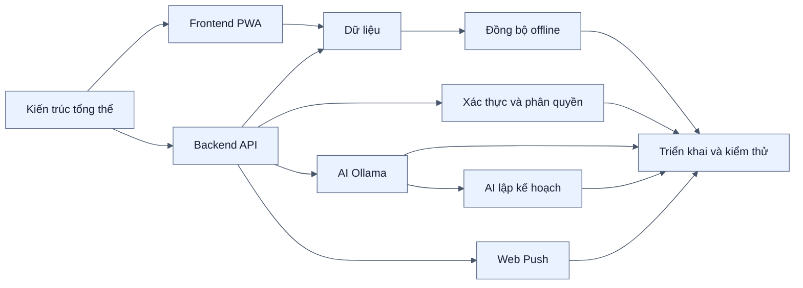

# Bộ sơ đồ kiến trúc PWA Notes

> Phản ánh mã nguồn hiện tại và phạm vi kiểm thử 394 test.

> Phạm vi triển khai: Chrome/Edge trên desktop hoặc laptop, truy cập bằng một URL chính thức của server. Không cài ứng dụng trên điện thoại/mobile; “PWA” ở đây chỉ kiến trúc Service Worker, cache và IndexedDB cho web desktop.

Thư mục này tách từng góc nhìn kiến trúc thành một file Markdown độc lập. Các sơ đồ dùng cú pháp Mermaid, có thể xem trực tiếp trên GitHub hoặc bằng Markdown Preview có hỗ trợ Mermaid.

## Danh mục

| File | Nội dung | Nên dùng khi trình bày |
| --- | --- | --- |
| [01-KIEN-TRUC-TONG-THE.md](01-KIEN-TRUC-TONG-THE.md) | Bối cảnh và các khối chính của toàn hệ thống | Mở đầu phần kiến trúc |
| [02-KIEN-TRUC-FRONTEND-PWA.md](02-KIEN-TRUC-FRONTEND-PWA.md) | React, hooks, Dexie/IndexedDB, Service Worker | Giải thích offline-first |
| [03-KIEN-TRUC-BACKEND-API.md](03-KIEN-TRUC-BACKEND-API.md) | Express, middleware, route, store và dịch vụ ngoài | Giải thích backend |
| [04-KIEN-TRUC-DU-LIEU.md](04-KIEN-TRUC-DU-LIEU.md) | Mô hình SQL Server và IndexedDB | Giải thích lưu trữ |
| [05-LUONG-DONG-BO-OFFLINE.md](05-LUONG-DONG-BO-OFFLINE.md) | Push/pull delta, phiên bản và xử lý xung đột | Phần kỹ thuật nổi bật nhất |
| [06-XAC-THUC-VA-PHAN-QUYEN.md](06-XAC-THUC-VA-PHAN-QUYEN.md) | JWT, khóa đăng nhập và RBAC user/admin/root | Trình bày bảo mật |
| [07-TRO-LY-AI-OLLAMA.md](07-TRO-LY-AI-OLLAMA.md) | Tạo bản nháp, RAG cục bộ, embedding và dẫn nguồn | Trình bày tính năng AI |
| [08-WEB-PUSH-NHAC-VIEC.md](08-WEB-PUSH-NHAC-VIEC.md) | Subscription, scheduler và Web Push | Trình bày nhắc việc |
| [09-TRIEN-KHAI-VA-KIEM-THU.md](09-TRIEN-KHAI-VA-KIEM-THU.md) | Chạy development/production, kiểm thử và ranh giới hệ thống | Chuẩn bị demo/bảo vệ |
| [10-BAN-DO-TINH-NANG.md](10-BAN-DO-TINH-NANG.md) | Tính năng theo vai trò và thành phần thực thi | Tổng kết phạm vi sản phẩm |
| [11-AI-LAP-KE-HOACH.md](11-AI-LAP-KE-HOACH.md) | Ước lượng, xếp lịch và mô phỏng ba kịch bản năng lực | Trình bày điểm nhấn AI lập kế hoạch |

## Cách đọc đề xuất

## Quy ước

- `Note` là mô hình dùng chung cho ghi chú và công việc; phân biệt bằng `kind`.
- `serverId` là UUID ổn định giữa client và server; `id` chỉ là khóa tự tăng trong IndexedDB.
- `Version` phát hiện xung đột ghi; `RowVer` là con trỏ đọc delta.
- `updatedAt` phục vụ hiển thị và sắp xếp, không quyết định bản nào được quyền ghi đè.
- Các sơ đồ mô tả hiện trạng, không phải tính năng dự kiến.
