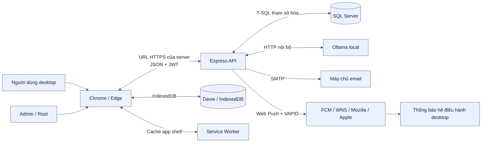
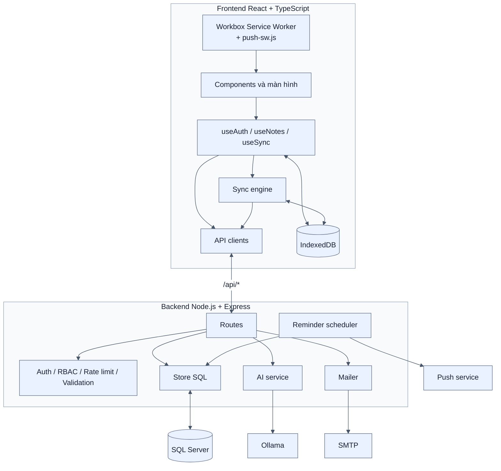
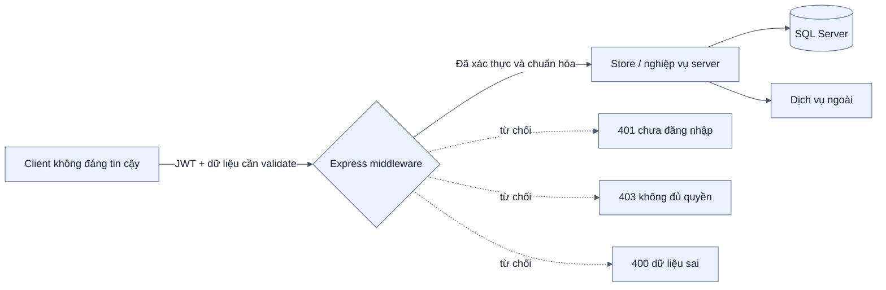

# Kiến trúc tổng thể

[← Mục lục](00-MUC-LUC.md)

## 1. Bối cảnh hệ thống

PWA Notes là ứng dụng web desktop quản lý ghi chú và công việc theo hướng offline-first. Người dùng mở một URL chính thức của server bằng Chrome/Edge trên desktop/laptop; không cài ứng dụng mobile. Thao tác được ghi cục bộ trước, khi có mạng trình duyệt đồng bộ với backend. Backend là biên tin cậy duy nhất cho xác thực, phân quyền và dữ liệu dùng chung giữa các profile trình duyệt.

## 2. Kiến trúc container

## 3. Nguyên tắc thiết kế

| Nguyên tắc | Cách hiện thực |
| --- | --- |
| Offline-first | Ghi vào IndexedDB trước, đồng bộ nền khi có mạng |
| Server là nguồn phân quyền | `UserId` lấy từ JWT; client không được chọn chủ sở hữu dữ liệu |
| Không ghi đè âm thầm | Mỗi bản ghi có `Version`; sai `baseVersion` tạo xung đột |
| Đồng bộ tăng dần | `RowVer` làm cursor, chỉ tải các dòng thay đổi |
| Tách lỗi hạ tầng khỏi dữ liệu | SQL/AI/SMTP/Push có xử lý lỗi độc lập; dữ liệu local vẫn được giữ |
| Tương thích dữ liệu cũ | Migration SQL và Dexie có phiên bản nâng cấp tại chỗ |
| Giảm tải ban đầu | `AdminPanel` và `StatsCharts` được lazy-load |

## 4. Ranh giới tin cậy

Backend không tin `UserId`, role, trạng thái đồng bộ hoặc phiên bản do client tự suy diễn. Mọi truy vấn ghi chú đều lấy chủ sở hữu từ `req.user.sub` sau khi JWT và trạng thái tài khoản đã được xác minh.

## 5. Điểm vào mã nguồn

- Frontend: `frontend/src/main.tsx`, `frontend/src/App.tsx`.
- Local database: `frontend/src/db/database.ts`.
- Sync engine: `frontend/src/db/sync.ts`.
- Backend bootstrap: `backend/src/server.js`.
- API composition: `backend/src/app.js`.
- SQL access: `backend/src/store.js`.
- Schema và migration: `backend/schema.sql`, `backend/migrations/`.
