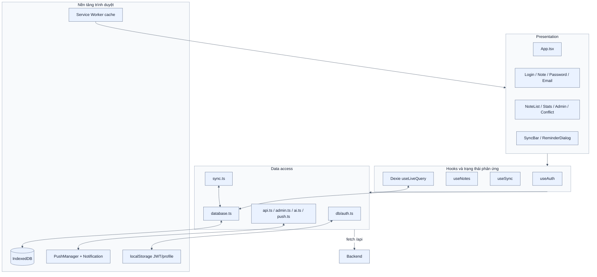
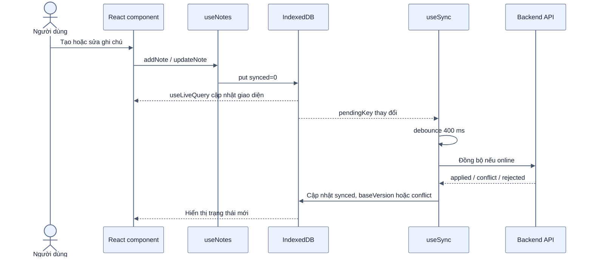
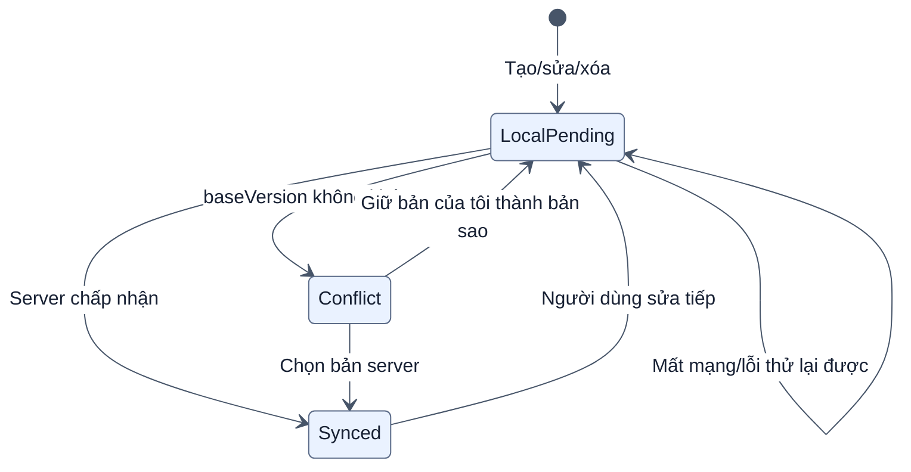
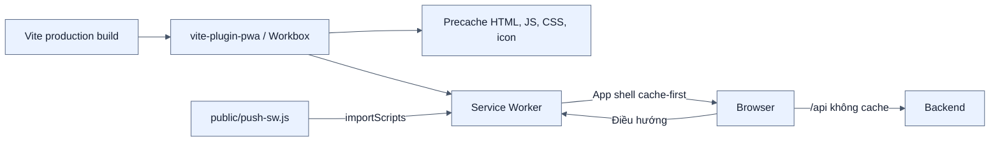

# Kiến trúc Frontend PWA

[← Mục lục](00-MUC-LUC.md)

Frontend được sử dụng trong tab Chrome/Edge desktop qua URL server. Project không có luồng cài đặt hoặc kiểm thử mobile; thuật ngữ PWA mô tả Service Worker/cache/offline của web desktop.

## 1. Phân lớp frontend

## 2. Luồng thao tác ghi chú

UI không chờ mạng để hoàn tất thao tác. Đây là lý do ứng dụng vẫn phản hồi nhanh khi backend chậm hoặc mất kết nối.

## 3. Trạng thái dữ liệu cục bộ

- `synced=0` và không có `conflict`: có thể tự gửi.
- Có `conflict`: chờ người dùng quyết định, không retry vô ích.
- `deleted=1`: xóa mềm, vẫn cần đồng bộ hành động xóa.

## 4. PWA và cache

Các API bị loại khỏi navigation fallback. Service Worker giữ phần giao diện; dữ liệu nghiệp vụ nằm trong IndexedDB, không nằm trong HTTP cache.

## 5. Các cơ chế tự đồng bộ

- Sau thay đổi local: debounce khoảng 400 ms.
- Khi lỗi tạm thời hoặc còn pending: thử lại mỗi 3 giây.
- Khi online lại, focus lại hoặc tab trở nên visible: đồng bộ ngay.
- Khi app đang mở: kiểm tra định kỳ mỗi 30 giây.
- `navigator.locks` ngăn nhiều lượt sync trong cùng trình duyệt chạy chồng nhau; biến `running` ngăn lời gọi trùng trong cùng context.

## 6. Tối ưu giao diện

- Bộ đếm active/todo/done/overdue/pending/conflict/trash được tính trong một lượt duyệt.
- Dexie index các trường lọc thường dùng như `synced`, `deleted`, `serverId`, `kind`, `dueAt`.
- `AdminPanel` và `StatsCharts` là chunk lazy, không làm nặng luồng chính.
- `useLiveQuery` chỉ cập nhật UI khi dữ liệu IndexedDB liên quan thay đổi.
