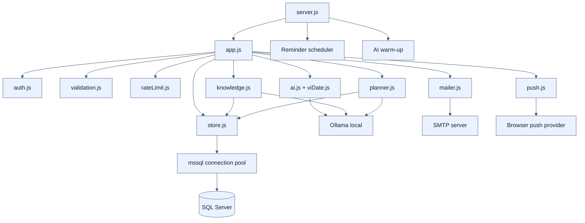
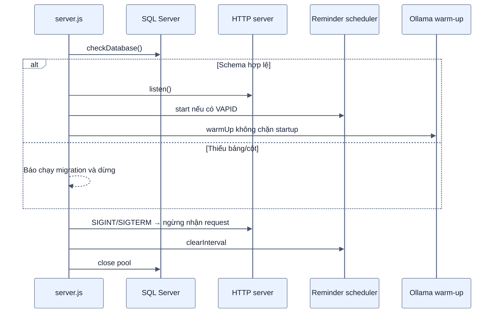

# Kiến trúc Backend API

[← Mục lục](00-MUC-LUC.md)

## 1. Pipeline xử lý request

```mermaid
%%{init: {"theme":"base","themeVariables":{"darkMode":false,"background":"#ffffff","primaryColor":"#eaf2ff","primaryTextColor":"#172033","primaryBorderColor":"#5b6b88","secondaryColor":"#edf8f0","secondaryTextColor":"#172033","secondaryBorderColor":"#5b6b88","tertiaryColor":"#fff7e6","tertiaryTextColor":"#172033","tertiaryBorderColor":"#7c6a46","lineColor":"#475569","textColor":"#172033","mainBkg":"#eaf2ff","nodeBorder":"#5b6b88","clusterBkg":"#f8fafc","clusterBorder":"#94a3b8","edgeLabelBackground":"#ffffff","actorBkg":"#eaf2ff","actorBorder":"#5b6b88","actorTextColor":"#172033","signalColor":"#475569","signalTextColor":"#172033","labelBoxBkgColor":"#ffffff","labelTextColor":"#172033","fontFamily":"Arial, sans-serif"},"themeCSS":"svg { background-color: #ffffff !important; }"}}%%
flowchart LR
    Client[Client] --> Express[Express]
    Express --> Common[CORS + JSON limit + headers]
    Common --> Limit[Rate limiter nếu áp dụng]
    Limit --> Auth[requireAuth]
    Auth --> RBAC[requireAdmin / requireRoot nếu áp dụng]
    RBAC --> Validate[Validate và chuẩn hóa input]
    Validate --> Handler[Route handler]
    Handler --> Store[store.js]
    Store --> SQL[(SQL Server)]
    Handler --> Service[AI / Mail / Push]
    Handler --> Response[JSON response]

    Auth -. lỗi .-> Error[Error handler]
    Validate -. lỗi .-> Error
    Store -. lỗi .-> Error
    Service -. lỗi .-> Error
    Error --> Response
```

`requireAuth` xác minh chữ ký JWT, tải lại user từ database và từ chối ngay nếu tài khoản không tồn tại hoặc đã bị khóa. User đã tải được gắn vào `req.authUser` để `/auth/me` và middleware admin không query lại.

## 2. Nhóm API

| Nhóm | Endpoint chính | Trách nhiệm |
| --- | --- | --- |
| Xác thực | `/api/auth/register`, `/login`, `/me` | Tạo tài khoản, cấp JWT, làm mới profile |
| Tài khoản | `/change-password`, `/email`, `/forgot-password`, `/reset-password` | Mật khẩu và email khôi phục |
| Ghi chú | `GET /api/notes`, `POST /api/notes/sync`, `/protocol` | Delta pull và optimistic concurrency |
| Quản trị | `/api/admin/users/*`, `/audit-log` | RBAC, khóa/mở, phân quyền, theo dõi tiến độ |
| AI | `/api/ai/draft`, `/warmup`, `/knowledge/query`, `/planner/simulate` | Tạo bản nháp, hỏi có nguồn và mô phỏng tiến độ qua Ollama local |
| Nhắc việc | `/api/push/config`, `/subscribe`, `/unsubscribe`, `/settings`, `/test` | Web Push theo tài khoản/profile trình duyệt desktop |

## 3. Thành phần backend

## 4. Quy tắc truy cập dữ liệu

- Tất cả câu SQL dùng tham số thay vì nối chuỗi dữ liệu người dùng.
- Ghi chú luôn lọc theo `UserId` lấy từ JWT.
- Admin thường chỉ truy cập user có `ManagedByAdminId` bằng ID của admin đó.
- Root có phạm vi toàn hệ thống nhưng vẫn không được tự hạ quyền hoặc tự khóa mình.
- Tạo tài khoản và cập nhật email khóa phạm vi kiểm tra trùng bằng `UPDLOCK, HOLDLOCK` trong transaction.
- Hạ admin và bỏ gán thành viên nằm trong cùng transaction.
- Nhật ký quản trị không chứa mật khẩu mới và lỗi ghi audit không làm đảo ngược nghiệp vụ chính đã thành công.

## 5. Khởi động và dừng an toàn

Ở production, backend có thể phục vụ trực tiếp `frontend/dist`; ở development, Vite proxy `/api` tới backend tại cổng 4000.
