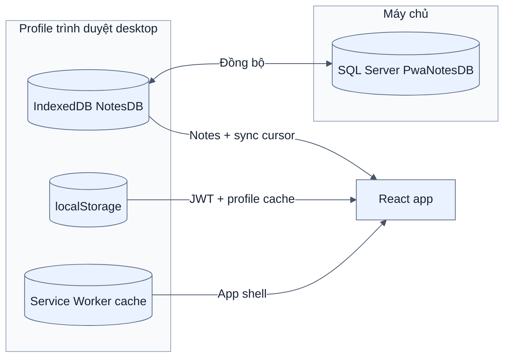
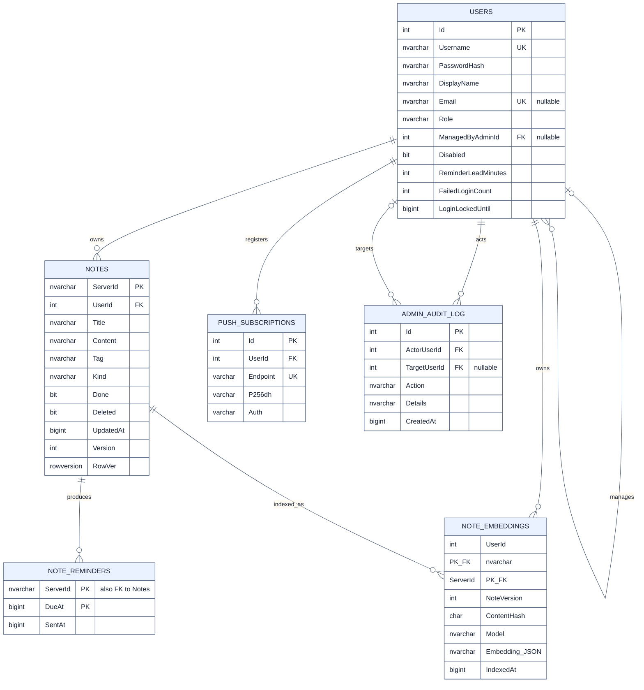
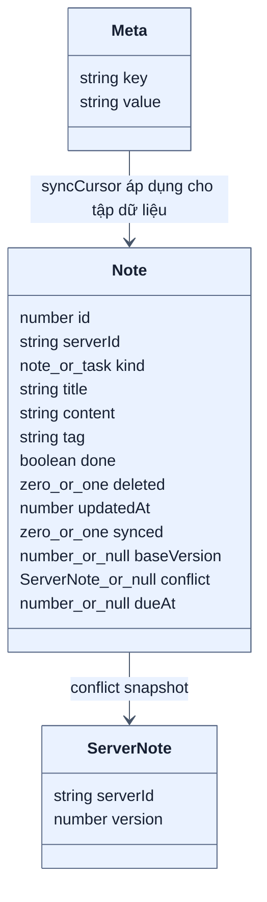

# Kiến trúc dữ liệu

[← Mục lục](00-MUC-LUC.md)

## 1. Hai tầng lưu trữ

| Vùng lưu trữ | Dữ liệu | Vai trò |
| --- | --- | --- |
| IndexedDB | Ghi chú, công việc, `baseVersion`, conflict, cursor | Làm việc offline và hàng đợi đồng bộ |
| localStorage | JWT, user profile, username gần nhất | Khôi phục phiên và phát hiện đổi tài khoản |
| Service Worker cache | HTML, JavaScript, CSS, icon | Mở giao diện khi offline |
| SQL Server | User, note chuẩn, audit, push subscription, reminder claim | Nguồn dữ liệu server và ranh giới phân quyền |

## 2. Mô hình quan hệ SQL Server

## 3. Mô hình IndexedDB

Dexie hiện ở schema version 4. Bảng `notes` có khóa cục bộ tự tăng `id`; `serverId` mới là định danh dùng khi trao đổi với server. Bảng `meta` giữ `syncCursor`.

## 4. Các bất biến dữ liệu

- `Users.Role` chỉ nhận `user`, `admin`, `root`.
- Admin/root phải có `ManagedByAdminId=NULL`; migration 012 dọn dữ liệu cũ và thêm CHECK.
- Email đăng ký mới là bắt buộc ở API, nhưng cột SQL vẫn nullable để giữ tài khoản legacy.
- `Notes.Version >= 1` và do server tăng khi ghi thành công.
- `RowVer` do SQL Server sinh, không do client cung cấp.
- `kind=note` không được mang trạng thái hoàn thành.
- Nếu có cả `StartAt` và `DueAt` thì `DueAt >= StartAt`.
- `CompletedAt` chỉ có ý nghĩa khi `Done=1`; `DeletedAt` chỉ có ý nghĩa khi `Deleted=1`.
- Khóa `(ServerId, DueAt)` trong `NoteReminders` ngăn nhắc trùng cho cùng một hạn.
- Khóa `(UserId, ServerId)` trong `NoteEmbeddings` cô lập cache vector theo tài khoản; `NoteVersion`, `ContentHash` và `Model` quyết định khi nào phải lập chỉ mục lại.

## 5. Index chính

| Index | Mục đích |
| --- | --- |
| `IX_Notes_UserId_RowVer` | Delta sync theo chủ sở hữu và cursor |
| `IX_Notes_UserId` | Truy vấn toàn bộ note của user |
| `IX_Notes_Tag` | Hỗ trợ lọc/tag phía SQL nếu cần |
| `UQ_Users_Email WHERE Email IS NOT NULL` | Không cho trùng email nhưng giữ user cũ chưa có email |
| `IX_Users_ManagedByAdminId` | Danh sách user thuộc admin |
| `IX_PushSubscriptions_UserId` | Lấy mọi profile trình duyệt desktop đã đăng ký của một user |
| `IX_AdminAuditLog_CreatedAt` | Nhật ký mới nhất trước |
| `IX_NoteEmbeddings_ServerId` | Dọn và đối chiếu cache embedding theo ghi chú |

## 6. Chiến lược migration

```mermaid
%%{init: {"theme":"base","themeVariables":{"darkMode":false,"background":"#ffffff","primaryColor":"#eaf2ff","primaryTextColor":"#172033","primaryBorderColor":"#5b6b88","secondaryColor":"#edf8f0","secondaryTextColor":"#172033","secondaryBorderColor":"#5b6b88","tertiaryColor":"#fff7e6","tertiaryTextColor":"#172033","tertiaryBorderColor":"#7c6a46","lineColor":"#475569","textColor":"#172033","mainBkg":"#eaf2ff","nodeBorder":"#5b6b88","clusterBkg":"#f8fafc","clusterBorder":"#94a3b8","edgeLabelBackground":"#ffffff","actorBkg":"#eaf2ff","actorBorder":"#5b6b88","actorTextColor":"#172033","signalColor":"#475569","signalTextColor":"#172033","labelBoxBkgColor":"#ffffff","labelTextColor":"#172033","fontFamily":"Arial, sans-serif"},"themeCSS":"svg { background-color: #ffffff !important; }"}}%%
flowchart LR
    Fresh[Cài mới] --> Schema[schema.sql]
    Existing[Database đang dùng] --> Runner[npm run migrate]
    Runner --> M002[002]
    M002 --> M003[003 ... 008]
    M003 --> M009[009 sync version]
    M009 --> M010[010 push]
    M010 --> M011[011 login lock]
    M011 --> M012[012 managed role]
    M012 --> M013[013 note embeddings]
```

Các migration được đặt theo số thứ tự và thiết kế để chạy lại. `migrate.js` đọc toàn bộ file `.sql`, sắp xếp theo tên rồi chạy tuần tự.
