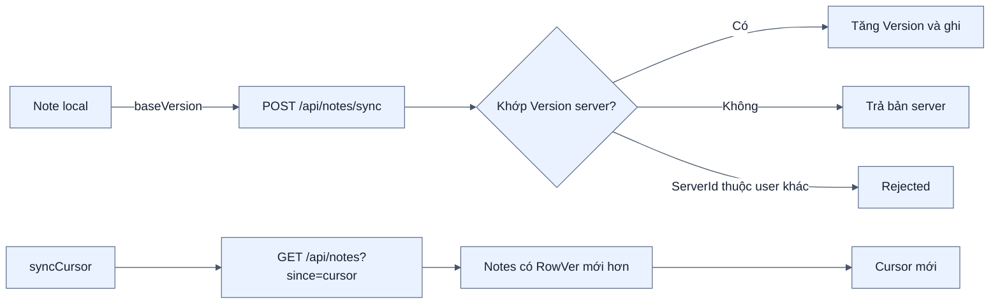
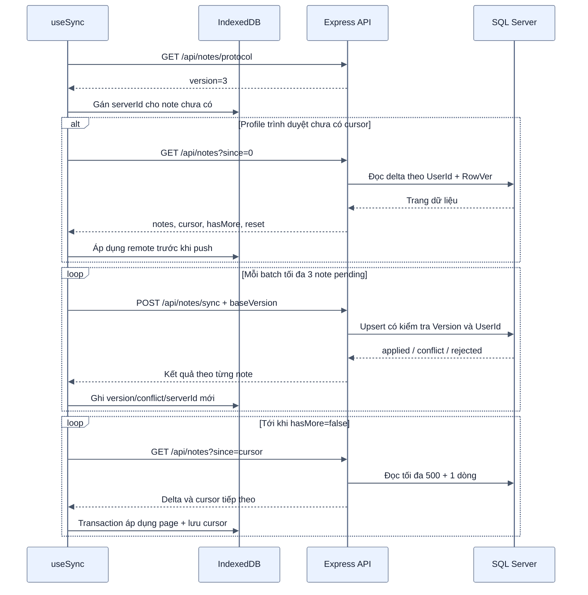
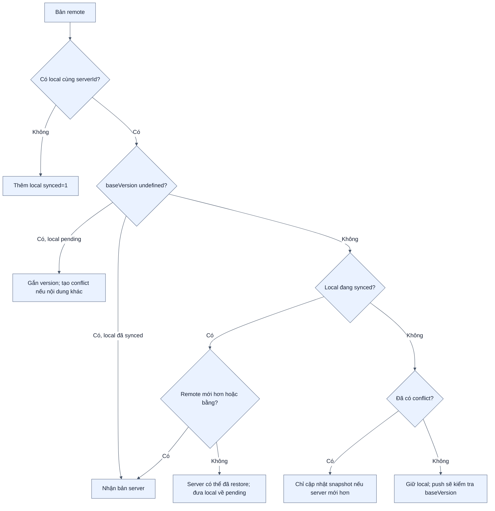
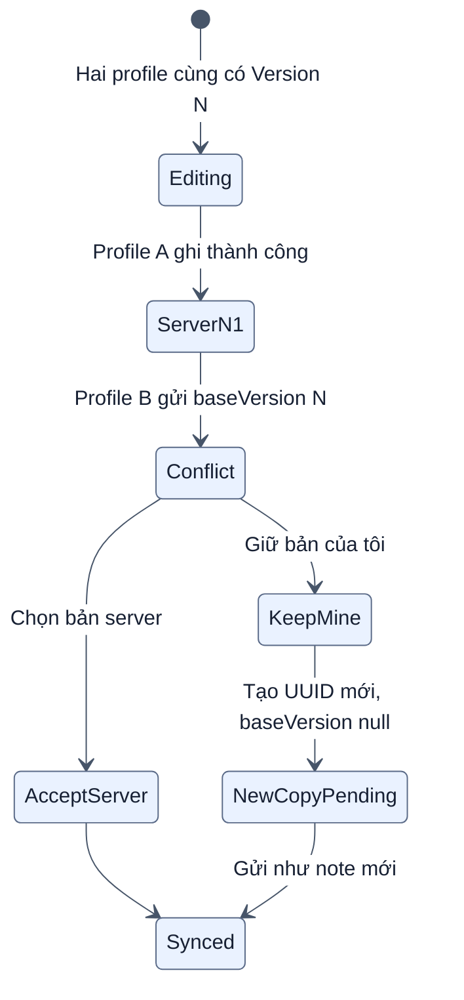

# Luồng đồng bộ offline và xử lý xung đột

[← Mục lục](00-MUC-LUC.md)

## 1. Mô hình đồng bộ hiện tại

Mỗi “client” trong sơ đồ là một profile/tab Chrome hoặc Edge desktop mở cùng URL server. Đồng bộ gồm hai cơ chế độc lập:

- `Version`: kiểm soát ghi lạc quan, phát hiện hai profile trình duyệt cùng sửa một bản.
- `RowVer`: cursor đọc delta, chỉ tải những dòng SQL thay đổi sau lần trước.

## 2. Một lượt đồng bộ đầy đủ

## 3. Quyết định khi áp dụng bản remote

## 4. Xử lý xung đột

Không có chiến lược “timestamp mới nhất thắng”. `updatedAt` chỉ hỗ trợ hiển thị và một số quyết định tương thích dữ liệu cũ; quyền ghi được quyết định bởi `Version` server.

## 5. Phục hồi tình huống lỗi

| Tình huống | Cách xử lý |
| --- | --- |
| Mất mạng | Giữ `synced=0`, tự thử lại khi online |
| Server nhận ghi nhưng response bị mất | UUID giữ nguyên; bản server version 1 được nhận làm gốc thay vì tạo conflict giả |
| Cursor không hợp lệ do database restore | Server trả `reset`; client tải lại toàn bộ rồi mới đối chiếu orphan |
| `hasMore=true` nhưng cursor đứng yên | Dừng và báo lỗi để tránh vòng lặp vô hạn |
| Quá 1000 trang trong một lượt | Dừng an toàn, giữ dữ liệu đã có và yêu cầu đồng bộ tiếp |
| Remote sai schema/giới hạn | Không áp dụng vào IndexedDB |
| `serverId` thuộc tài khoản khác | Server trả `rejected`; client đổi UUID rồi gửi lại |
| Đổi tài khoản trên cùng trình duyệt | Xóa cả notes và cursor local trước khi dùng tài khoản mới |

## 6. Các giới hạn có chủ đích

- Không có background sync bảo đảm chạy khi PWA đã đóng hoàn toàn.
- Xung đột cần người dùng chọn, hệ thống không tự ghép nội dung văn bản.
- Một lượt pull giới hạn 1000 trang để chống response/server bất thường.
- Sync theo eventual consistency: dữ liệu giữa hai profile desktop có thể lệch tạm thời trước lượt đồng bộ kế tiếp.
