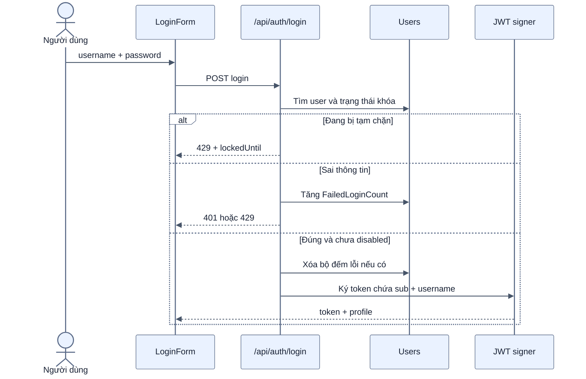
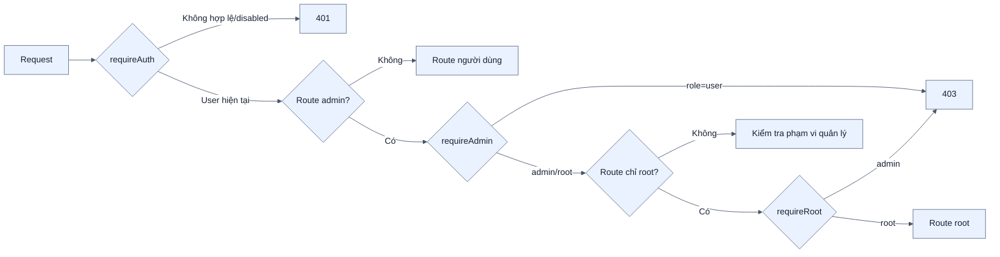
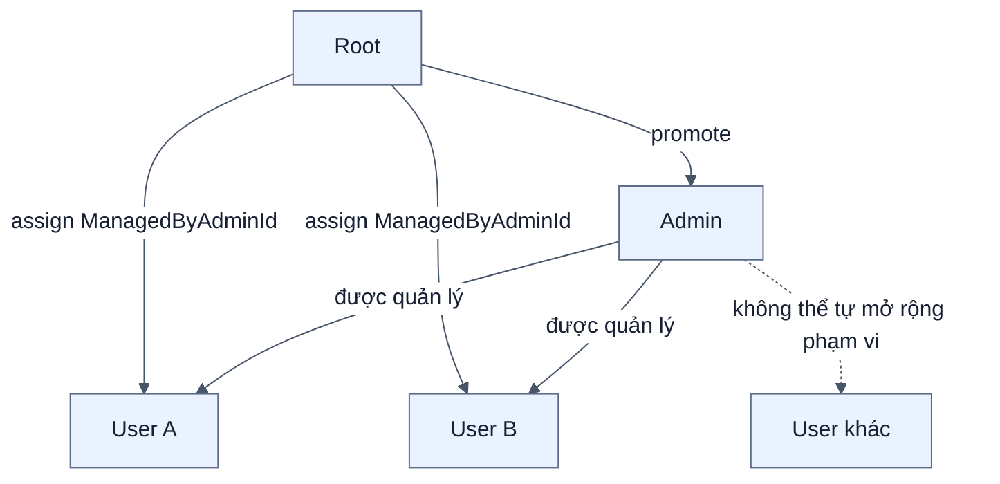
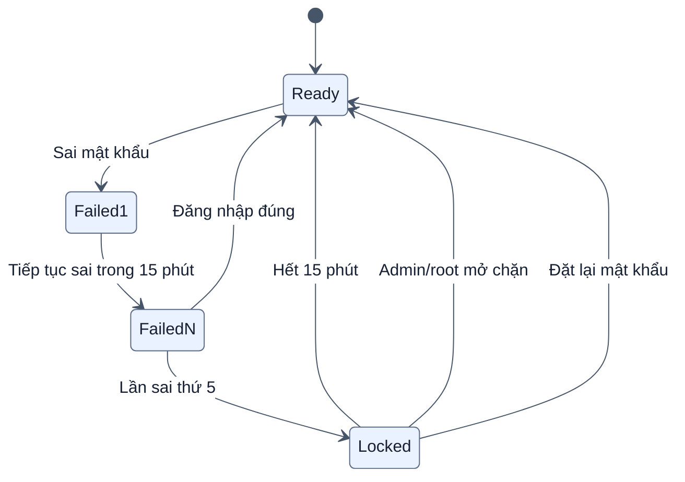
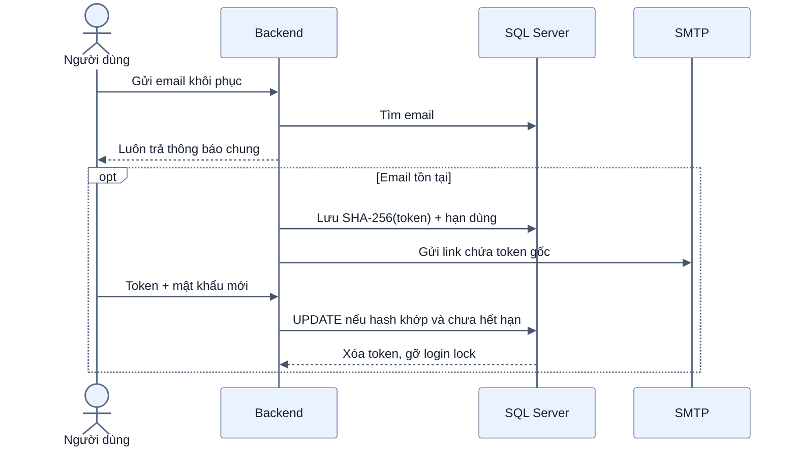

# Kiến trúc xác thực và phân quyền

[← Mục lục](00-MUC-LUC.md)

## 1. Đăng nhập và xác minh mỗi request

Với mỗi API được bảo vệ, `requireAuth` không chỉ kiểm tra chữ ký JWT mà còn tải lại user từ SQL. Vì vậy thao tác khóa tài khoản hoặc đổi role có hiệu lực ngay, không phải chờ token hết hạn.

## 2. Chuỗi middleware RBAC

## 3. Ma trận quyền

| Khả năng | User | Admin | Root |
| --- | :---: | :---: | :---: |
| CRUD và đồng bộ note của chính mình | Có | Có | Có |
| Xem trang quản trị | Không | Có | Có |
| Xem note user khác | Không | Chỉ user được giao, chỉ đọc | Mọi user, chỉ đọc |
| Sửa/khóa/reset mật khẩu user | Không | Chỉ user được giao | Mọi tài khoản hợp lệ |
| Tạo user từ trang quản trị | Không | Không | Có |
| Thăng/hạ admin | Không | Không | Có |
| Gán/bỏ gán user cho admin | Không | Không | Có |
| Xem audit log | Không | Không | Có |

Admin/root không có route sửa hoặc xóa note thay người dùng; quyền quản trị nội dung chỉ là xem tiến độ và xem chi tiết ở chế độ đọc.

## 4. Phạm vi quản lý

- Chỉ user thường được mang `ManagedByAdminId`.
- Thăng user thành admin sẽ xóa liên kết quản lý cũ.
- Hạ admin thành user sẽ bỏ gán toàn bộ thành viên của admin đó trong một transaction.
- Migration 012 bảo vệ bất biến admin/root không có `ManagedByAdminId` ở tầng database.

## 5. Bảo vệ đăng nhập

- Tài khoản có thật được đếm trong SQL để không mất trạng thái khi restart.
- Username không tồn tại được đếm tương tự trong RAM và nhận cùng kiểu phản hồi, hạn chế dò tài khoản.
- `Disabled` là khóa thủ công; `LoginLockedUntil` là tạm chặn do nhập sai. Hai trạng thái độc lập.
- Register và forgot-password có rate limit theo IP; `trust proxy` chỉ bật khi cấu hình rõ ràng.

## 6. Khôi phục mật khẩu

Database chỉ lưu hash của reset token. Token được dùng một lần; response quên mật khẩu không tiết lộ email có tồn tại hay không.

## 7. Lưu ý triển khai bảo mật

- Production phải dùng HTTPS và đặt bí mật JWT/SMTP/VAPID ngoài source.
- `ALLOWED_ORIGINS` phải giới hạn đúng domain frontend.
- Chỉ bật `TRUST_PROXY=true` sau reverse proxy đáng tin cậy.
- JWT đang nằm trong localStorage; cần tiếp tục kiểm soát XSS và không render HTML tùy ý từ nội dung người dùng.
- Không ghi mật khẩu, reset token gốc hoặc khóa bí mật vào audit log.

