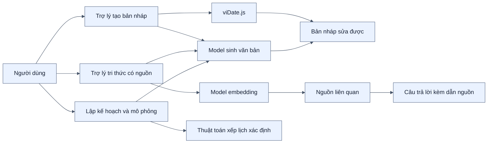
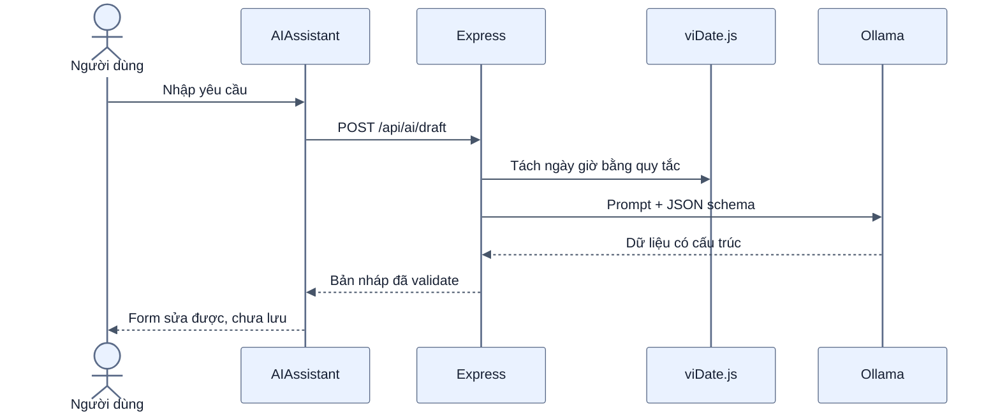
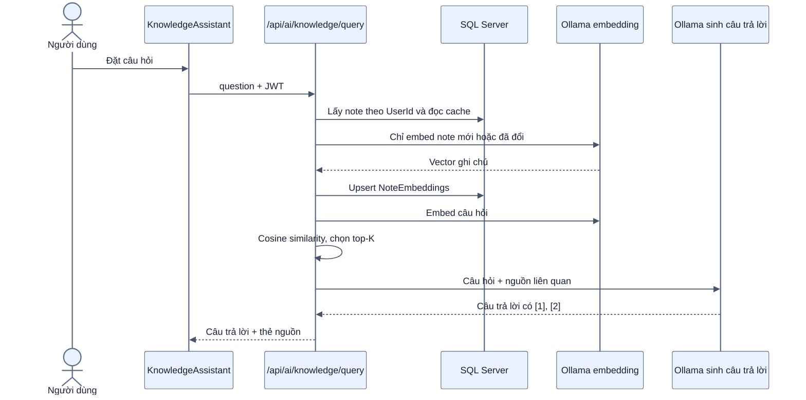
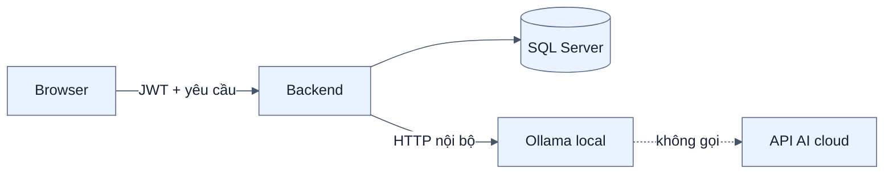

# Kiến trúc AI local với Ollama

[← Mục lục](00-MUC-LUC.md)

## 1. Ba chức năng AI

- **Tạo bản nháp:** chuyển yêu cầu tiếng Việt thành dữ liệu ghi chú; người dùng sửa và xác nhận trước khi lưu.
- **Hỏi kho tri thức:** tìm theo ngữ nghĩa trong ghi chú đã đồng bộ của tài khoản, tổng hợp câu trả lời và trả nguồn để kiểm chứng.
- **Lập kế hoạch:** AI ước lượng khối lượng/ưu tiên; thuật toán mô phỏng lịch và rủi ro. Chi tiết tại [11-AI-LAP-KE-HOACH.md](11-AI-LAP-KE-HOACH.md).

## 2. Luồng tạo bản nháp

Nếu Ollama lỗi hoặc quá thời gian, backend trả bản nháp cơ bản kèm cảnh báo. Hủy từ giao diện sẽ hủy request tới Ollama.

## 3. Luồng Trợ lý tri thức có dẫn nguồn

Cache hợp lệ khi `NoteVersion`, SHA-256 nội dung và model embedding đều khớp. Ghi chú bị xóa được dọn khỏi cache. Nếu không có nguồn đủ ngưỡng, backend báo không tìm thấy và không gọi model sinh câu trả lời.

## 4. Cô lập dữ liệu và kiểm soát nguồn

- `UserId` lấy từ JWT; client không được chọn ID tài khoản cần tra cứu.
- Mọi truy vấn note và embedding đều lọc theo `UserId`.
- Nội dung nguồn được đánh dấu là dữ liệu, không phải chỉ dẫn, để giảm prompt injection từ ghi chú.
- Model chỉ nhận tối đa các nguồn top-K, không nhận toàn bộ database.
- Dẫn nguồn ngoài phạm vi bị loại; nếu model bỏ quên dẫn nguồn, backend bổ sung danh sách nguồn thực tế đã dùng.
- Thẻ nguồn có tiêu đề, đoạn trích, tag và điểm liên quan; bấm thẻ sẽ tìm lại ghi chú trên giao diện.

## 5. Biên riêng tư

Mặc định Ollama chạy tại `127.0.0.1:11434`, nên câu hỏi và nguồn không rời máy chủ. Đổi `OLLAMA_URL` sang máy khác sẽ làm thay đổi biên riêng tư.

## 6. Cấu hình

| Biến | Mặc định | Ý nghĩa |
| --- | --- | --- |
| `OLLAMA_URL` | `http://127.0.0.1:11434` | Địa chỉ Ollama |
| `OLLAMA_MODEL` | `llama3.2` | Model tạo bản nháp và câu trả lời |
| `OLLAMA_EMBED_MODEL` | `embeddinggemma` | Model tạo vector ngữ nghĩa |
| `OLLAMA_TIMEOUT_MS` | `60000` | Timeout tạo bản nháp |
| `OLLAMA_KNOWLEDGE_TIMEOUT_MS` | `90000` | Timeout từng request trong luồng tri thức |
| `OLLAMA_PLANNER_TIMEOUT_MS` | `90000` | Timeout ước lượng cho luồng lập kế hoạch |
| `OLLAMA_KEEP_ALIVE` | `30m` | Thời gian giữ model trong RAM |
| `KNOWLEDGE_MIN_SIMILARITY` | `0.28` | Ngưỡng cosine để nhận note làm nguồn |

Dẫn nguồn giúp kiểm chứng nhưng không biến câu trả lời AI thành dữ liệu tuyệt đối chính xác.
