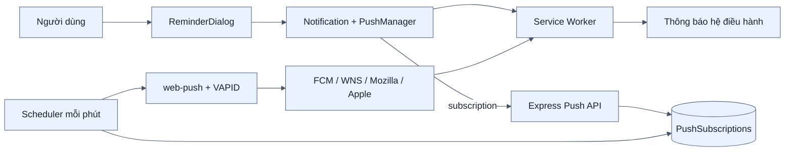
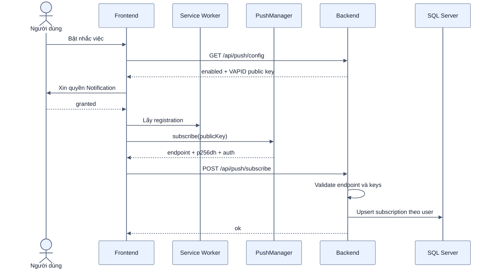
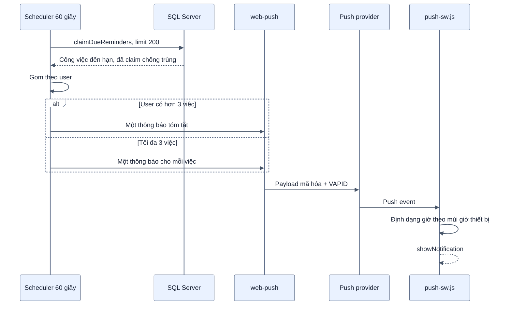
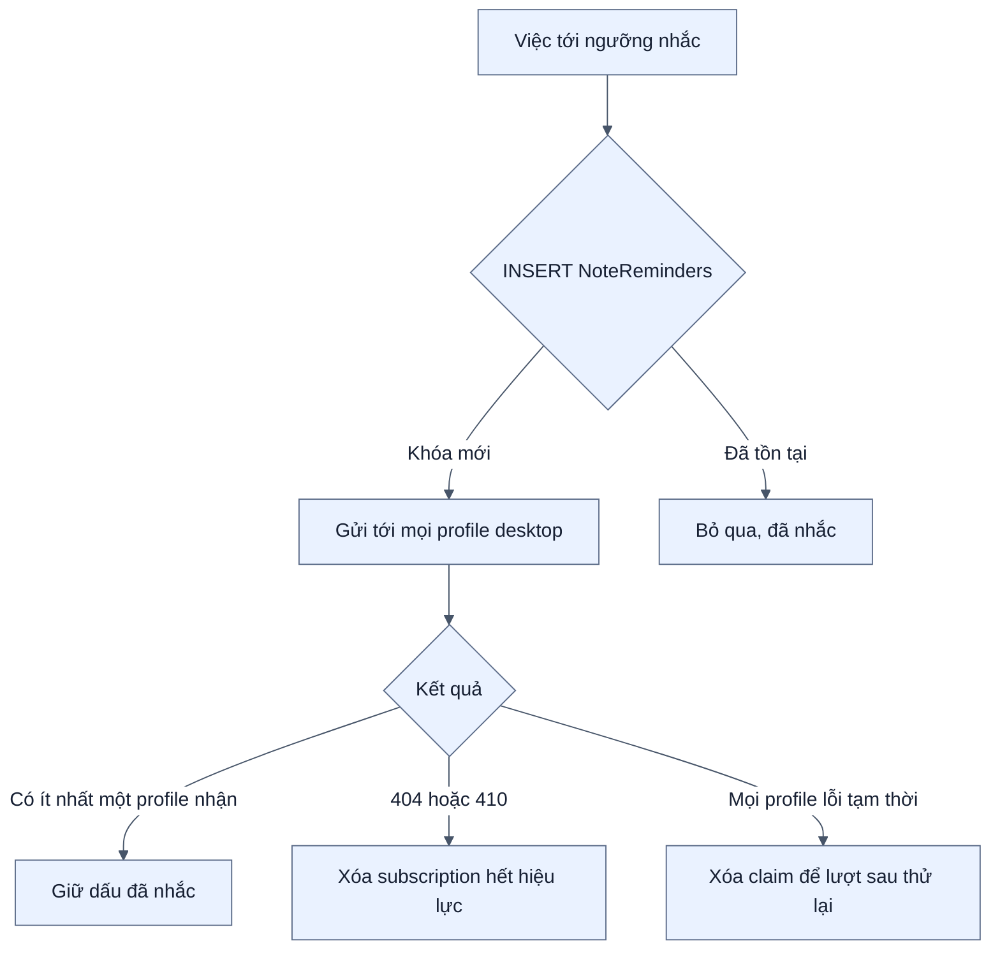

# Kiến trúc Web Push và nhắc việc

[← Mục lục](00-MUC-LUC.md)

Tính năng này chỉ được mô tả và kiểm thử trên Chrome/Edge desktop mở URL HTTPS của server. Không có phạm vi cài đặt hoặc nhận thông báo trên điện thoại/mobile.

## 1. Các thành phần

Nhắc việc chính thức dùng bản production qua URL HTTPS của server có Service Worker; preview chỉ phục vụ kiểm thử tại máy kỹ thuật. Chế độ Vite development không đăng ký Service Worker cho tính năng này.

## 2. Bật nhắc việc trên một profile trình duyệt desktop

Mỗi profile Chrome/Edge desktop là một subscription. Đăng xuất sẽ cố xóa subscription trên server rồi hủy subscription trong trình duyệt để người dùng tiếp theo trên cùng máy không nhận nhắc việc của tài khoản trước.

## 3. Quét và gửi nhắc việc

## 4. Chống gửi trùng và phục hồi lỗi

- Khóa chính `(ServerId, DueAt)` đảm bảo cùng một hạn chỉ claim một lần.
- Đổi hạn tạo cặp khóa mới nên được nhắc lại.
- Hai scheduler chạy chồng nhau không gửi trùng nhờ khóa database.
- Endpoint 404/410 được dọn tự động.
- Nếu toàn bộ profile trình duyệt lỗi tạm thời, claim được trả lại để retry.

## 5. Bảo mật

- Backend chỉ chấp nhận endpoint HTTPS thuộc các push provider đã cho phép, hạn chế SSRF.
- Subscription luôn gắn với user lấy từ JWT.
- Route unsubscribe chỉ xóa endpoint thuộc chính người gọi.
- VAPID private key chỉ nằm ở backend; frontend chỉ nhận public key.
- Payload được Web Push mã hóa cho khóa của subscription.

## 6. Điều kiện triển khai

- URL HTTPS chính thức của server; localhost chỉ dùng khi kiểm thử trên máy kỹ thuật.
- `VAPID_PUBLIC_KEY`, `VAPID_PRIVATE_KEY`, `VAPID_SUBJECT` hợp lệ.
- Trình duyệt hỗ trợ Service Worker, Push API và Notification API.
- Người dùng đã cấp quyền notification.
- Backend phải chạy liên tục để scheduler quét mỗi phút; nhận push khi tab đóng còn phụ thuộc trình duyệt desktop và hệ điều hành cho phép chạy nền.
