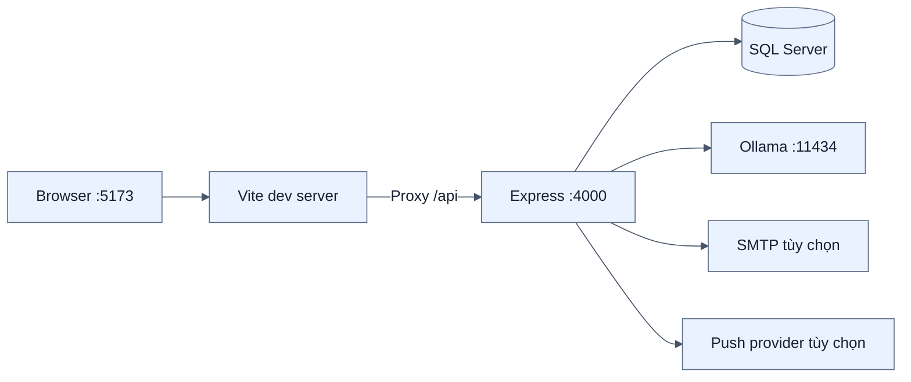
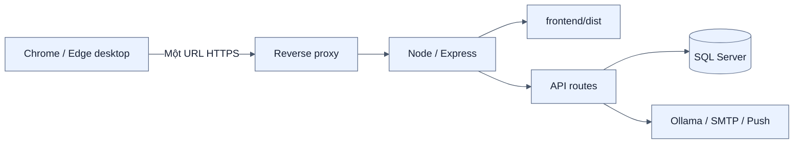
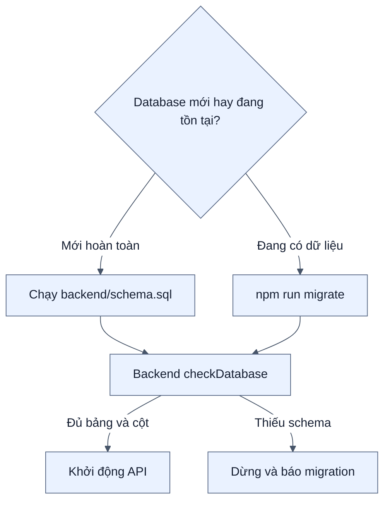
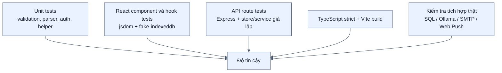
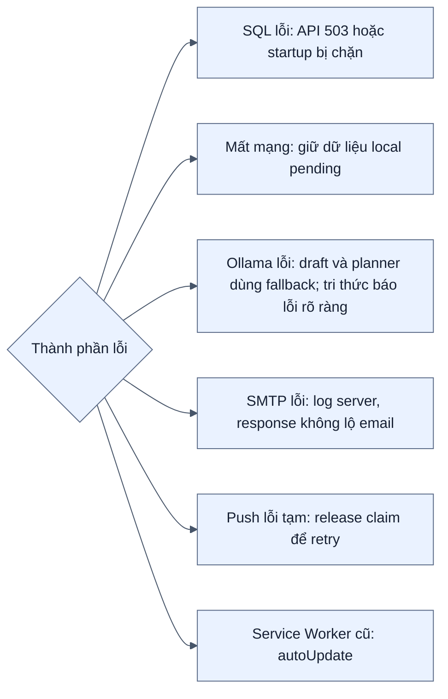

# Kiến trúc triển khai và kiểm thử

[← Mục lục](00-MUC-LUC.md)

Phạm vi bàn giao chỉ có một client chính thức: Chrome/Edge desktop truy cập URL HTTPS của server. Các URL `localhost:5173/4173` bên dưới chỉ dành cho lập trình viên; không có luồng cài đặt mobile.

Vite dev/preview bind `0.0.0.0` để có thể kiểm thử từ máy khác trong LAN, nhưng client truy cập bằng IP/hostname thật của server (`http://<IP-LAN>:4173`), không dùng `0.0.0.0` làm URL. Cách này không thay thế URL HTTPS bàn giao chính thức.

## 1. Môi trường development



```powershell
# Terminal backend
cd backend
npm.cmd run migrate
npm.cmd start

# Terminal frontend
cd frontend
npm.cmd run dev
```

Vite development phù hợp CRUD, auth, sync và AI. Web Push cần Service Worker nên phải kiểm tra bằng bản build/preview hoặc production.

## 2. Môi trường production đơn giản



Quy trình build trên PowerShell:

```powershell
cd frontend
npm.cmd run build

cd ..\backend
$env:NODE_ENV='production'
npm.cmd start
```

Ở production, Express phục vụ `frontend/dist`. Asset có hash được cache immutable một năm; HTML dùng `no-cache` để nhận phiên bản mới.

Người dùng chỉ biết URL HTTPS ở reverse proxy; họ không truy cập trực tiếp cổng Node, Vite hoặc SQL Server.

## 3. Luồng khởi tạo database



Không chạy lại `schema.sql` trên database đang có dữ liệu. Các thay đổi nâng cấp phải đi qua migration.

## 4. Kiến trúc kiểm thử



| Lớp | Hiện trạng | Phạm vi |
| --- | --- | --- |
| Backend tự động | 225 test | Route, auth, ba luồng AI, mô phỏng, validation, push, rate limit |
| Frontend tự động | 169 test | Hook, IndexedDB, sync, lọc tag theo loại nội dung, bộ lọc trạng thái không chồng lặp, thống kê và nhãn trạng thái công việc, component AI, service worker |
| Build | Thành công | TypeScript strict, bundle và PWA generation |
| Dependency audit | 0 vulnerability | `npm audit` hai workspace |
| Tích hợp dịch vụ thật | Cần chạy trên môi trường demo | SQL hiện hành, mailbox, Ollama model, Chrome/Edge desktop nhận push |

Lệnh kiểm tra:

```powershell
cd backend
npm.cmd test

cd ..\frontend
npm.cmd test -- --run
npm.cmd run build
```

## 5. Failure domains



## 6. Checklist trước khi demo

- Chạy toàn bộ migration đến `013_note_embeddings.sql` trên database demo.
- Chạy lại 394 test (225 backend + 169 frontend) và production build.
- Chuẩn bị tài khoản root/admin/user và hai profile trình duyệt.
- Kiểm tra offline/reconnect và xung đột trước buổi bảo vệ.
- Tải `llama3.2` và `embeddinggemma`; chạy thử cả tạo nháp, hỏi có nguồn và ba kịch bản planner trước phần demo AI.
- Gửi thử email và Web Push thật nếu hai tính năng này nằm trong phần demo.
- Không trình chiếu `.env`, JWT, mật khẩu hoặc khóa VAPID.
- Có video/screenshot dự phòng cho dịch vụ ngoài phụ thuộc mạng.

## 7. Giới hạn triển khai hiện tại

- Chưa có container/Docker hoặc pipeline CI/CD trong repository.
- Chưa có cơ chế backup/export dữ liệu tích hợp trong ứng dụng.
- Scheduler nhắc việc chạy trong tiến trình backend; triển khai nhiều instance cần thiết kế điều phối rõ ràng dù claim SQL đã chống gửi trùng.
- Chưa có browser E2E tự động; kiểm tra UI thật vẫn cần checklist thủ công.
- Phạm vi phù hợp web desktop nội bộ qua URL server, không hỗ trợ mobile và chưa phải kiến trúc multi-tenant Internet quy mô lớn.
