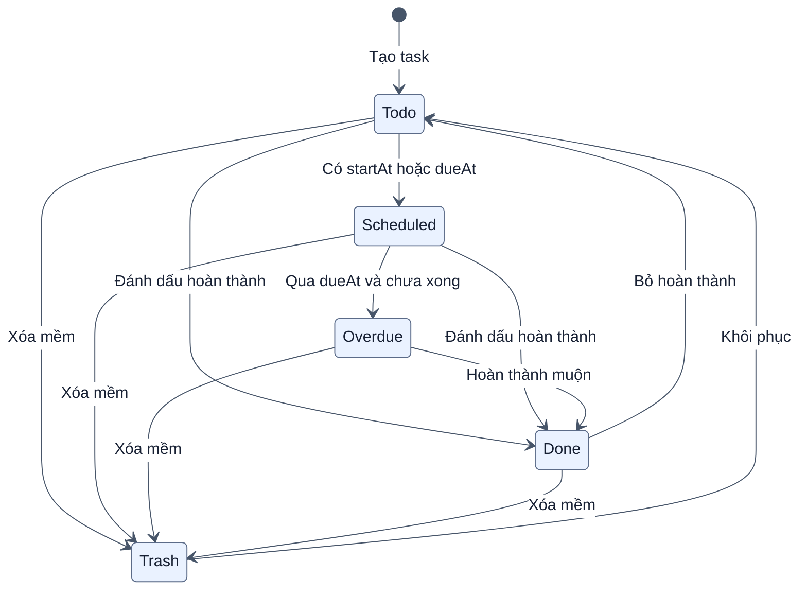
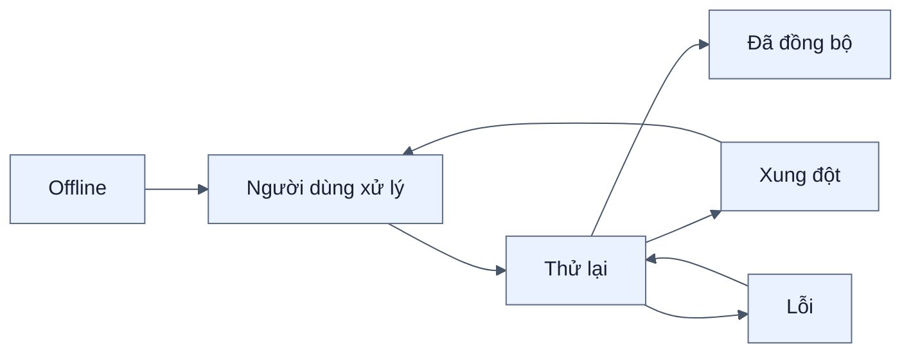

# Bản đồ tính năng

[← Mục lục](00-MUC-LUC.md)

Mọi vai trò bên dưới sử dụng Chrome/Edge desktop qua cùng URL server. Cài đặt ứng dụng trên mobile không thuộc bản đồ tính năng.

## 1. Tính năng theo vai trò

```mermaid
%%{init: {"theme":"base","themeVariables":{"darkMode":false,"background":"#ffffff","primaryColor":"#eaf2ff","primaryTextColor":"#172033","primaryBorderColor":"#5b6b88","secondaryColor":"#edf8f0","secondaryTextColor":"#172033","secondaryBorderColor":"#5b6b88","tertiaryColor":"#fff7e6","tertiaryTextColor":"#172033","tertiaryBorderColor":"#7c6a46","lineColor":"#475569","textColor":"#172033","mainBkg":"#eaf2ff","nodeBorder":"#5b6b88","clusterBkg":"#f8fafc","clusterBorder":"#94a3b8","edgeLabelBackground":"#ffffff","actorBkg":"#eaf2ff","actorBorder":"#5b6b88","actorTextColor":"#172033","signalColor":"#475569","signalTextColor":"#172033","labelBoxBkgColor":"#ffffff","labelTextColor":"#172033","fontFamily":"Arial, sans-serif"},"themeCSS":"svg { background-color: #ffffff !important; }"}}%%
flowchart TB
    Guest[Khách] --> Register[Đăng ký]
    Guest --> Login[Đăng nhập]
    Guest --> Forgot[Quên mật khẩu]

    User[User] --> Notes[Ghi chú và công việc]
    User --> Offline[Offline + đồng bộ]
    User --> Conflict[Xử lý xung đột]
    User --> AI[Trợ lý tạo bản nháp]
    User --> Knowledge[Hỏi kho tri thức có nguồn]
    User --> Planner[Lập kế hoạch và mô phỏng]
    User --> Stats[Thống kê]
    User --> Reminder[Web Push]
    User --> Account[Email / đổi mật khẩu]

    Admin[Admin] --> Managed[Quản lý user được giao]
    Managed --> Progress[Xem tiến độ và note chỉ đọc]
    Managed --> Lock[Khóa, mở và reset mật khẩu]

    Root[Root] --> AllUsers[Quản lý toàn bộ user]
    Root --> Roles[Thăng và hạ admin]
    Root --> Assign[Gán user cho admin]
    Root --> Audit[Xem audit log]
```

Mọi admin và root đồng thời vẫn là một người dùng bình thường đối với dữ liệu ghi chú của chính họ.

## 2. Tính năng và nơi thực thi

| Tính năng | Frontend | Backend | Dữ liệu |
| --- | --- | --- | --- |
| Đăng ký/đăng nhập | `LoginForm`, `db/auth.ts` | Auth routes, bcrypt, JWT | `Users` |
| Hồ sơ/email | Sidebar, `EmailDialog` | `/auth/me`, `/auth/email` | `Users.Email` |
| Khôi phục mật khẩu | `ResetPasswordForm` | Token hash + SMTP | `Users.ResetToken*` |
| CRUD note/task | `NoteForm`, `useNotes` | Qua sync API | IndexedDB + `Notes` |
| Offline/PWA | Dexie, Workbox | Không cần backend khi offline | IndexedDB + cache |
| Đồng bộ/xung đột | `useSync`, `sync.ts`, `ConflictPanel` | Cơ chế đồng bộ hiện tại + `upsertNote` | `Version`, `RowVer` |
| Tìm/lọc/trạng thái | `NoteList`, `useNotes` | Không cần gọi server | IndexedDB |
| Lọc và thống kê | `App`, `StatsView`, `StatsCharts`, `lib/stats.ts`; trang chính lọc Tất cả/Ghi chú/Công việc, thống kê bốn trạng thái công việc loại trừ nhau, tạo mới/tag và tiến độ/quá hạn theo 14 ngày hoặc 6 tháng | Không cần route riêng | IndexedDB |
| AI tạo bản nháp | `AIAssistant` | `ai.js`, `viDate.js`, Ollama | Chỉ lưu sau xác nhận |
| AI hỏi kho tri thức | `KnowledgeAssistant`, `db/knowledge.ts` | `knowledge.js`, Ollama | `Notes` + `NoteEmbeddings` theo `UserId` |
| AI lập kế hoạch | `PlanningAssistant`, `db/planner.ts` | `planner.js`, Ollama + thuật toán mô phỏng | Đọc `Notes`, không ghi kế hoạch |
| Nhắc việc | `ReminderDialog`, Service Worker | Scheduler + web-push | Push subscriptions/reminders |
| Quản trị | `AdminPanel`, `db/admin.ts` | RBAC + admin routes | Users, Notes, AuditLog |

## 3. Vòng đời một công việc

Ghi chú `kind=note` không tham gia trạng thái Todo/Done/Overdue nhưng vẫn có thể mang lịch nếu người dùng cần ghi nhớ theo thời gian.

Nhánh `Overdue --> Done` giữ lại dấu hiệu lịch sử: nếu `completedAt > dueAt`, giao diện chuyển nhãn từ **Đang quá hạn** sang **Đã hoàn thành trễ**.

## 4. Trạng thái đồng bộ hiển thị cho người dùng

`pending` và `conflict` là hai nhóm tách biệt: conflict không tự retry cho tới khi người dùng chọn cách giải quyết.

## 5. Dữ liệu phát sinh theo tính năng

| Hành động | Dữ liệu được tạo/cập nhật |
| --- | --- |
| Tạo note offline | IndexedDB note, `synced=0`, UUID local |
| Đồng bộ thành công | SQL `Notes`, local `baseVersion`, cursor |
| Xung đột | Snapshot server trong `Note.conflict` |
| Hoàn thành task | `Done=1`, `CompletedAt` |
| Xóa task | `Deleted=1`, `DeletedAt` |
| Bật nhắc việc | `PushSubscriptions` và cấu hình phút nhắc |
| Gửi nhắc thành công | `NoteReminders` chống gửi trùng |
| Admin thao tác | `AdminAuditLog` sau khi nghiệp vụ thành công |
| Quên mật khẩu | Hash token và hạn dùng, token gốc chỉ nằm trong email |
| Hỏi kho tri thức | Cache embedding cho note đã đồng bộ; câu trả lời kèm nguồn top-K |
| Mô phỏng tiến độ | Kết quả tạm trên giao diện; không tạo bảng và không sửa `Notes` |

## 6. Ngoài phạm vi hiện tại

- Cộng tác sửa cùng một note theo thời gian thực.
- Chia sẻ note công khai hoặc giữa nhiều user.
- Lịch sử toàn bộ phiên bản nội dung.
- File đính kèm và đồng bộ media.
- Background sync được bảo đảm khi ứng dụng đã đóng hoàn toàn.
- Multi-tenant nhiều tổ chức và phân quyền tùy biến.
