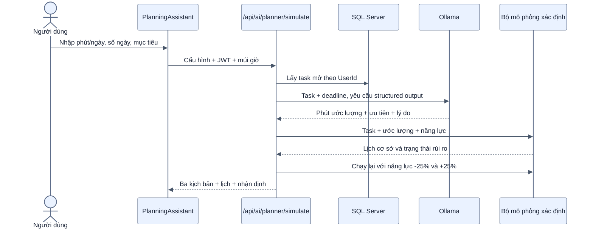
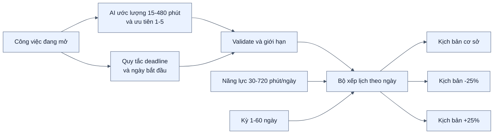

# Kiến trúc AI lập kế hoạch và mô phỏng tiến độ

[← Mục lục](00-MUC-LUC.md)

## 1. Mục tiêu và ranh giới

Tính năng biến các công việc đang mở đã đồng bộ thành một kế hoạch theo năng lực mỗi ngày. Kết quả là mô phỏng tạm thời, không thay đổi deadline, trạng thái hay nội dung công việc.

| Tính năng AI | Câu hỏi giải quyết | Đầu ra |
| --- | --- | --- |
| Tạo bản nháp | “Tôi muốn tạo việc gì?” | Một form ghi chú/công việc sửa được |
| Hỏi kho tri thức | “Dữ liệu đã lưu nói gì?” | Câu trả lời và nguồn kiểm chứng |
| Lập kế hoạch | “Với thời gian hiện có, tôi nên làm gì trước và có kịp không?” | Lịch theo ngày, rủi ro và kịch bản năng lực |

Ba chức năng dùng chung Ollama và dữ liệu tài khoản nhưng không trùng nghiệp vụ hay đầu ra.

## 2. Luồng xử lý

## 3. Phân công giữa AI và thuật toán

- AI không được tạo thêm công việc, đổi ID, deadline hoặc tự ghi dữ liệu.
- Deadline đặt mức ưu tiên tối thiểu; AI chỉ có thể nâng chứ không thể hạ việc gấp.
- Việc có deadline sớm được xếp trước, sau đó mới xét ưu tiên và khối lượng.
- Tổng phút phân bổ một ngày không vượt năng lực của kịch bản.
- `startAt` là ngày sớm nhất được phép xếp việc.
- So sánh trễ hạn ở mức ngày; mô phỏng không giả định giờ làm cụ thể trong ngày.

## 4. Trạng thái kết quả

| Trạng thái | Điều kiện |
| --- | --- |
| Đang quá hạn | `dueAt` nhỏ hơn thời điểm mô phỏng và task chưa hoàn thành |
| Có nguy cơ trễ | Không xếp hết trong kỳ hoặc ngày hoàn tất dự kiến sau ngày hạn |
| Đúng tiến độ | Có deadline và hoàn tất không sau ngày hạn |
| Đã xếp lịch | Không có deadline nhưng đã xếp hết trong kỳ |

## 5. Fallback và tính riêng tư

Nếu Ollama lỗi, backend ước lượng dự phòng theo độ dài nội dung và khoảng cách tới deadline, sau đó vẫn chạy cùng bộ mô phỏng. UI luôn ghi rõ khi không dùng được AI.

`UserId` lấy từ JWT, không nhận từ client. Backend chỉ lấy tối đa 60 công việc chưa hoàn thành, chưa xóa của tài khoản đang đăng nhập. Nội dung này được gửi tới Ollama local theo `OLLAMA_URL`; không có API AI cloud.

## 6. Giới hạn có chủ đích

- Chưa có trường thời lượng thực tế/ước lượng do người dùng nhập, nên phút AI đề xuất chỉ mang tính tham khảo.
- Chưa học từ lịch sử làm việc cá nhân và chưa xét quan hệ phụ thuộc giữa các task.
- Mô phỏng tính theo ngày lịch, chưa tự bỏ cuối tuần hoặc ngày nghỉ.
- Kết quả không được lưu để tránh biến một dự báo tạm thời thành dữ liệu nghiệp vụ chính thức.
